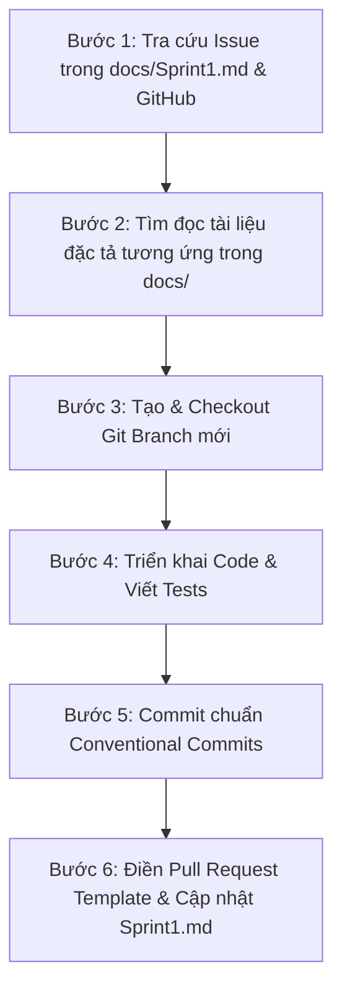

# 🤖 HƯỚNG DẪN DÀNH CHO AI AGENT (AGENT OPERATING MANUAL)

> **Dự án:** Gamified To-Do Application (`pm-subject_gamified-todo-application`)  
> **Mục tiêu:** Hướng dẫn AI Agent tự động tra cứu tài liệu trong thư mục `docs/`, thực thi chính xác các Technical Task của Sprint 1 (và các Sprint kế tiếp), tuân thủ nghiêm ngặt quy trình Git (nhánh, commit, PR template) và cập nhật tiến độ vào `docs/Sprint1.md`.

---

## 🧭 NGUYÊN TẮC CỐT LÕI: TÀI LIỆU ĐỘNG (DYNAMIC DOCS PROTOCOL)

Thư mục `docs/` là **nguồn chân lý kỹ thuật (Single Source of Truth - SSOT)** của dự án và **thường xuyên được cập nhật** qua các phiên họp, kiểm thử và thiết kế hệ thống.

> [!IMPORTANT]
> **Quy tắc bất di bất dịch đối với Agent:**
> 1. **KHÔNG BAO GIỜ** code dựa trên giả định hoặc kiến thức có sẵn từ pre-training weights.
> 2. **LUÔN LUÔN** đọc trực tiếp các file mới nhất trong thư mục `docs/` trước khi bắt tay vào triển khai bất kỳ Technical Task nào.
> 3. Nếu tài liệu `docs/` có thay đổi hoặc bổ sung sau khi hoàn thành task, Agent phải **cập nhật ngược lại** trạng thái và ghi chú vào `docs/Sprint1.md`.

---

## 📂 BẢN ĐỒ TÀI LIỆU TRONG THƯ MỤC `docs/`

Khi thực hiện nhiệm vụ, Agent cần biết chính xác tài liệu nào phụ trách phần việc nào:

| Tài liệu / Đường dẫn | Vai trò kỹ thuật | Những phần cần đọc |
|---|---|---|
| [`docs/Sprint1.md`](file:///d:/UNIVERSITY_PTIT/YEAR_4/PM/project/docs/Sprint1.md) | **Trung tâm điều phối Sprint 1** | Tra cứu Issue #ID, User Story cha, Assignee, Deadline, và Bảng Ánh xạ Kỹ thuật. |
| [`docs/[TECH-DOC] Task Data Model & API Contract.md`](file:///d:/UNIVERSITY_PTIT/YEAR_4/PM/project/docs/[TECH-DOC]%20Task%20Data%20Model%20&%20API%20Contract.md) | **Hợp đồng API & Data Model Tasks** | • Mục 1: Validation Rules (độ dài title, enum priority, due_date ISO 8601, status).<br>• Mục 2: Request/Response Payloads chi tiết cho US-07, US-08, US-09, US-10. |
| [`docs/[DOC-11] System Design Document.md`](file:///d:/UNIVERSITY_PTIT/YEAR_4/PM/project/docs/[DOC-11]%20System%20Design%20Document.md) | **Kiến trúc hệ thống toàn diện** | • Mục 2: 3-Tier Architecture.<br>• Mục 3: Mongoose Schemas (users, tasks, habits, badges) & Indexing.<br>• Mục 4: RESTful Response Envelope Pattern, Danh mục API, Quy tắc Gamification & Anti-gaming (Daily XP Cap = 200XP).<br>• Mục 5.1: Cấu trúc thư mục chuẩn (`client/` và `server/`). |
| [`docs/wireframe/Core MVP Screens.html`](file:///d:/UNIVERSITY_PTIT/YEAR_4/PM/project/docs/wireframe/Core%20MVP%20Screens.html) | **Giao diện mẫu Task Management** | Dashboard, Form tạo nhanh task (`.quick`), Danh sách task (`.listbox`, `.task-row`), các trạng thái loading (`.skeleton`), empty (`.empty`), error, và Modal chỉnh sửa (`#overlay`). |
| [`docs/wireframe/Authentication.html`](file:///d:/UNIVERSITY_PTIT/YEAR_4/PM/project/docs/wireframe/Authentication.html) | **Giao diện mẫu Xác thực (Auth)** | Màn hình Đăng nhập, Đăng ký, Quên mật khẩu, show/hide password, client validation và thông báo lỗi. |
| [`docs/[DOC-07] Requirements Elicitation Records.md`](file:///d:/UNIVERSITY_PTIT/YEAR_4/PM/project/docs/[DOC-07]%20Requirements%20Elicitation%20Records.md) | **Yêu cầu nghiệp vụ & Ràng buộc** | Ràng buộc Free Tier 0 USD, múi giờ Việt Nam UTC+7 cho Streak/Reset, chống gian lận điểm (Anti-gaming). |

---

## 🔁 QUY TRÌNH 6 BƯỚC BẮT BUỘC KHI LÀM MỘT TECH ISSUE

Mỗi khi Agent được yêu cầu thực hiện một Technical Task (ví dụ: `[TECH-S1-02]`), Agent **BẮT BUỘC** tuân thủ tuần tự 6 bước sau:



### Bước 1: Tra cứu Issue
1. Mở file [`docs/Sprint1.md`](file:///d:/UNIVERSITY_PTIT/YEAR_4/PM/project/docs/Sprint1.md).
2. Tìm mã Task (ví dụ: `TECH-S1-02`):
   - Xác định Issue `#ID` thực tế trên GitHub (ví dụ: `#28`).
   - Xác định User Story cha (ví dụ: `US-S1-01` - Issue `#18`).
   - Đọc kỹ Acceptance Criteria của User Story cha.

### Bước 2: Tìm đọc tài liệu trong `docs/`
- Tra cứu cột **Tài liệu tham chiếu** trong Bảng Ánh xạ Kỹ thuật tại `docs/Sprint1.md`.
- Đọc file tài liệu tương ứng:
  - Kiểm tra **Mô hình dữ liệu (Schema)**.
  - Kiểm tra **Validation Rules** phía Client và Server.
  - Kiểm tra cấu trúc **Request/Response JSON Envelope** (chuẩn `success`, `data`, `message`, `timestamp` hoặc `error`).
  - Kiểm tra giao diện và CSS/HTML mẫu trong thư mục `docs/wireframe/`.

### Bước 3: Tạo Branch mới
- Luôn pull code mới nhất từ nhánh mặc định (`main`):
  ```bash
  git checkout main
  git pull origin main
  ```
- Tạo branch mới theo quy chuẩn bắt buộc:
  - **Feature task:** `feat/tech-s1-xx-<ten-ngan>`
  - **Testing task:** `test/tech-s1-xx-<ten-ngan>`
  - **Doc/Contract task:** `docs/tech-s1-xx-<ten-ngan>`
- *Ví dụ:*
  ```bash
  git checkout -b feat/tech-s1-02-create-task
  ```
- ⚠️ **Tuyệt đối không commit trực tiếp lên nhánh `main`!**

### Bước 4: Triển khai Code & Kiểm thử
- **Cấu trúc phân tầng Backend (Clean Layered Architecture):**
  - Controller: `server/src/controllers/` (tiếp nhận HTTP request, gọi service, bọc response envelope).
  - Service: `server/src/services/` (chứa toàn bộ business logic, validation, tương tác database).
  - Model: `server/src/models/` (định nghĩa Mongoose schema).
  - Middleware: `server/src/middlewares/` (JWT auth, error handler).
- **Cấu trúc Frontend:**
  - Component/Page: `client/src/components/`, `client/src/pages/` (bám sát cấu trúc wireframe HTML).
  - API Client: `client/src/services/` (sử dụng axios/fetch với JWT Authorization header).
- **Bảo mật:**
  - Mật khẩu phải băm bằng Bcrypt với Salt rounds = 10.
  - JWT token truyền qua header: `Authorization: Bearer <token>`.
  - Mọi query dữ liệu cá nhân phải gắn điều kiện `{ user_id: req.user.id }`.

### Bước 5: Gợi ý & Thực hiện Commit chuẩn
Sử dụng format chuẩn **Conventional Commits**, luôn kèm mã Task trong dấu ngoặc vuông:
```text
<type>: [TECH-S1-xx] <Mô tả ngắn gọn bằng tiếng Anh hoặc tiếng Việt>

- Chi tiết các thay đổi chính
- Xử lý validation / logic
- Unit test bổ sung
```
*Ví dụ:*
```text
feat: [TECH-S1-02] implement create task form and backend api

- Add create task form with title and priority validation
- Implement POST /api/v1/tasks endpoint with Mongoose model
- Prevent duplicate submission on client
- Return standard JSON response envelope
```

### Bước 6: Tự động điền Form Pull Request & Cập nhật `Sprint1.md`
Tạo Pull Request tuân thủ file [`.github/PULL_REQUEST_TEMPLATE.md`](file:///d:/UNIVERSITY_PTIT/YEAR_4/PM/project/.github/PULL_REQUEST_TEMPLATE.md):
- **BẮT BUỘC điền chính xác:**
  ```markdown
  ## 1. Phân loại Pull Request
  - Technical Task (Feature / Test): Triển khai công việc kỹ thuật trong Sprint ([TECH-Sx-yy])

  ## 2. Liên kết Issue
  - Đóng Tech Task trên GitHub (Closes / Fixes): Closes #<id_cua_tech_task>
  ```
- **Tích chọn phân loại thay đổi:** `Backend`, `Frontend`, `Database`, `Docs`, `Tests`...
- **Ghi rõ Hướng dẫn Test:** Từng bước tái hiện / kiểm tra.
- **Checklist:** Tự rà soát trước khi gửi PR.
- **Cập nhật `docs/Sprint1.md`:** Đánh dấu `[x]` vào checklist của task đó trong file `docs/Sprint1.md` để ghi nhận tiến độ.

---

## 📋 BẢNG ÁNH XẠ NHANH 12 TECH TASKS SPRINT 1

| Task | Issue #ID | User Story cha (#ID) | Branch chuẩn | File tài liệu cần đọc trong `docs/` |
|---|---|---|---|---|
| **TECH-S1-01** | #27 | US-S1-01..04 (#18..#21) | `docs/tech-s1-01-task-api-contract` | `[TECH-DOC] Task Data Model & API Contract.md`<br>`[DOC-11] System Design Document.md` (Mục 3.2, 4.1, 4.2) |
| **TECH-S1-02** | #28 | US-S1-01 (#18) | `feat/tech-s1-02-create-task` | `[TECH-DOC] Task Data Model & API Contract.md` (Mục 1, 2.1)<br>`wireframe/Core MVP Screens.html` (Mục form `.quick`) |
| **TECH-S1-03** | #29 | US-S1-02 (#19) | `feat/tech-s1-03-view-task-list` | `[TECH-DOC] Task Data Model & API Contract.md` (Mục 2.2)<br>`wireframe/Core MVP Screens.html` (Mục `.listbox`, `.empty`, `.skeleton`) |
| **TECH-S1-04** | #30 | US-S1-03 (#20) | `feat/tech-s1-04-update-task` | `[TECH-DOC] Task Data Model & API Contract.md` (Mục 1, 2.3)<br>`wireframe/Core MVP Screens.html` (Modal `#overlay`) |
| **TECH-S1-05** | #31 | US-S1-04 (#21) | `feat/tech-s1-05-complete-task` | `[TECH-DOC] Task Data Model & API Contract.md` (Mục 2.4)<br>`wireframe/Core MVP Screens.html` (Checkbox `.check.done`) |
| **TECH-S1-06** | #32 | US-S1-01..04 (#18..#21) | `test/tech-s1-06-task-integration-test` | `Sprint1.md` (Acceptance Criteria của US 01-04)<br>`[TECH-DOC] Task Data Model & API Contract.md` |
| **TECH-S1-07** | #33 | US-S1-05..09 (#22..#26) | `docs/tech-s1-07-auth-api-contract` | `[DOC-11] System Design Document.md` (Mục 3.2, 3.3, 4.1, 4.2 Auth)<br>`wireframe/Authentication.html` |
| **TECH-S1-08** | #34 | US-S1-05 (#22) | `feat/tech-s1-08-user-registration` | `[DOC-11] System Design Document.md` (Mục 1.2 Bcrypt, Mục 3.2, 4.2 POST register)<br>`wireframe/Authentication.html` |
| **TECH-S1-09** | #35 | US-S1-06 (#23) | `feat/tech-s1-09-login-logout-session` | `[DOC-11] System Design Document.md` (Mục 1.2 JWT, Mục 4.1, 4.2 POST login)<br>`wireframe/Authentication.html`<br>`wireframe/Core MVP Screens.html` (Logout) |
| **TECH-S1-10** | #36 | US-S1-07, 08 (#24, #25) | `feat/tech-s1-10-user-profile` | `[DOC-11] System Design Document.md` (Mục 3.2, 4.2 GET/PUT profile)<br>`wireframe/Core MVP Screens.html` (Màn hình Profile) |
| **TECH-S1-11** | #37 | US-S1-09 (#26) | `feat/tech-s1-11-forgot-password` | `[DOC-11] System Design Document.md` (Mục 4.2 reset-password)<br>`wireframe/Authentication.html` (Forgot flow) |
| **TECH-S1-12** | #38 | US-S1-05..09 (#22..#26) | `test/tech-s1-12-auth-integration-test` | `Sprint1.md` (Acceptance Criteria của US 05-09)<br>`[DOC-11] System Design Document.md` |

---

## 🛠️ NGUYÊN TẮC KHI PHÁT HIỆN THAY ĐỔI TRONG `docs/`

Nếu trong quá trình làm việc, một tài liệu trong `docs/` được cập nhật:
1. Agent phải so sánh nội dung mới với mã nguồn hiện tại.
2. Nếu có sự sai khác về API Contract, Schema hoặc Validation Rule, **ưu tiên tuân theo file tài liệu mới nhất trong `docs/`**.
3. Cập nhật lại ghi chú tương ứng trong `docs/Sprint1.md` để đảm bảo tính đồng bộ giữa tiến độ và thiết kế kỹ thuật.

