# 🤖 HƯỚNG DẪN CHI TIẾT CÁC HỆ THỐNG GITHUB ACTIONS WORKFLOWS

> **Dự án:** Gamified To-Do Application (`pm-subject_gamified-todo-application`)  
> **Phiên bản:** Sprint 1 Automations  
> **Cập nhật lần cuối:** 16/11/2026  
> **Thư mục cấu hình:** [`.github/workflows/`](file:///d:/UNIVERSITY_PTIT/YEAR_4/PM/project/.github/workflows/) & [`.github/scripts/`](file:///d:/UNIVERSITY_PTIT/YEAR_4/PM/project/.github/scripts/)

---

## 📌 TỔNG QUAN HỆ THỐNG TỰ ĐỘNG HÓA

Repository hiện tại được trang bị **4 GitHub Actions Workflows** phối hợp chặt chẽ với nhau, phủ kín toàn bộ vòng đời phát triển từ lúc tạo Task, lập trình, kiểm thử đến khi tạo Pull Request và nhắc nhở thời hạn.

```mermaid
flowchart TD
    subgraph S1 ["1. Quản lý Trạng thái & Phụ thuộc"]
        A["Issue mới tạo / Cập nhật / Đóng Task"] -->|Trigger: promote-ready.yml| B["Script promote-ready.cjs"]
        B -->|GraphQL API| C["Cập nhật Cột Status trên GitHub Project V2"]
        C --> C1["Bị chặn -> Cột Backlog"]
        C --> C2["Đã mở chặn -> Cột Ready"]
    end

    subgraph S2 ["2. Bắt đầu Lập trình"]
        D["Dev tạo branch feat/tech-s1-xx hoặc push"] -->|Trigger: auto-in-progress-on-branch.yml| E["Khớp mã Task [TECH-S1-xx]"]
        E --> F["Tự động Comment thông báo trên Issue"]
    end

    subgraph S3 ["3. Kiểm soát Chất lượng PR"]
        G["Dev mở Pull Request"] -->|Trigger: pr-convention-check.yml| H{"Kiểm tra Tiêu chuẩn PR"}
        H -->|Sai Title / Thiếu Closes #ID| I["Báo Fail CI + Comment hướng dẫn sửa lỗi"]
        H -->|Hợp lệ| K["Pass CI + Đánh dấu In Review"]
    end

    subgraph S4 ["4. Giám sát Tiến độ Hàng ngày"]
        L["08:00 AM VN Time (Mỗi sáng)"] -->|Trigger: deadline-reminder.yml| M{"Tính ngày tới Deadline"}
        M -->|Còn < 24h| N["@mention Assignee nhắc hoàn thành"]
        M -->|Đã quá hạn| P["@mention Assignee cảnh báo Overdue"]
    end
```

---

## 1. WORKFLOW 1: TỰ ĐỘNG CHUYỂN CỘT KANBAN PROJECT V2 (`promote-ready.yml`)

* **Tệp cấu hình:** [`.github/workflows/promote-ready.yml`](file:///d:/UNIVERSITY_PTIT/YEAR_4/PM/project/.github/workflows/promote-ready.yml)
* **Tệp script bổ trợ:** [`.github/scripts/promote-ready.cjs`](file:///d:/UNIVERSITY_PTIT/YEAR_4/PM/project/.github/scripts/promote-ready.cjs)
* **Bảng Kanban điều khiển:** **`Gamified todo application - group 5`**

### 🎯 Khả năng & Chức năng thực hiện
1. **Tự động thêm Issue vào bảng Project:** Quét tất cả Issue đang `OPEN`, nếu Issue nào chưa có thẻ trên bảng Kanban thì tự động thêm vào.
2. **Phân tích phụ thuộc tự động (`Blocked by`):** Đọc nội dung mô tả của từng Issue tại dòng:
   `- **Blocked by (Chờ task này xong trước):** #41, #27` (hoặc `Không có`).
3. **Chuyển trạng thái linh hoạt:**
   * **Nếu đang bị chặn (`isBlocked = true`):** Khi có ít nhất một Issue trong danh sách `Blocked by` vẫn đang `OPEN`, hệ thống tự động đưa thẻ về cột **`Backlog`**.
   * **Nếu đã hết bị chặn (`isBlocked = false`):** Khi dòng `Blocked by` ghi `Không có` HOẶC tất cả các Issue chặn đều đã `CLOSED`, hệ thống tự động nhấc thẻ từ cột **`Backlog`** sang cột **`Ready`** (sẵn sàng làm việc).
   * **Bảo toàn tiến độ:** Nếu Issue đã được Dev kéo sang các cột cao hơn như `In Progress`, `Done`, hệ thống sẽ **giữ nguyên**, không ghi đè.
4. **Cơ chế chống xung đột (Concurrency Control):** Nhóm `group: gtd-auto-ready` với `cancel-in-progress: false` đảm bảo khi nhiều sự kiện xảy ra cùng lúc, các lượt chạy sẽ xếp hàng tuần tự, tránh tranh chấp dữ liệu.

### ⚡ Điều kiện kích hoạt (Triggers)
* Mỗi khi có Issue được: `opened`, `closed`, `reopened`, `edited`, `milestoned`.
* Lịch quét định kỳ: Phút thứ 17 mỗi giờ (`cron: '17 * * * *'`).
* Kích hoạt thủ công qua nút **Run workflow** (`workflow_dispatch`).

---

## 2. WORKFLOW 2: TỰ ĐỘNG GHI NHẬN KHI BẮT ĐẦU LÀM VIỆC (`auto-in-progress-on-branch.yml`)

* **Tệp cấu hình:** [`.github/workflows/auto-in-progress-on-branch.yml`](file:///d:/UNIVERSITY_PTIT/YEAR_4/PM/project/.github/workflows/auto-in-progress-on-branch.yml)

### 🎯 Khả năng & Chức năng thực hiện
1. **Nhận diện nhánh thông minh:** Tự động bắt mã nhiệm vụ từ tên nhánh theo chuẩn:
   * `feat/tech-s1-02-create-task` $\rightarrow$ Nhận diện mã `TECH-S1-02`.
   * `fix/bug-s1-01-fix-login` $\rightarrow$ Nhận diện mã `BUG-S1-01`.
   * `chore/conf-s1-00-setup` $\rightarrow$ Nhận diện mã `CONF-S1-00`.
2. **Khớp nối với Issue gốc:** Tìm đúng Issue đang `OPEN` trên GitHub có tiêu đề chứa mã nhiệm vụ tương ứng (ví dụ: `[TECH-S1-02] Triển khai...`).
3. **Bình luận ghi nhận hoạt động (Audit Trail):**
   * Tự động để lại comment trên Issue thông báo thành viên đã bắt đầu code trên branch:
     > `🚀 Branch feat/tech-s1-02-create-task đã được khởi tạo bởi @khongpc-ptit. Trạng thái công việc được tự động chuyển sang In Progress.`
   * **Chống lặp comment:** Nếu comment thông báo cho branch này đã tồn tại, bot sẽ bỏ qua, không gây loãng phần thảo luận.

### ⚡ Điều kiện kích hoạt (Triggers)
* Khi tạo branch mới (`create`).
* Khi push commit lên bất kỳ branch nào thuộc tiền tố: `feat/**`, `fix/**`, `chore/**`, `docs/**`, `test/**`.

---

## 3. WORKFLOW 3: KIỂM SOÁT QUY CHUẨN PULL REQUEST (`pr-convention-check.yml`)

* **Tệp cấu hình:** [`.github/workflows/pr-convention-check.yml`](file:///d:/UNIVERSITY_PTIT/YEAR_4/PM/project/.github/workflows/pr-convention-check.yml)

### 🎯 Khả năng & Chức năng thực hiện
1. **Ép chuẩn Tiêu đề Pull Request (PR Title):**
   * Bắt buộc phải bắt đầu bằng mã Task hợp lệ trong dấu ngoặc vuông:
     * `[TECH-S1-xx] <Mô tả>`
     * `[BUG-S1-xx] <Mô tả>`
     * `[CONF-S1-xx] <Mô tả>`
     * `[DOC-xx] <Mô tả>`
2. **Ép chuẩn Liên kết Issue trong PR Body:**
   * Bắt buộc phải chứa từ khóa hợp lệ kèm số hiệu Issue thực tế:
     * `Closes #28` hoặc `Fixes #15` hoặc `Refs #30`.
     * Ngăn chặn tình trạng để trống placeholder như `Closes #` mà không có số ID.
3. **Cơ chế Phản hồi Trực quan & Tự phục hồi:**
   * Nếu PR **vi phạm quy chuẩn**: Workflow sẽ đánh dấu bước kiểm tra **FAILED** (chặn merge) và tự động đăng bình luận chỉ rõ lỗi cần sửa.
   * Nếu người tạo PR **sửa lại đúng chuẩn**: Workflow tự động cập nhật lại bình luận đó thành:
     > `✅ Quy chuẩn Pull Request đã đạt! Tiêu đề và cú pháp liên kết Issue đã hoàn toàn hợp lệ.`
4. **Cập nhật Issue sang giai đoạn Review:**
   * Quét các Issue ID được khai báo tại `Closes #<id>` hoặc `Fixes #<id>` để chuyển trạng thái sang `In Review` phục vụ công tác kiểm thử và review code.

### ⚡ Điều kiện kích hoạt (Triggers)
* Mỗi khi Pull Request được: `opened`, `edited`, `synchronize` (push commit mới), `reopened`.

---

## 4. WORKFLOW 4: NHẮC NHỞ DEADLINE VÀ CẢNH BÁO QUÁ HẠN HÀNG NGÀY (`deadline-reminder.yml`)

* **Tệp cấu hình:** [`.github/workflows/deadline-reminder.yml`](file:///d:/UNIVERSITY_PTIT/YEAR_4/PM/project/.github/workflows/deadline-reminder.yml)

### 🎯 Khả năng & Chức năng thực hiện
1. **Chuẩn hóa Múi giờ Việt Nam (UTC+7):**
   * Chạy vào đúng **08:00 sáng** mỗi ngày theo giờ Việt Nam (`01:00 UTC`), đảm bảo thông báo đến đúng đầu giờ làm việc.
2. **Quét và tính toán khoảng cách ngày:**
   * Đọc trường `- **Deadline:** DD/MM/YYYY` trong tất cả các Issue đang mở.
   * So sánh hạn chót với ngày hiện tại của Việt Nam (`Asia/Ho_Chi_Minh`).
3. **Phân loại thông báo thông minh:**
   * **Cảnh báo sắp đến hạn (Dưới 24h hoặc đến hạn trong ngày):**
     > `⏰ Nhắc nhở Deadline: Công việc này có hạn hoàn thành vào ngày 10/11/2026 (còn chưa đầy 24h). Nhờ @kiennarutonbmn1 kiểm tra tiến độ và tạo Pull Request nhé!`
   * **Cảnh báo quá hạn (Overdue):**
     > `⚠️ Cảnh báo quá hạn: Công việc này đã quá hạn hoàn thành (Hạn chót: 06/11/2026). Đề nghị @kiennarutonbmn1 cập nhật tình trạng tiến độ hoặc báo cáo trở ngại nếu cần hỗ trợ!`
4. **Chống Spam Thông báo:**
   * Giới hạn thông báo: Nếu trong vòng **20 giờ** vừa qua Issue đã nhận được thông báo cùng loại thì bot sẽ không nhắc lại, tránh làm phiền hộp thư của thành viên.

### ⚡ Điều kiện kích hoạt (Triggers)
* Lịch tự động: `01:00 UTC` hàng ngày (tức `08:00 AM` múi giờ Việt Nam).
* Kích hoạt thủ công: `workflow_dispatch`.

---

## 📊 BẢNG TỔNG HỢP CÁC WORKFLOWS

| Tên Workflow | Tệp kích hoạt | Tần suất / Sự kiện | Quyền hạn (Permissions) | Tác động chính |
|---|---|---|---|---|
| **Promote Ready** | `promote-ready.yml` | `issues`, cron phút 17, `dispatch` | `contents: read`, `issues: read` | Tự động chuyển thẻ **Backlog $\leftrightarrow$ Ready** trên Project Board `Gamified todo application - group 5`. |
| **Auto In-Progress** | `auto-in-progress-on-branch.yml` | `create` branch, `push` vào `feat/**`, `fix/**`... | `issues: write`, `contents: read` | Bình luận thông báo đã bắt đầu code nhánh, đánh dấu tiến độ trên Issue. |
| **PR Convention** | `pr-convention-check.yml` | PR `opened`, `edited`, `synchronize` | `pull-requests: write`, `issues: write` | Chặn PR sai chuẩn Title/Body, hướng dẫn sửa lỗi, đánh dấu In Review. |
| **Deadline Reminder**| `deadline-reminder.yml` | `08:00 AM VN` mỗi sáng, `dispatch` | `issues: write`, `contents: read` | @mention người phụ trách khi còn < 24h hoặc khi công việc bị trễ hạn. |

---

## 🔑 YÊU CẦU CẤU HÌNH SECRET TRÊN GITHUB REPOSITORY

Để toàn bộ hệ thống hoạt động trơn tru 100% trên GitHub Actions Cloud, repository cần cấu hình **01 Secret duy nhất**:

* **Tên Secret:** `GH_PROJECT_TOKEN`
* **Vị trí thiết lập:** `Repository Settings` $\rightarrow$ `Secrets and variables` $\rightarrow$ `Actions` $\rightarrow$ `New repository secret`
* **Loại Token:** GitHub Personal Access Token (Classic) tạo tại [github.com/settings/tokens](https://github.com/settings/tokens)
* **Các quyền (Scopes) bắt buộc tích chọn:**
  * `repo` (Toàn quyền thao tác repository, issues, pull requests)
  * `project` (Toàn quyền đọc/ghi GitHub Projects V2)
