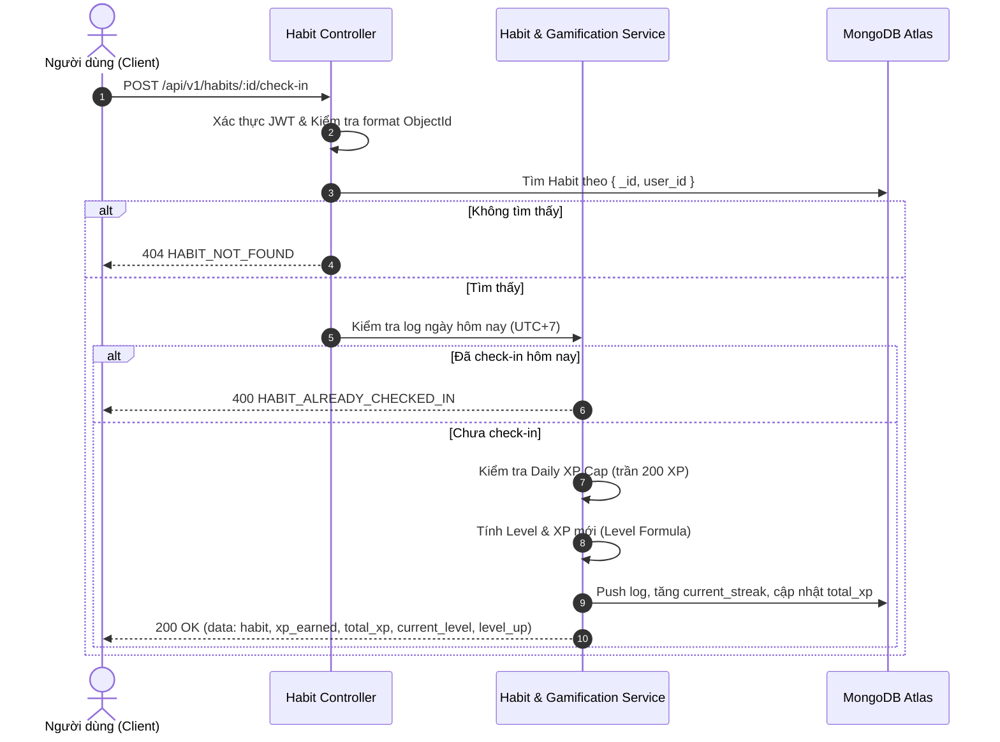

# 📑 [TECH-S2-01] Habit Data Model & Gamification API Contract

> **Dự án:** Gamified To-Do Application (`pm-subject_gamified-todo-application`)  
> **Mã nhiệm vụ kỹ thuật:** `TECH-S2-01` (GitHub Issue [#56](https://github.com/khongpc-ptit/pm-subject_gamified-todo-application/issues/56))  
> **Phân loại:** Docs / Technical Specification / Shared Contract  
> **Người phụ trách:** Khổng Phú Cường (`@khongpc-ptit`)  
> **Thời gian phát hành:** 24/11/2026 (Khung hạn chót: 29/11/2026)  
> **Tài liệu tham chiếu nền tảng:** [`docs/[DOC-11] System Design Document.md`]([DOC-11]%20System%20Design%20Document.md) (Mục 3.2, 3.3, 4.2, 4.3), [`docs/plan.md`](plan.md) (Mục 3.2)

---

## 🧭 1. TỔNG QUAN VÀ BỐI CẢNH KỸ THUẬT

Tài liệu này là **Hợp đồng Kỹ thuật (API Contract & Data Model)** chính thức của **Sprint 2**, đóng vai trò là **Nguồn chân lý kỹ thuật duy nhất (Single Source of Truth - SSOT)** để tất cả thành viên trong nhóm phát triển Frontend, Backend và QA triển khai mã nguồn song song mà không bị xung đột cấu trúc dữ liệu.

### 1.1. Phạm vi bao phủ các User Stories
Tài liệu quy định toàn bộ đặc tả cho 05 User Stories của Sprint 2:
1. **`US-S2-01` [Thiết lập thói quen lặp lại]:** Tạo, xem danh sách và hủy theo dõi thói quen lặp lại (Daily / Weekly).
2. **`US-S2-02` [Điểm danh thói quen hàng ngày]:** Check-in thói quen trong ngày theo múi giờ UTC+7, ngăn điểm danh trùng lặp.
3. **`US-S2-03` [Tích lũy điểm kinh nghiệm khi hoàn thành công việc]:** Cộng điểm thưởng XP khi hoàn thành One-off Task (10, 20, 30 XP) và Check-in Habit (15 XP).
4. **`US-S2-04` [Cơ chế giới hạn điểm thưởng và hoàn tác (Anti-gaming)]:** Thiết lập trần **Daily XP Cap = 200 XP/ngày** và cơ chế hoàn tác (Revert XP) khi chuyển task về TODO.
5. **`US-S2-05` [Thăng cấp độ và theo dõi thanh tiến trình]:** Thuật toán tính toán Level, mốc kinh nghiệm ngưỡng, cờ `level_up: true` và thanh tiến trình XP Bar trên Header.

---

## 🗄️ 2. ĐẶC TẢ DATA MODEL: COLLECTION `habits`

### 2.1. Cấu trúc Lược đồ Mongoose (Schema Definition)
Collection `habits` lưu trữ các thói quen cần duy trì định kỳ của người dùng. Mỗi tài liệu Habit nhúng trực tiếp mảng `logs` để ghi nhận lịch sử các ngày đã điểm danh.

```typescript
// server/src/types/habit.types.ts
export type HabitFrequency = 'DAILY' | 'WEEKLY';

export interface IHabitLog {
  log_date: string;       // Định dạng chuẩn YYYY-MM-DD theo múi giờ UTC+7
  is_completed: boolean;  // Mặc định: true
  xp_earned: number;     // Mặc định: 15
}

export interface IHabit extends Document {
  user_id: Types.ObjectId;
  title: string;
  frequency: HabitFrequency;
  target_days: number;
  current_streak: number;
  is_active: boolean;
  logs: IHabitLog[];
  created_at: Date;
}
```

### 2.2. Bảng Mô tả Chi tiết Các Trường Dữ liệu
| Tên trường (Field) | Kiểu dữ liệu (BSON) | Bắt buộc | Mặc định | Ràng buộc & Quy tắc nghiệp vụ |
|---|---|:---:|:---:|---|
| `_id` | `ObjectId` | Có | Tự sinh | Khóa chính của thói quen (MongoDB ObjectID 24 hex). |
| `user_id` | `ObjectId` (Ref: `User`) | **Có** | - | Khóa ngoại trỏ đến `users._id`. Phục vụ Data Isolation (`{ user_id: req.user.id }`). |
| `title` | `String` | **Có** | - | Tiêu đề thói quen (1–200 ký tự sau khi `trim()`). Không được để trống. |
| `frequency` | `String` (Enum) | Không | `'DAILY'` | Chu kỳ lặp lại. Chỉ chấp nhận một trong 2 giá trị: `'DAILY'` hoặc `'WEEKLY'`. |
| `target_days` | `Number` | Không | `7` | Số ngày mục tiêu cần duy trì trong chu kỳ (Giá trị nguyên từ `1` đến `7`). |
| `current_streak` | `Number` | Không | `0` | Chuỗi ngày liên tục duy trì riêng của thói quen này ($\ge 0$). |
| `is_active` | `Boolean` | Không | `true` | Trạng thái theo dõi. Khi xóa thói quen, cập nhật `is_active = false` (Soft delete) hoặc xóa vật lý. |
| `logs` | `Array<IHabitLog>` | Không | `[]` | Mảng nhúng danh sách nhật ký các ngày đã điểm danh. |
| `logs.log_date` | `String` | Có | - | Ngày điểm danh định dạng `YYYY-MM-DD` theo múi giờ Việt Nam (UTC+7). Regex: `/^\d{4}-\d{2}-\d{2}$/`. |
| `logs.is_completed` | `Boolean` | Không | `true` | Trạng thái hoàn thành của ngày điểm danh. |
| `logs.xp_earned` | `Number` | Không | `15` | Số XP thực tế nhận được tại thời điểm check-in (15 XP nếu chưa chạm trần 200 XP). |
| `created_at` | `Date` | Có | `Date.now` | Thời điểm tạo thói quen (lưu chuẩn ISO 8601 UTC). |

### 2.3. Chiến lược Chỉ mục (Indexing Strategy)
Nhằm đảm bảo thời gian phản hồi truy vấn dưới **50ms** trên môi trường MongoDB Atlas Free Tier:
- **Compound Index:**
  ```javascript
  habitSchema.index({ user_id: 1, is_active: 1 });
  ```
  *Mục đích:* Tối ưu hóa truy vấn lọc danh sách các thói quen đang kích hoạt của một user cụ thể (`Habit.find({ user_id, is_active: true })`), tránh tình trạng Scan toàn bộ Collection (COLLSCAN).

---

## 📋 3. BẢNG QUY TẮC RÀNG BUỘC & VALIDATION (VALIDATION RULES MATRIX)

| Trường dữ liệu | Ràng buộc nghiệp vụ | Kiểm tra phía Client (Frontend) | Kiểm tra phía Server (Backend) | Mã lỗi Backend phản hồi |
|---|---|---|---|---|
| `title` | • 1 đến 200 ký tự.<br>• Không được rỗng hoặc chỉ toàn khoảng trắng. | • Chặn submit nếu rỗng sau khi trim.<br>• Thuộc tính `maxLength={200}` trên ô input. | • Trim chuỗi trước khi kiểm tra.<br>• Kiểm tra `length >= 1 && length <= 200`. | `400 VALIDATION_ERROR`<br>code: `TITLE_REQUIRED` / `TITLE_TOO_LONG` |
| `frequency` | • Chỉ nhận `'DAILY'` hoặc `'WEEKLY'`. | • Dùng Radio Buttons hoặc Select dropdown (chỉ cho phép chọn 1 trong 2). | • Enum validation trong Mongoose Schema. | `400 VALIDATION_ERROR`<br>code: `INVALID_FREQUENCY` |
| `target_days` | • Số nguyên dương từ 1 đến 7.<br>• Mặc định là 7. | • Input type `number`, `min={1}`, `max={7}`. | • Kiểm tra `Number.isInteger(val) && val >= 1 && val <= 7`. | `400 VALIDATION_ERROR`<br>code: `INVALID_TARGET_DAYS` |
| `:id` (Path param) | • Phải là 24 ký tự hex hợp lệ của MongoDB ObjectId. | • Kiểm tra regex `/^[0-9a-fA-F]{24}$/` trước khi gửi request (tùy chọn). | • Kiểm tra `mongoose.Types.ObjectId.isValid(id)`. | `400 INVALID_ID` |
| Quyền sở hữu (`user_id`) | • Người dùng chỉ được xem/sửa/xóa thói quen do chính mình tạo. | • Tự động gửi kèm `Authorization: Bearer <token>` qua Axios interceptor. | • Luôn ép điều kiện query `{ _id: req.params.id, user_id: req.user.id }`. | `404 HABIT_NOT_FOUND` hoặc `403 FORBIDDEN` |

---

## 🔌 4. ĐẶC TẢ CHI TIẾT CÁC API ENDPOINTS MODULE HABITS

> **Yêu cầu chung cho tất cả Endpoints:**
> - **Header bắt buộc:** `Authorization: Bearer <JWT_TOKEN>`.
> - **Content-Type:** `application/json`.
> - **Format phản hồi:** Chuẩn JSON Response Envelope (`success`, `data`, `message`, `timestamp`).



---

### 4.1. [US-S2-01] Tạo thói quen mới: `POST /api/v1/habits`

* **Request Body:**
  ```json
  {
    "title": "Uống đủ 2 lít nước",
    "frequency": "DAILY",
    "target_days": 7
  }
  ```
  *(Các trường `frequency` và `target_days` là tùy chọn, mặc định lần lượt là `'DAILY'` và `7`).*

* **Response Thành công (`201 Created`):**
  ```json
  {
    "success": true,
    "data": {
      "_id": "674201abcd5678ef90120001",
      "user_id": "672a11112222333344445555",
      "title": "Uống đủ 2 lít nước",
      "frequency": "DAILY",
      "target_days": 7,
      "current_streak": 0,
      "is_active": true,
      "logs": [],
      "created_at": "2026-11-24T00:00:00.000Z"
    },
    "message": "Tạo thói quen thành công",
    "timestamp": "2026-11-24T00:00:00.000Z"
  }
  ```

* **Response Thất bại (`400 Bad Request`):**
  ```json
  {
    "success": false,
    "error": {
      "code": "TITLE_REQUIRED",
      "message": "Tiêu đề thói quen không được để trống"
    },
    "timestamp": "2026-11-24T00:00:00.000Z"
  }
  ```

---

### 4.2. [US-S2-01] Xem danh sách thói quen: `GET /api/v1/habits`

* **Mô tả:** Trả về danh sách tất cả các thói quen đang kích hoạt (`is_active: true`) của user đăng nhập, kèm mảng `logs` 7 ngày gần nhất để vẽ biểu đồ mini tuần. Sắp xếp thói quen theo thời gian tạo mới nhất (`created_at: -1`).
* **Response Thành công (`200 OK` - Danh sách có dữ liệu):**
  ```json
  {
    "success": true,
    "data": {
      "habits": [
        {
          "_id": "674201abcd5678ef90120001",
          "user_id": "672a11112222333344445555",
          "title": "Uống đủ 2 lít nước",
          "frequency": "DAILY",
          "target_days": 7,
          "current_streak": 3,
          "is_active": true,
          "logs": [
            { "log_date": "2026-11-22", "is_completed": true, "xp_earned": 15 },
            { "log_date": "2026-11-23", "is_completed": true, "xp_earned": 15 },
            { "log_date": "2026-11-24", "is_completed": true, "xp_earned": 15 }
          ],
          "created_at": "2026-11-20T08:00:00.000Z"
        }
      ],
      "total": 1
    },
    "timestamp": "2026-11-24T00:00:00.000Z"
  }
  ```

* **Response Thành công (`200 OK` - Danh sách rỗng / Empty State):**
  ```json
  {
    "success": true,
    "data": {
      "habits": [],
      "total": 0
    },
    "timestamp": "2026-11-24T00:00:00.000Z"
  }
  ```
  *(Khi `habits.length === 0`, Frontend hiển thị Empty State minh họa và nút "Thiết lập thói quen đầu tiên").*

---

### 4.3. [US-S2-01] Xóa / Hủy theo dõi thói quen: `DELETE /api/v1/habits/:id`

* **Path Parameter:** `:id` (24 ký tự hex ObjectId).
* **Xử lý Backend:** Kiểm tra quyền sở hữu `{ _id: id, user_id: req.user.id }`. Xóa thói quen hoặc cập nhật `is_active: false`.
* **Response Thành công (`200 OK`):**
  ```json
  {
    "success": true,
    "data": {
      "id": "674201abcd5678ef90120001"
    },
    "message": "Đã xóa thói quen thành công",
    "timestamp": "2026-11-24T00:00:00.000Z"
  }
  ```

* **Response Lỗi Không tìm thấy (`404 Not Found`):**
  ```json
  {
    "success": false,
    "error": {
      "code": "HABIT_NOT_FOUND",
      "message": "Không tìm thấy thói quen yêu cầu hoặc bạn không có quyền truy cập"
    },
    "timestamp": "2026-11-24T00:00:00.000Z"
  }
  ```

---

### 4.4. [US-S2-02, US-S2-03] Điểm danh thói quen trong ngày: `POST /api/v1/habits/:id/check-in`

* **Path Parameter:** `:id` (24 ký tự hex ObjectId).
* **Request Body:** Không có (gửi `{}`).
* **Thuật toán xử lý tại Backend:**
  1. Xác định ngày hôm nay `today = YYYY-MM-DD` theo múi giờ `Asia/Ho_Chi_Minh` (UTC+7).
  2. Tìm thói quen theo `_id` và `user_id`. Nếu không thấy $\rightarrow$ trả về `404 HABIT_NOT_FOUND`.
  3. Kiểm tra mảng `logs`: Nếu đã có phần tử thỏa mãn `log.log_date === today && log.is_completed === true` $\rightarrow$ Trả về lỗi `400 HABIT_ALREADY_CHECKED_IN`.
  4. Tính toán điểm kinh nghiệm qua `gamificationService`:
     - Điểm danh Habit chuẩn nhận: `+15 XP`.
     - Kiểm tra trần Daily XP Cap (200 XP). Nếu tổng XP trong ngày đã đạt 200 XP $\rightarrow$ `xp_earned = 0`, trả về cờ `is_cap_reached: true`.
  5. Cập nhật cơ sở dữ liệu:
     - Push `{ log_date: today, is_completed: true, xp_earned }` vào `habit.logs`.
     - Tăng chuỗi liên tục riêng của thói quen: `habit.current_streak += 1`.
     - Cập nhật thông tin user: `user.last_active_date = today`, `user.total_xp += xp_earned`.
  6. Gọi `levelService` tính toán lại Level: Nếu có thăng cấp $\rightarrow$ `user.current_level = new_level`, `level_up = true`.
  7. Lưu các thay đổi và trả về Response Envelope.

* **Response Thành công (`200 OK` - Điểm danh & nhận XP bình thường):**
  ```json
  {
    "success": true,
    "data": {
      "habit": {
        "_id": "674201abcd5678ef90120001",
        "title": "Uống đủ 2 lít nước",
        "current_streak": 4,
        "logs": [
          { "log_date": "2026-11-24", "is_completed": true, "xp_earned": 15 }
        ]
      },
      "xp_earned": 15,
      "total_xp": 115,
      "current_level": 2,
      "level_up": true,
      "next_level_xp": 400,
      "is_cap_reached": false
    },
    "message": "Điểm danh thói quen thành công! Bạn nhận được +15 XP",
    "timestamp": "2026-11-24T00:00:00.000Z"
  }
  ```

* **Response Thành công (`200 OK` - Đã chạm trần Daily Cap 200 XP):**
  ```json
  {
    "success": true,
    "data": {
      "habit": {
        "_id": "674201abcd5678ef90120001",
        "title": "Uống đủ 2 lít nước",
        "current_streak": 4,
        "logs": [
          { "log_date": "2026-11-24", "is_completed": true, "xp_earned": 0 }
        ]
      },
      "xp_earned": 0,
      "total_xp": 250,
      "current_level": 2,
      "level_up": false,
      "next_level_xp": 400,
      "is_cap_reached": true
    },
    "message": "Điểm danh thói quen thành công. Bạn đã đạt trần tối đa 200 XP trong ngày hôm nay!",
    "timestamp": "2026-11-24T00:00:00.000Z"
  }
  ```

* **Response Lỗi Đã điểm danh hôm nay (`400 Bad Request`):**
  ```json
  {
    "success": false,
    "error": {
      "code": "HABIT_ALREADY_CHECKED_IN",
      "message": "Bạn đã điểm danh thói quen này hôm nay rồi"
    },
    "timestamp": "2026-11-24T00:00:00.000Z"
  }
  ```

---

## 🎮 5. ĐẶC TẢ GAMIFICATION CORE & CƠ CHẾ CHỐNG GIAN LẬN (ANTI-GAMING)

### 5.1. Bảng Quy đổi Điểm Thưởng Kinh nghiệm (XP Rules)
Điểm kinh nghiệm được cấp phát theo mức độ đóng góp giá trị của công việc:
| Loại công việc / Hành vi | Chi tiết độ ưu tiên / Thao tác | Điểm XP thưởng | Ghi chú |
|---|---|:---:|---|
| **One-off Task** | Ưu tiên Thấp (`LOW`) | **+10 XP** | Task hoàn thành chuyển sang COMPLETED. |
| **One-off Task** | Ưu tiên Trung bình (`MEDIUM`) | **+20 XP** | Mức ưu tiên mặc định. |
| **One-off Task** | Ưu tiên Cao (`HIGH`) | **+30 XP** | Nhiệm vụ quan trọng, cấp bách. |
| **Recurring Habit** | Check-in thói quen trong ngày | **+15 XP** | Mỗi thói quen nhận tối đa 1 lần/ngày. |

### 5.2. Cơ chế Trần Kinh nghiệm Hàng ngày (Daily XP Cap = 200 XP)
- **Mục tiêu:** Ngăn chặn việc người dùng tạo hàng loạt công việc ảo hoặc spam thao tác nhằm cày level bất thường (Gaming the system).
- **Thuật toán kiểm soát trần điểm:**
  1. Khoảng thời gian tính toán: Từ `00:00:00` đến `23:59:59` theo múi giờ Việt Nam (`UTC+7`).
  2. Tổng XP đã nhận trong ngày hôm nay:
     $$\text{Current\_Day\_XP} = \sum \text{Task\_XP}_{\text{completed\_at} \in \text{Today}} + \sum \text{Habit\_XP}_{\text{log\_date} = \text{Today}}$$
  3. Khi phát sinh cộng `xp_to_add`:
     - Nếu $\text{Current\_Day\_XP} \ge 200$: $\text{Actual\_XP} = 0$, gán cờ `is_cap_reached = true`.
     - Nếu $\text{Current\_Day\_XP} + \text{xp\_to\_add} > 200$: $\text{Actual\_XP} = 200 - \text{Current\_Day\_XP}$, gán cờ `is_cap_reached = true`.
     - Nếu $\text{Current\_Day\_XP} + \text{xp\_to\_add} \le 200$: $\text{Actual\_XP} = \text{xp\_to\_add}$, cờ `is_cap_reached = false`.
  4. Trạng thái task vẫn cập nhật bình thường sang `COMPLETED`, chỉ có số điểm kinh nghiệm thực nhận bị điều chỉnh.

### 5.3. Cơ chế Hoàn tác Điểm Thưởng (Revert Task XP)
- Khi người dùng bỏ chọn hoàn thành task (chuyển trạng thái từ `COMPLETED` ngược lại `TODO` hoặc `IN_PROGRESS`):
  1. Lấy điểm kinh nghiệm tương ứng với task đó (`task.xp_reward`).
  2. Trừ điểm kinh nghiệm của user:
     $$\text{user.total\_xp} = \max(0, \text{user.total\_xp} - \text{task.xp\_reward})$$
  3. Cập nhật lại level của user theo công thức nếu số điểm bị giảm xuống dưới ngưỡng level hiện tại.
  4. Reset `task.completed_at = null`.

### 5.4. Mở rộng API `PATCH /api/v1/tasks/:id/complete` (Tích hợp Gamification)
Trong Sprint 2, endpoint hoàn thành task được nâng cấp để trả về đầy đủ gói dữ liệu Gamification đồng bộ với Frontend:

* **Response Thành công (`200 OK`):**
  ```json
  {
    "success": true,
    "data": {
      "task": {
        "_id": "672b1234abcd5678ef901234",
        "title": "Nộp báo cáo đồ án",
        "status": "COMPLETED",
        "completed_at": "2026-11-24T09:30:00.000Z"
      },
      "xp_earned": 30,
      "total_xp": 145,
      "current_level": 2,
      "level_up": false,
      "next_level_xp": 400,
      "is_cap_reached": false
    },
    "message": "Hoàn thành công việc! +30 XP",
    "timestamp": "2026-11-24T09:30:00.000Z"
  }
  ```

---

## 🎖️ 6. THUẬT TOÁN CẤP BẬC & TIẾN TRÌNH LEVEL (LEVEL PROGRESSION)

### 6.1. Công thức Xác định Cấp độ Chuẩn
Cấp độ được tính toán dựa trên tổng điểm tích lũy lũy kế (`total_xp`) theo hàm căn bậc hai để tạo đường cong tiến độ mượt mà (càng lên cao càng cần nhiều XP):

$$\text{Level}(X) = \left\lfloor \frac{\sqrt{X}}{10} \right\rfloor + 1$$

*Trong đó: $X = \text{user.total\_xp}$. Hàm $\lfloor \cdot \rfloor$ lấy phần nguyên làm tròn xuống.*

### 6.2. Công thức Điểm Kinh Nghiệm Ngưỡng và Kế tiếp
- **Điểm kinh nghiệm tối thiểu để đạt cấp $L$:**
  $$\text{Required\_XP}(L) = \left( 10 \times (L - 1) \right)^2$$
- **Điểm kinh nghiệm cần thiết để lên cấp tiếp theo $(L + 1)$:**
  $$\text{Next\_Level\_XP}(L) = \left( 10 \times L \right)^2$$
- **Phần trăm tiến độ hiển thị trên thanh XP Bar:**
  $$\text{Progress\_Percent} = \min\left(100, \max\left(0, \frac{\text{Total\_XP} - \text{Required\_XP}(L)}{\text{Next\_Level\_XP}(L) - \text{Required\_XP}(L)} \times 100\% \right)\right)$$

### 6.3. Bảng Mốc Cấp Bậc & Danh Hiệu Mẫu
| Cấp độ (Level) | Khoảng điểm XP | XP ngưỡng đạt cấp | XP lên cấp kế tiếp | Danh hiệu hiển thị (Title) |
|:---:|:---:|:---:|:---:|---|
| **Level 1** | 0 – 99 XP | 0 XP | 100 XP | **Tập sự** *(Novice)* |
| **Level 2** | 100 – 399 XP | 100 XP | 400 XP | **Chiến binh** *(Warrior)* |
| **Level 3** | 400 – 899 XP | 400 XP | 900 XP | **Tinh anh** *(Elite)* |
| **Level 4** | 900 – 1599 XP | 900 XP | 1600 XP | **Cao thủ** *(Master)* |
| **Level 5** | 1600 – 2499 XP | 1600 XP | 2500 XP | **Chuyên gia** *(Expert)* |
| **Level 6** | 2500 – 3599 XP | 2500 XP | 3600 XP | **Huyền thoại** *(Legendary)* |

### 6.4. Cơ chế Kích hoạt Thăng Cấp (Level Up Trigger)
- Sau mỗi giao dịch cộng XP:
  - Nếu $\text{new\_level} > \text{old\_level}$:
    - Cập nhật `user.current_level = new_level`.
    - Trả về cờ `level_up: true` trong response.
  - Phía Frontend: Khi nhận được `level_up: true`, giao diện kích hoạt Modal chúc mừng (`LevelUpModal.tsx`) với hiệu ứng pháo giấy (Confetti) và âm thanh/visual chúc mừng.

---

## ⏰ 7. ĐỒNG BỘ MÚI GIỜ VIỆT NAM (UTC+7 TIMEZONE HANDLING)

1. **Chuẩn lưu trữ máy chủ (Server Storage):**
   - Mọi trường thời gian (`created_at`, `completed_at`, v.v.) lưu chuẩn ISO 8601 UTC trên máy chủ Render/MongoDB Atlas.
2. **Quy đổi chuỗi ngày hoạt động (`log_date` / `last_active_date`):**
   - Mọi hàm kiểm tra ngày hiện tại và tính toán Daily XP Cap **bắt buộc** phải quy đổi thời gian hệ thống sang múi giờ `Asia/Ho_Chi_Minh` (`UTC+7`) trước khi lấy chuỗi ngày `YYYY-MM-DD`:
   ```typescript
   // Helper chuẩn múi giờ Việt Nam
   export function getVietnamDateString(date: Date = new Date()): string {
     return new Intl.DateTimeFormat('en-CA', {
       timeZone: 'Asia/Ho_Chi_Minh',
       year: 'numeric',
       month: '2-digit',
       day: '2-digit'
     }).format(date); // Định dạng: "YYYY-MM-DD"
   }
   ```
   *Lợi ích:* Tránh lỗi người dùng điểm danh lúc 23:30 tại Việt Nam nhưng server UTC (đang là 16:30) hiểu nhầm ngày hoặc reset chuỗi Streak sai thời điểm.

---

## 🗺️ 8. MA TRẬN ÁNH XẠ TRIỂN KHAI CHO CÁC TECH TASKS KẾ TIẾP

| Mã Task | Phân công | Module phụ trách | Tài liệu & Phần cần bám sát | File đích cần tạo / chỉnh sửa |
|---|---|---|---|---|
| **`TECH-S2-02`** | `@khongpc-ptit` | Backend CRUD Habits | Mục 2 (Model), Mục 3 (Validation), Mục 4.1, 4.2, 4.3 (APIs) | • `server/src/controllers/habitController.ts`<br>• `server/src/services/habitService.ts`<br>• `server/src/routes/habitRoutes.ts` |
| **`TECH-S2-03`** | `@khongpc-ptit` | Frontend Habit UI | Mục 3 (Form Validation), Mục 4.1, 4.2, 4.3 (Response Envelopes) | • `client/src/pages/HabitsPage.tsx`<br>• `client/src/components/habits/HabitCard.tsx`<br>• `client/src/components/habits/HabitCreateModal.tsx`<br>• `client/src/services/habitService.ts` |
| **`TECH-S2-04`** | `@mhunglee20405` | Backend Gamification Core | Mục 5 (XP Rules, Daily Cap 200, Revert XP), Mục 7 (UTC+7) | • `server/src/services/gamificationService.ts`<br>• Cập nhật `taskController.ts` & `taskService.ts` |
| **`TECH-S2-05`** | `@mhunglee20405` | Backend Level Service | Mục 6 (Công thức Level, Required XP, Next Level XP) | • `server/src/services/levelService.ts`<br>• `server/src/utils/gamificationUtils.ts` |
| **`TECH-S2-06`** | `@kiennarutonbmn1` | Fullstack Habit Check-in | Mục 4.4 (Check-in API), Mục 5 (Cộng 15 XP), Mục 6 (Level Up) | • Endpoint `POST /api/v1/habits/:id/check-in`<br>• Tích hợp nút check-in trên `HabitCard.tsx`<br>• Thông báo Toast nhận XP |
| **`TECH-S2-07`** | `@mhunglee20405` | Frontend XP & Level UI | Mục 6 (XP Progress Bar %, Level Badge, Level Up Modal) | • `client/src/components/gamification/XPProgressBar.tsx`<br>• `LevelBadge.tsx`<br>• `LevelUpModal.tsx`<br>• Cập nhật Header Navigation |
| **`TECH-S2-08`** | `@mhunglee20405`<br>`@khongpc-ptit`<br>`@kiennarutonbmn1` | QA / Integration Tests | Toàn bộ Mục 3, Mục 4, Mục 5, Mục 6 | • `server/tests/habits.test.ts`<br>• `server/tests/gamification.test.ts` |

---

## 🎯 9. TIÊU CHUẨN HOÀN THÀNH (DEFINITION OF DONE - DOD)
- [x] Tạo đầy đủ TypeScript interface `IHabit`, `IHabitLog`, DTOs trong `server/src/types/habit.types.ts`.
- [x] Triển khai Mongoose Model `server/src/models/Habit.ts` với đầy đủ validation và Compound Index `{ user_id: 1, is_active: 1 }`.
- [x] Viết kịch bản kiểm thử đơn vị `server/tests/habit.model.test.ts` đạt 10/10 test cases pass.
- [x] Hoàn thiện tài liệu đặc tả kỹ thuật `docs/[TECH-S2-01] Habit Data Model & Gamification API Contract.md`.
- [x] Đảm bảo toàn bộ test suites hiện có của dự án đều vượt qua (100% pass, 0 compile errors).
- [x] Tạo Pull Request chuẩn template liên kết đóng Issue #56.
