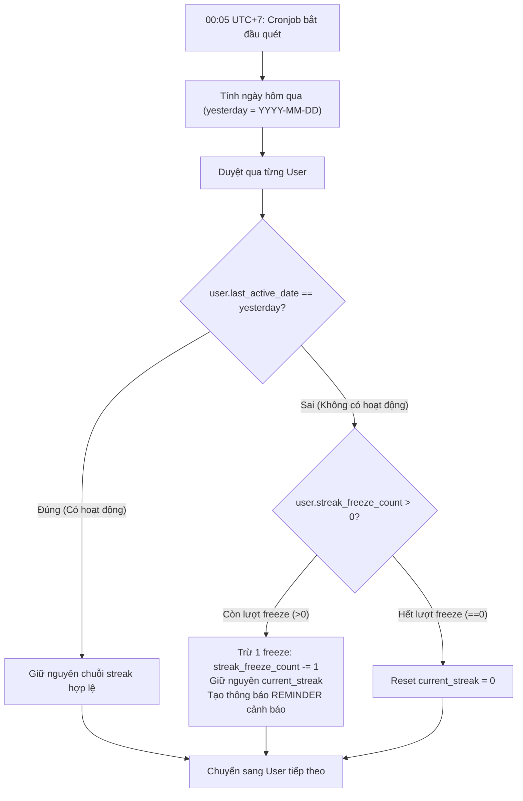

# 📑 [TECH-S3-01] Badges, Streak & Notification API Contract

> **Dự án:** Gamified To-Do Application (`pm-subject_gamified-todo-application`)  
> **Mã nhiệm vụ kỹ thuật:** `TECH-S3-01` (GitHub Issue [#73](https://github.com/khongpc-ptit/pm-subject_gamified-todo-application/issues/73))  
> **Phân loại:** Docs / Technical Specification / Shared Contract / Database & Seed  
> **Người phụ trách:** Khổng Phú Cường (`@khongpc-ptit`)  
> **Thời gian phát hành:** 24/11/2026 (Khung hạn chót: 27/11/2026)  
> **Tài liệu tham chiếu nền tảng:** [`docs/[DOC-11] System Design Document.md`]([DOC-11]%20System%20Design%20Document.md) (Mục 3.2, 3.3, 4.2), [`docs/plan.md`](plan.md) (Mục 3.3)

---

## 🧭 1. TỔNG QUAN VÀ BỐI CẢNH KỸ THUẬT

Tài liệu này là **Hợp đồng Kỹ thuật (API Contract & Data Model)** chính thức của **Sprint 3**, đóng vai trò là **Nguồn chân lý kỹ thuật duy nhất (Single Source of Truth - SSOT)** để các thành viên trong nhóm phát triển Backend, Frontend và QA lập trình song song mà không bị xung đột cấu trúc dữ liệu.

### 1.1. Phạm vi bao phủ các User Stories
Tài liệu quy định toàn bộ đặc tả cho 05 User Stories của Sprint 3:
1. **`US-S3-01` [Theo dõi chuỗi ngày làm việc liên tục (Daily Streak)]:** Tính toán chuỗi hoạt động liên tục hàng ngày theo múi giờ Việt Nam (UTC+7) qua Scheduled Cronjob.
2. **`US-S3-02` [Sử dụng đóng băng chuỗi (Streak Freeze)]:** Tiêu hao lượt đóng băng tự động khi nghỉ đột xuất hoặc kích hoạt chủ động để bảo vệ chuỗi ngày.
3. **`US-S3-03` [Mở khóa huy hiệu thành tích (Badges)]:** Bộ máy kích hoạt tự động (Badge Trigger Engine) quét điều kiện số lượng task, chuỗi streak và cấp bậc level.
4. **`US-S3-04` [Xem bộ sưu tập huy hiệu]:** Hiển thị danh mục huy hiệu đã đạt (rực sáng, ngày mở khóa) và chưa đạt (làm mờ grayscale kèm thanh tiến độ %).
5. **`US-S3-05` [Nhận thông báo nhắc nhở và thành tích]:** Hệ thống thông báo nội bộ gồm huy hiệu mới, cảnh báo chuỗi streak và chuông thông báo (Notification Bell) với badge đếm số lượng chưa đọc.

---

## 🗄️ 2. ĐẶC TẢ DATA MODELS & MONGOOSE SCHEMAS

### 2.1. Collection `badges` (Danh mục huy hiệu thành tích)

Lưu trữ danh mục tất cả huy hiệu có trong hệ thống cùng tiêu chí kích hoạt mở khóa.

#### TypeScript Interface (`server/src/types/badge.types.ts`)
```typescript
import { Document, Types } from 'mongoose';

export type BadgeConditionType = 'TASK_COUNT' | 'STREAK_DAYS' | 'LEVEL_REACH';

export interface IBadge extends Document {
  _id: Types.ObjectId;
  code: string;
  title: string;
  description: string;
  icon_url: string;
  condition_type: BadgeConditionType;
  condition_value: number;
  created_at?: Date;
}
```

#### Bảng chi tiết các trường dữ liệu
| Tên trường (Field) | Kiểu dữ liệu | Bắt buộc | Mặc định | Ràng buộc & Quy tắc |
|---|---|:---:|:---:|---|
| `_id` | `ObjectId` | Có | Tự sinh | Khóa chính của huy hiệu. |
| `code` | `String` | **Có** | - | Mã định danh duy nhất (Unique, Uppercase, Trim, max 50 ký tự), ví dụ: `FIRST_TASK`, `STREAK_7`, `LEVEL_5`. |
| `title` | `String` | **Có** | - | Tên hiển thị của huy hiệu (1–100 ký tự). |
| `description` | `String` | **Có** | - | Mô tả ý nghĩa / điều kiện mở khóa (1–500 ký tự). |
| `icon_url` | `String` | **Có** | - | Đường dẫn ảnh đồ họa WebP (`/icons/badges/*.webp`). |
| `condition_type` | `String` (Enum) | **Có** | - | Chỉ nhận 1 trong 3 giá trị: `'TASK_COUNT'`, `'STREAK_DAYS'`, `'LEVEL_REACH'`. |
| `condition_value` | `Number` | **Có** | - | Ngưỡng giá trị kích hoạt (Số nguyên $\ge 1$). |
| `created_at` | `Date` | Không | `Date.now` | Thời điểm tạo huy hiệu trong CSDL. |

---

### 2.2. Collection `user_badges` (Huy hiệu người dùng đã sở hữu)

Lưu trữ liên kết giữa Người dùng và Huy hiệu đã mở khóa.

#### TypeScript Interface (`server/src/types/badge.types.ts`)
```typescript
export interface IUserBadge extends Document {
  _id: Types.ObjectId;
  user_id: Types.ObjectId;
  badge_id: Types.ObjectId;
  unlocked_at: Date;
}
```

#### Bảng chi tiết các trường dữ liệu
| Tên trường (Field) | Kiểu dữ liệu | Bắt buộc | Mặc định | Ràng buộc & Quy tắc |
|---|---|:---:|:---:|---|
| `_id` | `ObjectId` | Có | Tự sinh | Khóa chính bản ghi cấp phát. |
| `user_id` | `ObjectId` (Ref: `User`) | **Có** | - | Người dùng nhận huy hiệu. Index = true. |
| `badge_id` | `ObjectId` (Ref: `Badge`) | **Có** | - | Huy hiệu được mở khóa. Index = true. |
| `unlocked_at` | `Date` | Không | `Date.now` | Thời điểm chính xác mở khóa huy hiệu. |

#### Chỉ mục độc nhất (Unique Compound Index)
```typescript
userBadgeSchema.index({ user_id: 1, badge_id: 1 }, { unique: true });
```
> **Mục đích:** Đảm bảo tính toàn vẹn dữ liệu (Idempotency), tuyệt đối ngăn chặn việc một người dùng được cấp trùng 1 huy hiệu nhiều hơn một lần.

---

### 2.3. Collection `notifications` (Thông báo nội bộ)

Lưu trữ thông báo thành tích và nhắc nhở gửi tới từng người dùng.

#### TypeScript Interface (`server/src/types/notification.types.ts`)
```typescript
export type NotificationType = 'REMINDER' | 'ACHIEVEMENT' | 'SYSTEM';

export interface INotification extends Document {
  _id: Types.ObjectId;
  user_id: Types.ObjectId;
  title: string;
  message: string;
  type: NotificationType;
  is_read: boolean;
  created_at: Date;
}
```

#### Bảng chi tiết các trường dữ liệu
| Tên trường (Field) | Kiểu dữ liệu | Bắt buộc | Mặc định | Ràng buộc & Quy tắc |
|---|---|:---:|:---:|---|
| `_id` | `ObjectId` | Có | Tự sinh | Khóa chính của thông báo. |
| `user_id` | `ObjectId` (Ref: `User`) | **Có** | - | Người nhận thông báo. Phục vụ Data Isolation (`{ user_id: req.user.id }`). |
| `title` | `String` | **Có** | - | Tiêu đề thông báo (1–200 ký tự). |
| `message` | `String` | **Có** | - | Nội dung chi tiết thông báo (1–1000 ký tự). |
| `type` | `String` (Enum) | Không | `'REMINDER'` | Phân loại: `'ACHIEVEMENT'`, `'REMINDER'`, `'SYSTEM'`. |
| `is_read` | `Boolean` | Không | `false` | Trạng thái đã xem hay chưa xem. |
| `created_at` | `Date` | Không | `Date.now` | Thời điểm phát sinh thông báo. |

#### Chỉ mục tối ưu truy vấn (Compound Indexes)
```typescript
notificationSchema.index({ user_id: 1, is_read: 1 });
notificationSchema.index({ user_id: 1, created_at: -1 });
```
> **Mục đích:**
> - Index `{ user_id: 1, is_read: 1 }` giúp câu truy vấn đếm số lượng thông báo chưa đọc (`countDocuments({ user_id, is_read: false })`) phản hồi tức thì (< 5ms).
> - Index `{ user_id: 1, created_at: -1 }` giúp lấy 20 thông báo mới nhất nhanh chóng.

---

### 2.4. Mở rộng Model `User` cho Sprint 3 (Daily Streak & Freeze)

Trong `server/src/models/User.ts`, các trường phục vụ Streak và Freeze được quy chuẩn:
| Tên trường | Kiểu dữ liệu | Mặc định | Ý nghĩa kỹ thuật |
|---|---|:---:|---|
| `current_streak` | `Number` | `0` | Số ngày liên tục duy trì hoàn thành ít nhất 1 việc hoặc check-in 1 thói quen. |
| `last_active_date` | `String` | `null` | Ngày ghi nhận hoạt động gần nhất theo định dạng `YYYY-MM-DD` (Giờ UTC+7). |
| `streak_freeze_count` | `Number` | `1` | Số lượt bảo vệ chuỗi còn lại. Tài khoản mới tạo được tặng sẵn 01 lượt. |

---

## ⏰ 3. QUY TRÌNH SCHEDULED CRONJOB QUÉT CHUỖI STREAK (00:05 UTC+7)

### 3.1. Cấu hình Cronjob (`server/src/cron/streakResetJob.ts`)
- **Biểu thức Cron:** `5 17 * * *` (Chạy lúc 17:05 UTC hàng ngày = đúng **00:05:00 UTC+7** sáng hôm sau theo giờ Hà Nội).
- **Múi giờ chuẩn:** `Asia/Ho_Chi_Minh` (UTC+7).

### 3.2. Thuật toán điều chỉnh Streak


---

## 🌐 4. DANH MỤC API CONTRACTS CHI TIẾT (SPRINT 3)

Tất cả các API đều tuân thủ **JSON Envelope Pattern** chuẩn:
```json
{
  "success": true,
  "data": { ... },
  "message": "Thông điệp thành công",
  "timestamp": "2026-11-24T14:48:00.000Z"
}
```
Trường hợp lỗi:
```json
{
  "success": false,
  "error": {
    "code": "ERROR_CODE",
    "message": "Mô tả chi tiết lỗi"
  },
  "timestamp": "2026-11-24T14:48:00.000Z"
}
```

---

### 4.1. `POST /api/v1/gamification/freeze-streak` - Kích hoạt đóng băng chuỗi
- **Mục đích:** Cho phép người dùng chủ động tiêu hao 01 lượt đóng băng để bảo vệ chuỗi ngày hiện tại khi có việc bận.
- **Yêu cầu xác thực:** Bắt buộc JWT (`Authorization: Bearer <token>`).
- **Request Headers:**
  ```http
  Authorization: Bearer <access_token>
  ```
- **Request Body:** Không yêu cầu body (`{}`).
- **Success Response (200 OK):**
  ```json
  {
    "success": true,
    "data": {
      "current_streak": 7,
      "streak_freeze_count": 0,
      "is_protected": true,
      "message": "Kích hoạt đóng băng chuỗi thành công! Chuỗi ngày của bạn hôm nay được bảo vệ."
    },
    "message": "Đã sử dụng 1 lượt đóng băng chuỗi",
    "timestamp": "2026-11-24T14:48:00.000Z"
  }
  ```
- **Error Response (400 Bad Request):**
  ```json
  {
    "success": false,
    "error": {
      "code": "NO_FREEZE_REMAINING",
      "message": "Bạn không còn lượt đóng băng chuỗi nào để sử dụng."
    },
    "timestamp": "2026-11-24T14:48:00.000Z"
  }
  ```

---

### 4.2. `GET /api/v1/gamification/badges` - Lấy danh mục huy hiệu & tiến độ
- **Mục đích:** Trả về toàn bộ danh mục huy hiệu trong hệ thống, kèm trạng thái đã đạt (`is_unlocked`), ngày đạt (`unlocked_at`) và tiến độ hiện tại (`current_progress` / `target`).
- **Yêu cầu xác thực:** Bắt buộc JWT (`Authorization: Bearer <token>`).
- **Success Response (200 OK):**
  ```json
  {
    "success": true,
    "data": {
      "total_badges": 10,
      "unlocked_count": 2,
      "badges": [
        {
          "id": "67425f1a9b1c2d3e4f5a6b7c",
          "code": "FIRST_TASK",
          "title": "Khởi đầu nan",
          "description": "Hoàn thành công việc đầu tiên trong ứng dụng",
          "icon_url": "/icons/badges/first-task.webp",
          "condition_type": "TASK_COUNT",
          "condition_value": 1,
          "is_unlocked": true,
          "unlocked_at": "2026-11-20T08:30:00.000Z",
          "current_progress": 1,
          "target": 1,
          "progress_percent": 100
        },
        {
          "id": "67425f1a9b1c2d3e4f5a6b7d",
          "code": "TASK_10",
          "title": "Tập trung cao độ",
          "description": "Hoàn thành 10 công việc để hình thành thói quen giải quyết việc",
          "icon_url": "/icons/badges/task-10.webp",
          "condition_type": "TASK_COUNT",
          "condition_value": 10,
          "is_unlocked": false,
          "unlocked_at": null,
          "current_progress": 4,
          "target": 10,
          "progress_percent": 40
        },
        {
          "id": "67425f1a9b1c2d3e4f5a6b80",
          "code": "STREAK_7",
          "title": "Bậc thầy kỷ luật",
          "description": "Duy trì chuỗi Streak 7 ngày liên tục không gián đoạn",
          "icon_url": "/icons/badges/streak-7.webp",
          "condition_type": "STREAK_DAYS",
          "condition_value": 7,
          "is_unlocked": false,
          "unlocked_at": null,
          "current_progress": 3,
          "target": 7,
          "progress_percent": 42.8
        }
      ]
    },
    "message": "Lấy danh mục huy hiệu thành công",
    "timestamp": "2026-11-24T14:48:00.000Z"
  }
  ```

---

### 4.3. `GET /api/v1/notifications` - Lấy danh sách thông báo & số lượng chưa đọc
- **Mục đích:** Lấy 20 thông báo mới nhất của người dùng hiện tại, sắp xếp giảm dần theo thời gian tạo, kèm theo số lượng thông báo chưa đọc (`unread_count`).
- **Yêu cầu xác thực:** Bắt buộc JWT.
- **Success Response (200 OK):**
  ```json
  {
    "success": true,
    "data": {
      "unread_count": 1,
      "total": 3,
      "notifications": [
        {
          "id": "67426a1b2c3d4e5f6a7b8c9d",
          "title": "Chúc mừng mở khóa huy hiệu!",
          "message": "Bạn đã đạt được huy hiệu 'Khởi đầu nan'!",
          "type": "ACHIEVEMENT",
          "is_read": false,
          "created_at": "2026-11-24T14:30:00.000Z"
        },
        {
          "id": "67426a1b2c3d4e5f6a7b8c9e",
          "title": "Bảo vệ chuỗi ngày",
          "message": "Chuỗi ngày của bạn đã được bảo vệ tự động bằng 01 lượt Đóng băng chuỗi.",
          "type": "REMINDER",
          "is_read": true,
          "created_at": "2026-11-23T17:05:00.000Z"
        }
      ]
    },
    "message": "Lấy danh sách thông báo thành công",
    "timestamp": "2026-11-24T14:48:00.000Z"
  }
  ```

---

### 4.4. `PATCH /api/v1/notifications/:id/read` - Đánh dấu đã đọc 1 thông báo
- **Mục đích:** Cập nhật trạng thái `is_read: true` cho 1 thông báo theo ID.
- **Yêu cầu xác thực:** Bắt buộc JWT. Kiểm tra bảo mật: `{ _id: id, user_id: req.user.id }`.
- **Success Response (200 OK):**
  ```json
  {
    "success": true,
    "data": {
      "id": "67426a1b2c3d4e5f6a7b8c9d",
      "is_read": true
    },
    "message": "Đã đánh dấu thông báo là đã đọc",
    "timestamp": "2026-11-24T14:48:00.000Z"
  }
  ```
- **Error Response (404 Not Found):**
  ```json
  {
    "success": false,
    "error": {
      "code": "NOTIFICATION_NOT_FOUND",
      "message": "Thông báo không tồn tại hoặc bạn không có quyền truy cập"
    },
    "timestamp": "2026-11-24T14:48:00.000Z"
  }
  ```

---

### 4.5. `PATCH /api/v1/notifications/read-all` - Đánh dấu đọc tất cả thông báo
- **Mục đích:** Cập nhật toàn bộ thông báo chưa đọc của người dùng hiện tại sang `is_read: true`.
- **Yêu cầu xác thực:** Bắt buộc JWT.
- **Success Response (200 OK):**
  ```json
  {
    "success": true,
    "data": {
      "modified_count": 3
    },
    "message": "Đã đánh dấu tất cả thông báo là đã đọc",
    "timestamp": "2026-11-24T14:48:00.000Z"
  }
  ```

---

## 🏆 5. DANH MỤC 10 HUY HIỆU MẪU (SEED DATA SPECIFICATION)

Script nạp dữ liệu `server/src/scripts/seedBadges.ts` khởi tạo 10 huy hiệu mẫu:

| STT | Mã Code | Tên huy hiệu | Mô tả | Icon WebP | Loại điều kiện | Ngưỡng giá trị |
|:---:|---|---|---|---|:---:|:---:|
| 1 | `FIRST_TASK` | Khởi đầu nan | Hoàn thành công việc đầu tiên trong ứng dụng | `/icons/badges/first-task.webp` | `TASK_COUNT` | 1 |
| 2 | `TASK_10` | Tập trung cao độ | Hoàn thành 10 công việc để hình thành thói quen giải quyết việc | `/icons/badges/task-10.webp` | `TASK_COUNT` | 10 |
| 3 | `TASK_50` | Chiến binh chăm chỉ | Chinh phục cột mốc 50 công việc hoàn thành | `/icons/badges/task-50.webp` | `TASK_COUNT` | 50 |
| 4 | `TASK_100` | Bậc thầy hoàn thành | Đạt mốc 100 công việc hoàn thành xuất sắc | `/icons/badges/task-100.webp` | `TASK_COUNT` | 100 |
| 5 | `STREAK_3` | Khởi động chuỗi | Duy trì hoạt động liên tục trong 3 ngày | `/icons/badges/streak-3.webp` | `STREAK_DAYS` | 3 |
| 6 | `STREAK_7` | Bậc thầy kỷ luật | Duy trì chuỗi Streak 7 ngày liên tục không gián đoạn | `/icons/badges/streak-7.webp` | `STREAK_DAYS` | 7 |
| 7 | `STREAK_30` | Kỷ luật thép | Duy trì chuỗi Streak 30 ngày bền bỉ đáng kinh ngạc | `/icons/badges/streak-30.webp` | `STREAK_DAYS` | 30 |
| 8 | `LEVEL_2` | Bước lên nấc thang | Đạt Cấp độ 2 với 100 điểm kinh nghiệm (XP) tích lũy | `/icons/badges/level-2.webp` | `LEVEL_REACH` | 2 |
| 9 | `LEVEL_5` | Chuyên gia năng suất | Đạt Cấp độ 5 với 1,600 điểm kinh nghiệm (XP) tích lũy | `/icons/badges/level-5.webp` | `LEVEL_REACH` | 5 |
| 10 | `LEVEL_10` | Huyền thoại năng suất | Đạt Cấp độ 10 đỉnh cao với 8,100 điểm kinh nghiệm (XP) | `/icons/badges/level-10.webp` | `LEVEL_REACH` | 10 |

---

## ⚙️ 6. HƯỚNG DẪN THỰC THI SEED DATA & KIỂM THỬ

### 6.1. Chạy Seed Badges Data
Chạy lệnh npm script trong thư mục `server/`:
```bash
npm run seed:badges
```
Output kỳ vọng:
```text
[SeedBadges] Connecting to MongoDB: mongodb://127.0.0.1:27017/gamified-todo
[SeedBadges] Connected successfully.
[SeedBadges] Completed: 10 inserted, 0 updated (Total: 10 badges).
[SeedBadges] Disconnected from MongoDB.
```

### 6.2. Chạy Kiểm Thử Unit Test cho Model
```bash
npm test tests/badge.model.test.ts
```
100% test cases bao phủ Schema validation, compound index, và seed data integrity phải đạt trạng thái **PASS**.
