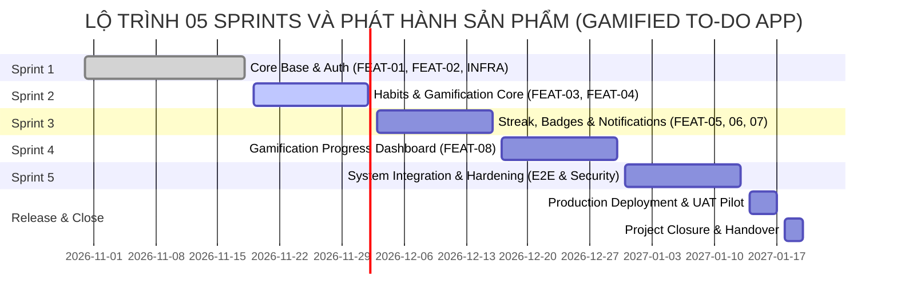
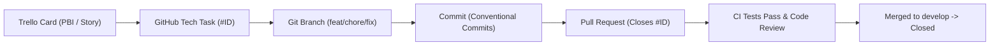

# 🎯 KẾ HOẠCH PHÁT TRIỂN DỰ ÁN TỔNG THỂ (MASTER PROJECT EXECUTION PLAN)
## Gamified To-Do Application (`pm-subject_gamified-todo-application`)

> **Phiên bản tài liệu:** 3.0 (Bản Kỹ Thuật Chi Tiết Hoàn Chỉnh - Production Ready)  
> **Mô hình quản lý:** Hybrid (Kiểm soát đường cơ sở Thác nước + Thực thi lặp Agile/Scrum 05 Sprint)  
> **Khung thời gian:** 11 tuần (31/10/2026 – 20/01/2027) | **Timebox mỗi Sprint:** 14 ngày (02 tuần cố định)  
> **Nguồn lực thực hiện:** Nhóm 3 thành viên (Khổng Phú Cường, Nguyễn Trung Kiên, Lê Mạnh Hùng)  
> **Tài liệu căn cứ kỹ thuật (Single Source of Truth - SSOT):**
> - [`docs/[DOC-11] System Design Document.md`]([DOC-11]%20System%20Design%20Document.md) (Kiến trúc 3 tầng, Schemas Mongoose, Đặc tả API, Thuật toán Gamification)
> - [`docs/Sprint1.md`](Sprint1.md) (Báo cáo điều phối Sprint 1, ánh xạ 24 Issues GitHub)
> - [`docs/[DOC-07] Requirements Elicitation Records.md`]([DOC-07]%20Requirements%20Elicitation%20Records.md) (Yêu cầu nghiệp vụ, Anti-gaming, Ràng buộc 0 USD)
> - [`docs/[TECH-S1-01] Task Data Model & API Contract.md`]([TECH-S1-01]%20Task%20Data%20Model%20&%20API%20Contract.md) (Hợp đồng API & Validation Task)
> - [`docs/[TECH-S1-07] Xác định User Data Model & Authentication API Contract.md`]([TECH-S1-07]%20Xác%20định%20User%20Data%20Model%20&%20Authentication%20API%20Contract.md) (Hợp đồng API Auth & JWT)
> - [`docs/PM-report1.docx.md`](PM-report1.docx.md) (Báo cáo đồ án môn học PMBOK/PTIT số 1)
> - [`AGENTS.md`](../AGENTS.md) (Cẩm nang quy chuẩn Git, Branch, Conventional Commits & Pull Request)

---

## 🧭 1. TỔNG QUAN KIẾN TRÚC, NGUYÊN TẮC KỸ THUẬT & PHÂN CÔNG NHÂN SỰ

### 1.1. Kiến trúc Công nghệ Cốt lõi (Decoupled Architecture)
- **Frontend (`client/`):** React 19 + TypeScript (SPA), Vite, React Router v7, Custom React Hooks (`useAuth`, `useTasks`, `useHabits`, `useGamification`), Axios API Client (BaseURL + Request/Response Interceptors tự động gắn JWT Bearer token và xử lý lỗi tập trung), Lucide React Icons, Vitest + React Testing Library.
- **Backend (`server/`):** Node.js + Express + TypeScript, Clean Layered Architecture:
  - `controllers/`: Tiếp nhận HTTP Request, trích xuất dữ liệu, kiểm tra DTO sơ bộ và trả về chuẩn JSON Envelope.
  - `services/`: Chứa toàn bộ Business Logic, Gamification Engine, Anti-gaming rules, Level progression, tương tác cơ sở dữ liệu qua Mongoose models.
  - `models/`: Định nghĩa Mongoose Schemas, TypeScript Interfaces, Compound Indexes.
  - `middlewares/`: JWT Authentication (`verifyToken`), Request Validator, Centralized Error Handler, CORS, Security Headers (Helmet), Rate Limiting.
  - `cron/`: Scheduled Cronjobs (Reset chuỗi Streak lúc `00:05 UTC+7`).
  - `utils/`: Hàm bổ trợ quy đổi thời gian ISO 8601 sang múi giờ UTC+7, công thức tính Level.
- **Cơ sở dữ liệu:** MongoDB 7.0 (chạy qua Docker Compose local trên cổng `27017` kèm Mongo-Express Web GUI `8081`; môi trường Staging/Production sử dụng cụm MongoDB Atlas Cluster M0 Free Tier).
- **Hạ tầng Cloud & CI/CD (Ngân sách 0 USD):**
  - Backend API & Cronjob: Render Web Service (Free Tier, 512MB RAM).
  - Frontend SPA: Vercel / Netlify CDN (Free Tier, SSL/HTTPS tự động).
  - Giám sát Uptime: UptimeRobot ping `GET /api/v1/health` 5 phút/lần chống ngủ đông máy chủ Render.
  - Tự động hóa CI/CD: 4 GitHub Actions workflows (`promote-ready.yml`, `pr-convention-check.yml`, `auto-in-progress-on-branch.yml`, `deadline-reminder.yml`).

### 1.2. Chuẩn Thiết Kế Phản Hồi API (RESTful JSON Envelope Pattern)
Mọi API Endpoint trong toàn bộ dự án bắt buộc phải trả về dữ liệu được bọc trong Envelope JSON theo chuẩn sau:
- **Phản hồi Thành công (HTTP 200 OK, 201 Created):**
```json
{
  "success": true,
  "data": { ... },
  "message": "Thao tác thành công",
  "timestamp": "2026-11-18T08:00:00.000Z"
}
```
- **Phản hồi Lỗi (HTTP 400 Bad Request, 401 Unauthorized, 403 Forbidden, 404 Not Found, 409 Conflict, 500 Internal Server Error):**
```json
{
  "success": false,
  "error": {
    "code": "ERROR_CODE_NAME",
    "message": "Thông báo lỗi chi tiết cho người dùng"
  },
  "timestamp": "2026-11-18T08:00:00.000Z"
}
```

### 1.3. Đội ngũ Thực hiện & Phân chia Trách nhiệm
| Thành viên | Tài khoản GitHub | Vai trò chính | Trách nhiệm cốt lõi |
|---|---|---|---|
| **Khổng Phú Cường** | `@khongpc-ptit` | Project Manager & Tech Lead | Quản lý tiến độ chung, thiết kế kiến trúc hệ thống, cấu hình Docker/CI/CD, Backend API lõi, CSDL MongoDB & Mongoose Schemas, Code Review & Merge PR. |
| **Đinh Trung Kiên** | `@kiennarutonbmn1` | Business Analyst & Frontend Lead | Phân tích quy trình nghiệp vụ (SRS), phát triển toàn bộ UI/UX Components, Custom React Hooks, tích hợp API Client, Quản lý State Frontend. |
| **Lê Mạnh Hùng** | `@mhunglee20405` | Product Owner & QA/Fullstack Lead | Quản lý Acceptance Criteria, thiết kế Test Plan & Test Suites tự động (Unit/Integration/E2E), kiểm thử bảo mật & hiệu năng, điều phối UAT Pilot. |

---

## 📅 2. LỘ TRÌNH TỔNG THỂ 05 SPRINTS & CÁC CỘT MỐC (MASTER ROADMAP)



### Bảng Ma trận Kế hoạch Theo Chu kỳ
| Chu kỳ | Thời gian | Tính năng mục tiêu (Features) | User Stories | Technical Tasks | Sản phẩm bàn giao (Deliverables) | Trạng thái |
|---|---|---|---|---|---|:---:|
| **Sprint 1** | 31/10/2026 → 18/11/2026 | **FEAT-01:** Task Management (One-off Task)<br>**FEAT-02:** User Auth & Account Management<br>**INFRA:** Foundation Setup & Docker | `US-S1-01` → `US-S1-09`<br>(9 Stories) | `TECH-S1-00` → `TECH-S1-12`<br>(13 Tasks) | Docker MongoDB 7.0, Auth JWT/Bcrypt, CRUD One-off Tasks, Profile, 23/23 tests pass. | 🟢 Đang hoàn tất |
| **Sprint 2** | 19/11/2026 → 02/12/2026 | **FEAT-03:** Earn XP for Eligible Tasks<br>**FEAT-04:** Progress Through Levels<br>**Mở rộng FEAT-01:** Recurring Habits | `US-S2-01` → `US-S2-05`<br>(5 Stories) | `TECH-S2-01` → `TECH-S2-08`<br>(8 Tasks) | Module Thói quen lặp lại, Gamification Service tính XP, Anti-gaming (Cap 200 XP), Level Bar. | 🟡 Kế hoạch chi tiết |
| **Sprint 3** | 03/12/2026 → 16/12/2026 | **FEAT-05:** Maintain a Daily Streak & Freeze<br>**FEAT-06:** Unlock Achievements/Badges<br>**FEAT-07:** Task Notifications & Reminders | `US-S3-01` → `US-S3-05`<br>(5 Stories) | `TECH-S3-01` → `TECH-S3-08`<br>(8 Tasks) | Daily Streak UTC+7, Render Cronjob 00:05, Badge Unlock Engine, Notification Bell. | ⚪ Kế hoạch chi tiết |
| **Sprint 4** | 17/12/2026 → 30/12/2026 | **FEAT-08:** View Gamification Progress & Analytics Dashboard | `US-S4-01` → `US-S4-04`<br>(4 Stories) | `TECH-S4-01` → `TECH-S4-06`<br>(6 Tasks) | Dashboard Hub tổng thể, Biểu đồ năng suất tuần (Chart.js), Bộ lọc nâng cao, Mobile Responsive. | ⚪ Kế hoạch chi tiết |
| **Sprint 5** | 31/12/2026 → 13/01/2027 | **Tích hợp toàn diện hệ thống, Thắt chặt bảo mật, Kiểm thử E2E & Hiệu năng** | `US-S5-01` → `US-S5-03`<br>(3 Stories) | `TECH-S5-01` → `TECH-S5-05`<br>(5 Tasks) | Kiểm thử E2E Cypress/Supertest, Security Audit (Helmet, Rate-limit), Fix bug backlog, Staging Ready. | ⚪ Kế hoạch chi tiết |
| **Release** | 14/01/2027 → 17/01/2027 | **Production Deployment & Pilot User Testing** | UAT Acceptance | `PROD-01` → `PROD-04`<br>(4 Tasks) | Backend live trên Render, Frontend live trên Vercel/Netlify, UAT 20 người dùng thử nghiệm. | ⚪ Kế hoạch chi tiết |
| **Close** | 18/01/2027 → 20/01/2027 | **Project Closure & Final Evaluation** | Final Sign-off | `CLOSE-01` → `CLOSE-03`<br>(3 Tasks) | Hoàn thiện 21 tài liệu chuẩn PTIT, bảo vệ đồ án trước Hội đồng, đóng và lưu trữ kho mã nguồn. | ⚪ Kế hoạch chi tiết |

---

## 🚀 3. ĐẶC TẢ CHI TIẾT TỪNG SPRINT: USER STORIES & TECHNICAL TASKS

---

### 🏃 SPRINT 1: NỀN TẢNG KỸ THUẬT, QUẢN LÝ CÔNG VIỆC ĐƠN LẺ & XÁC THỰC NGƯỜI DÙNG
* **Khung thời gian:** 31/10/2026 – 18/11/2026 (18 ngày)
* **Mục tiêu Sprint:** Khởi tạo kiến trúc Decoupled, CSDL MongoDB qua Docker/Atlas, hoàn thành chức năng Xác thực người dùng (Auth) và Quản lý công việc làm một lần (One-off Task).
* **Tài liệu tham chiếu chi tiết:** [`docs/Sprint1.md`](Sprint1.md), [`docs/[TECH-S1-01] Task Data Model & API Contract.md`]([TECH-S1-01]%20Task%20Data%20Model%20&%20API%20Contract.md), [`docs/[TECH-S1-07] Xác định User Data Model & Authentication API Contract.md`]([TECH-S1-07]%20Xác%20định%20User%20Data%20Model%20&%20Authentication%20API%20Contract.md).

#### 3.1.1. Danh sách User Stories & Tiêu chí Nghiệm thu (09 US)
1. **`US-S1-01` [Tạo công việc cần làm] (Issue #18):**
   - *Mô tả:* Là người dùng, tôi muốn tạo nhanh công việc với tiêu đề, mô tả, mức độ ưu tiên và ngày hết hạn để ghi nhớ việc cần làm.
   - *Acceptance Criteria (AC):*
     - `AC-1.1`: Nhập `title` hợp lệ (1–200 ký tự sau trim), chọn `priority` ("LOW", "MEDIUM", "HIGH") và `due_date` (ISO 8601). Bấm "Lưu" -> Tạo task thành công (201 Created), task mới hiển thị ngay trên đầu danh sách với trạng thái "TODO".
     - `AC-1.2`: Bỏ trống `title` hoặc nhập toàn khoảng trắng -> Nút submit bị vô hiệu hóa hoặc báo lỗi client "Tiêu đề không được để trống". Backend trả về 400 Bad Request nếu cố tình bypass.
     - `AC-1.3`: Không chọn priority -> Mặc định gán "MEDIUM" và `xp_reward: 20`.
2. **`US-S1-02` [Xem danh sách công việc] (Issue #19):**
   - *Mô tả:* Là người dùng, tôi muốn xem danh sách công việc cá nhân được lọc theo trạng thái và độ ưu tiên với đầy đủ trạng thái Loading/Empty.
   - *Acceptance Criteria (AC):*
     - `AC-2.1`: Khi tải trang, hiển thị hiệu ứng Skeleton loading. Tải xong hiển thị đúng danh sách task thuộc `user_id` của phiên đăng nhập.
     - `AC-2.2`: Khi người dùng chưa có task nào -> Hiển thị Empty State với hình minh họa và nút "Tạo công việc đầu tiên".
     - `AC-2.3`: Chọn bộ lọc Status ("TODO", "IN_PROGRESS", "COMPLETED") -> Danh sách cập nhật tức thì tương ứng.
3. **`US-S1-03` [Cập nhật công việc] (Issue #20):**
   - *Mô tả:* Là người dùng, tôi muốn chỉnh sửa tiêu đề, mô tả, hạn chót, mức độ ưu tiên hoặc xóa công việc khi có thay đổi kế hoạch.
   - *Acceptance Criteria (AC):*
     - `AC-3.1`: Bấm vào task mở Modal chỉnh sửa với dữ liệu cũ điền sẵn. Sửa thông tin hợp lệ và bấm "Cập nhật" -> Gọi `PUT /api/v1/tasks/:id`, danh sách cập nhật ngay lập tức.
     - `AC-3.2`: Bấm nút "Xóa" kèm hộp thoại xác nhận -> Gọi `DELETE /api/v1/tasks/:id`, task biến mất khỏi danh sách.
4. **`US-S1-04` [Đánh dấu công việc đã hoàn thành] (Issue #21):**
   - *Mô tả:* Là người dùng, tôi muốn tick chọn hoàn thành công việc để chuyển trạng thái sang `COMPLETED`.
   - *Acceptance Criteria (AC):*
     - `AC-4.1`: Tick vào checkbox của task TODO -> Gọi `PATCH /api/v1/tasks/:id/complete`, task chuyển sang trạng thái COMPLETED kèm hiệu ứng gạch ngang tiêu đề.
     - `AC-4.2`: Bỏ tick task đã COMPLETED -> Trạng thái hoàn tác về TODO.
5. **`US-S1-05` [Đăng ký tài khoản] (Issue #22):**
   - *Mô tả:* Là người dùng mới, tôi muốn đăng ký tài khoản bằng email, mật khẩu và họ tên hợp lệ để bắt đầu sử dụng hệ thống.
   - *Acceptance Criteria (AC):*
     - `AC-5.1`: Nhập email hợp lệ, mật khẩu $\ge$ 6 ký tự, họ tên 2–100 ký tự -> Đăng ký thành công (201 Created), nhận JWT token và tự động đăng nhập vào Dashboard. Mật khẩu được mã hóa Bcrypt (saltRounds = 10).
     - `AC-5.2`: Đăng ký bằng email đã tồn tại -> Trả về lỗi 409 Conflict với code `EMAIL_ALREADY_EXISTS`.
6. **`US-S1-06` [Đăng nhập và đăng xuất] (Issue #23):**
   - *Mô tả:* Là người dùng, tôi muốn đăng nhập an toàn bằng tài khoản đã tạo để lấy JWT session và đăng xuất khi rời khỏi thiết bị.
   - *Acceptance Criteria (AC):*
     - `AC-6.1`: Nhập đúng email/password -> Trả về HTTP 200 kèm JWT token, lưu vào LocalStorage/State và chuyển hướng sang Dashboard.
     - `AC-6.2`: Nhập sai email hoặc password -> Trả về lỗi 401 Unauthorized chung (`INVALID_CREDENTIALS`), không làm lộ email có tồn tại hay không.
     - `AC-6.3`: Bấm nút "Đăng xuất" -> Xóa sạch JWT token trong client, xóa thông tin user và chuyển hướng về trang Login.
7. **`US-S1-07` [Xem hồ sơ người dùng] (Issue #24):**
   - *Mô tả:* Là người dùng, tôi muốn xem thông tin tài khoản cá nhân, cấp độ hiện tại và điểm kinh nghiệm tích lũy.
   - *Acceptance Criteria (AC):*
     - `AC-7.1`: Truy cập trang Profile -> Gọi `GET /api/v1/auth/me` hiển thị email, full_name, current_level, total_xp, current_streak, streak_freeze_count. Tuyệt đối không để lộ `password_hash`.
8. **`US-S1-08` [Cập nhật hồ sơ người dùng] (Issue #25):**
   - *Mô tả:* Là người dùng, tôi muốn cập nhật họ tên hiển thị cá nhân.
   - *Acceptance Criteria (AC):*
     - `AC-8.1`: Nhập họ tên mới hợp lệ (2–100 ký tự) và bấm "Lưu" -> Gọi `PUT /api/v1/users/profile`, họ tên mới được cập nhật trên toàn hệ thống và Header.
9. **`US-S1-09` [Đặt lại mật khẩu đã quên] (Issue #26):**
   - *Mô tả:* Là người dùng, tôi muốn gửi yêu cầu đặt lại mật khẩu qua email khi quên mật khẩu đăng nhập.
   - *Acceptance Criteria (AC):*
     - `AC-9.1`: Nhập email tại màn hình Forgot Password -> Gọi `POST /api/v1/auth/forgot-password`, hệ thống sinh token reset có hạn 15 phút và gửi hướng dẫn.

#### 3.1.2. Danh sách Technical Tasks (13 TECH Tasks)
| Mã Task | GitHub Issue | Phân loại | Người phụ trách | Hạn chót | Mục tiêu & Chi tiết triển khai kỹ thuật | Phụ thuộc |
|---|:---:|---|---|:---:|---|---|
| **TECH-S1-00** | [#41](https://github.com/khongpc-ptit/pm-subject_gamified-todo-application/issues/41) | Shared Infra | `@khongpc-ptit` | 06/11/2026 | Khởi tạo cấu trúc Decoupled client/server, Docker Compose MongoDB 7.0 + Mongo Express 8081, Mongoose Connection Pooling trong `server/src/config/db.ts`, endpoint `GET /api/v1/health`. *(Đã hoàn thành - PR #42 merged)*. | Không có |
| **TECH-S1-01** | [#27](https://github.com/khongpc-ptit/pm-subject_gamified-todo-application/issues/27) | Shared Tech | `@khongpc-ptit` | 07/11/2026 | Xác định Mongoose Schema `tasks` (Compound index `{ user_id: 1, status: 1 }`), DTOs, Validation Rules (title 1-200, priority enum, due_date ISO 8601) và tài liệu API Contract CRUD Task. *(Đã hoàn thành)*. | Không có |
| **TECH-S1-02** | [#28](https://github.com/khongpc-ptit/pm-subject_gamified-todo-application/issues/28) | FE + BE | `@kiennarutonbmn1` | 10/11/2026 | Triển khai API `POST /api/v1/tasks` (gán mặc định `xp_reward` theo priority: LOW 10, MEDIUM 20, HIGH 30) và Giao diện Form tạo nhanh công việc (`QuickCreateTask.tsx`). | #41, #27 |
| **TECH-S1-03** | [#29](https://github.com/khongpc-ptit/pm-subject_gamified-todo-application/issues/29) | FE + BE | `@khongpc-ptit` | 10/11/2026 | Triển khai API `GET /api/v1/tasks` (query filter status, priority) và Component `TaskList.tsx`, `TaskItem.tsx` với Skeleton Loader và Empty State. | #41, #27 |
| **TECH-S1-04** | [#30](https://github.com/khongpc-ptit/pm-subject_gamified-todo-application/issues/30) | FE + BE | `@mhunglee20405` | 10/11/2026 | Triển khai API `PUT /api/v1/tasks/:id`, `DELETE /api/v1/tasks/:id` và Modal chỉnh sửa chi tiết công việc (`TaskEditModal.tsx`) trên Frontend. | #41, #27 |
| **TECH-S1-05** | [#31](https://github.com/khongpc-ptit/pm-subject_gamified-todo-application/issues/31) | FE + BE | `@kiennarutonbmn1` | 09/11/2026 | Triển khai API `PATCH /api/v1/tasks/:id/complete` (chuyển đổi qua lại giữa TODO và COMPLETED, gán `completed_at`) và hiệu ứng tick checkbox hoàn thành. | #41, #27, #28 |
| **TECH-S1-06** | [#32](https://github.com/khongpc-ptit/pm-subject_gamified-todo-application/issues/32) | QA / Test | Cả 3 thành viên | 13/11/2026 | Viết kịch bản kiểm thử tích hợp tự động cho toàn bộ module One-off Task Management trong `server/tests/tasks.test.ts` (100% test cases pass). | #28, #29, #30, #31 |
| **TECH-S1-07** | [#33](https://github.com/khongpc-ptit/pm-subject_gamified-todo-application/issues/33) | Shared Tech | `@khongpc-ptit` | 17/11/2026 | Xác định Mongoose Schema `users` (Unique email lowercase, Gamification default fields), middleware xác thực `verifyToken` (`req.user = decoded`) và API Contract Auth. *(Đã hoàn thành)*. | Không có |
| **TECH-S1-08** | [#34](https://github.com/khongpc-ptit/pm-subject_gamified-todo-application/issues/34) | FE + BE | `@khongpc-ptit` | 18/11/2026 | Triển khai API `POST /api/v1/auth/register` (Bcrypt băm mật khẩu saltRounds=10, chặn email trùng) và Giao diện Đăng ký (`RegisterPage.tsx`). | #41, #33 |
| **TECH-S1-09** | [#35](https://github.com/khongpc-ptit/pm-subject_gamified-todo-application/issues/35) | FE + BE | `@kiennarutonbmn1` | 18/11/2026 | Triển khai API `POST /api/v1/auth/login` (sinh JWT HS256 exp 7d), `AuthContext.tsx`, bảo vệ route `PrivateRoute.tsx` và Giao diện Đăng nhập (`LoginPage.tsx`). | #41, #33, #34 |
| **TECH-S1-10** | [#36](https://github.com/khongpc-ptit/pm-subject_gamified-todo-application/issues/36) | FE + BE | `@mhunglee20405` | 18/11/2026 | Triển khai API `GET /api/v1/auth/me`, `PUT /api/v1/users/profile` và Giao diện Hồ sơ cá nhân (`ProfilePage.tsx`). | #41, #33, #34, #35 |
| **TECH-S1-11** | [#37](https://github.com/khongpc-ptit/pm-subject_gamified-todo-application/issues/37) | FE + BE | `@kiennarutonbmn1` | 18/11/2026 | Triển khai API `POST /api/v1/auth/forgot-password` (tạo reset token có thời hạn 15 phút) và Giao diện Quên mật khẩu (`ForgotPasswordPage.tsx`). | #41, #33, #34, #35 |
| **TECH-S1-12** | [#38](https://github.com/khongpc-ptit/pm-subject_gamified-todo-application/issues/38) | QA / Test | Cả 3 thành viên | 18/11/2026 | Viết kịch bản kiểm thử tích hợp tự động cho toàn bộ module Authentication trong `server/tests/auth.test.ts` (kiểm tra token, bcrypt, profile, validation). | #34, #35, #36, #37 |

---

### 🏃 SPRINT 2: THÓI QUEN LẶP LẠI (RECURRING HABITS) & ĐỘNG CƠ GAMIFICATION CỐT LÕI (XP & LEVEL)
* **Khung thời gian:** 19/11/2026 – 02/12/2026 (14 ngày)
* **Mục tiêu Sprint:** Xây dựng module Quản lý thói quen lặp lại (`habits`), cài đặt Business Rules Gamification (Cộng điểm XP theo độ ưu tiên, Chống gian lận Daily XP Cap 200 XP, Thuật toán Cấp bậc Level Progression).
* **Tài liệu tham chiếu:** [`docs/[DOC-11] System Design Document.md`]([DOC-11]%20System%20Design%20Document.md) (Mục 3.2, 3.3, 4.2, 4.3).

#### 3.2.1. Danh sách User Stories & Tiêu chí Nghiệm thu (05 US)

| User Story ID | Tên User Story | Người được giao | Deadline |
|---|---|---|:---:|
| **US-S2-01** | Thiết lập thói quen lặp lại | Khổng Phú Cường (`@khongpc-ptit`) | 29/11/2026 |
| **US-S2-02** | Điểm danh thói quen hàng ngày | Đinh Trung Kiên (`@kiennarutonbmn1`) | 29/11/2026 |
| **US-S2-03** | Tích lũy điểm kinh nghiệm khi hoàn thành công việc | Đinh Trung Kiên (`@kiennarutonbmn1`) | 29/11/2026 |
| **US-S2-04** | Cơ chế giới hạn điểm thưởng và hoàn tác (Anti-gaming) | Lê Mạnh Hùng (`@mhunglee20405`) | 29/11/2026 |
| **US-S2-05** | Thăng cấp độ và theo dõi thanh tiến trình | Lê Mạnh Hùng (`@mhunglee20405`) | 29/11/2026 |

1. **`US-S2-01` [Thiết lập thói quen lặp lại]** *(Phụ trách: `@khongpc-ptit` | Hạn chót: 29/11/2026)*:
   - *Mô tả:* Là người dùng, tôi muốn tạo thói quen cần duy trì với chu kỳ lặp lại (Hàng ngày / Hàng tuần) và số ngày mục tiêu để theo đuổi mục tiêu dài hạn.
   - *Acceptance Criteria (AC):*
     - `AC-2.1.1`: Nhập tiêu đề thói quen (1–200 ký tự), chọn chu kỳ (`frequency`: "DAILY" hoặc "WEEKLY"), chọn số ngày mục tiêu (`target_days`, mặc định 7 ngày). Bấm "Tạo thói quen" -> Lưu vào CSDL với `is_active: true`, hiển thị ngay trên bảng Habit Tracker.
     - `AC-2.1.2`: Người dùng có thể xóa/hủy theo dõi thói quen -> Gọi `DELETE /api/v1/habits/:id`, hệ thống chuyển `is_active: false` (soft delete) hoặc xóa bản ghi.
2. **`US-S2-02` [Điểm danh thói quen hàng ngày]** *(Phụ trách: `@kiennarutonbmn1` | Hạn chót: 29/11/2026)*:
   - *Mô tả:* Là người dùng, tôi muốn check-in đánh dấu hoàn thành thói quen trong ngày hôm nay và xem lại lịch sử các ngày đã thực hiện.
   - *Acceptance Criteria (AC):*
     - `AC-2.2.1`: Bấm nút Check-in trên thói quen -> Gọi `POST /api/v1/habits/:id/check-in`. Hệ thống tự động lấy ngày hiện tại định dạng `YYYY-MM-DD` theo múi giờ UTC+7, kiểm tra nếu hôm nay chưa check-in thì thêm vào mảng `logs`, cộng +15 XP cho người dùng.
     - `AC-2.2.2`: Nếu hôm nay đã check-in rồi mà bấm tiếp -> Hệ thống thông báo "Bạn đã điểm danh thói quen này hôm nay rồi" (hoặc chặn nút ở Frontend), không cộng dồn XP lần 2.
3. **`US-S2-03` [Tích lũy điểm kinh nghiệm khi hoàn thành công việc]** *(Phụ trách: `@kiennarutonbmn1` | Hạn chót: 29/11/2026)*:
   - *Mô tả:* Là người dùng, tôi muốn nhận điểm kinh nghiệm tương ứng khi hoàn thành công việc (Thấp: 10 XP, Trung bình: 20 XP, Cao: 30 XP, Check-in thói quen: 15 XP).
   - *Acceptance Criteria (AC):*
     - `AC-2.3.1`: Hoàn thành Task LOW -> Cộng +10 XP vào `user.total_xp`.
     - `AC-2.3.2`: Hoàn thành Task MEDIUM -> Cộng +20 XP vào `user.total_xp`.
     - `AC-2.3.3`: Hoàn thành Task HIGH -> Cộng +30 XP vào `user.total_xp`.
     - `AC-2.3.4`: Check-in Habit thành công -> Cộng +15 XP vào `user.total_xp`. Hiển thị Toast thông báo chúc mừng kèm số XP nhận được trên màn hình.
4. **`US-S2-04` [Cơ chế giới hạn điểm thưởng và hoàn tác (Anti-gaming)]** *(Phụ trách: `@mhunglee20405` | Hạn chót: 29/11/2026)*:
   - *Mô tả:* Là người dùng, tôi hiểu rằng hệ thống giới hạn nhận tối đa 200 XP/ngày (để đảm bảo tính công bằng) và sẽ trừ lại điểm XP nếu tôi hủy đánh dấu hoàn thành một việc cũ.
   - *Acceptance Criteria (AC):*
     - `AC-2.4.1`: Tổng số XP người dùng kiếm được trong ngày từ cả Task và Habit không được vượt quá **200 XP (Daily XP Cap)**. Khi đã đạt 200 XP trong ngày, việc hoàn thành thêm task vẫn đổi trạng thái sang COMPLETED nhưng `xp_earned: 0` và hiển thị thông báo "Bạn đã đạt giới hạn 200 XP tối đa trong ngày hôm nay".
     - `AC-2.4.2`: Khi người dùng chuyển trạng thái Task từ COMPLETED ngược về TODO -> Hệ thống tự động trừ đi đúng số XP đã cộng tương ứng từ `user.total_xp` (không để `total_xp` bị âm).
5. **`US-S2-05` [Thăng cấp độ và theo dõi thanh tiến trình]** *(Phụ trách: `@mhunglee20405` | Hạn chót: 29/11/2026)*:
   - *Mô tả:* Là người dùng, tôi muốn nhìn thấy cấp độ (Level) của mình tăng lên khi đủ điểm XP và có thanh tiến trình hiển thị rõ còn thiếu bao nhiêu XP để lên cấp tiếp theo.
   - *Acceptance Criteria (AC):*
     - `AC-2.5.1`: Cấp độ được tính tự động theo công thức chuẩn: $\text{Level} = \lfloor \sqrt{\text{Total\_XP}} / 10 \rfloor + 1$.
       - Ví dụ: 0–99 XP: Level 1; 100–399 XP: Level 2; 400–899 XP: Level 3; 900–1599 XP: Level 4; 1600–2499 XP: Level 5...
     - `AC-2.5.2`: Khi tích lũy đủ XP đưa Level tăng lên -> Hệ thống hiển thị Modal chúc mừng thăng cấp (Level Up Modal).
     - `AC-2.5.3`: Thanh XP Bar trên Header hiển thị tỷ lệ % kinh nghiệm hiện tại so với mốc kinh nghiệm cần thiết để đạt cấp kế tiếp.

#### 3.2.2. Danh sách Technical Tasks Chi Tiết (08 TECH Tasks)
| Mã Task | GitHub Issue | User Story cha | Phân loại | Người phụ trách | Hạn chót | Mục tiêu, Đặc tả Kỹ thuật & Tiêu chí Hoàn thành | Phụ thuộc (Blocked by) |
|---|:---:|:---:|---|---|:---:|---|---|
| **TECH-S2-01** | [#56](https://github.com/khongpc-ptit/pm-subject_gamified-todo-application/issues/56) | `US-S2-01`<br>(Shared) | Docs/Design | `@khongpc-ptit` | 29/11/2026 | **Đặc tả Schema `habits`, Compound Index & API Contract:**<br>• Tạo model `server/src/models/Habit.ts` với Schema: `user_id` (ObjectId, ref: User, required), `title` (String, max 200, required), `frequency` (Enum: ['DAILY', 'WEEKLY'], default 'DAILY'), `target_days` (Number, default 7), `current_streak` (Number, default 0), `is_active` (Boolean, default true), `logs` (Array nhúng: `log_date` YYYY-MM-DD, `is_completed` Boolean, `xp_earned` Number).<br>• Compound Index: `{ user_id: 1, is_active: 1 }`.<br>• Xuất bản tài liệu `docs/[TECH-S2-01] Habit Data Model & Gamification API Contract.md` (mục tiêu hợp đồng ban hành ngày 21/11/2026). | Sprint 1 |
| **TECH-S2-02** | [#57](https://github.com/khongpc-ptit/pm-subject_gamified-todo-application/issues/57) | `US-S2-01` | Backend | `@khongpc-ptit` | 29/11/2026 | **Triển khai Habit Controller, Service & CRUD APIs:**<br>• Tệp: `server/src/controllers/habitController.ts`, `server/src/services/habitService.ts`.<br>• `GET /api/v1/habits`: Trả về danh sách thói quen active của user kèm lịch sử logs 7 ngày gần nhất.<br>• `POST /api/v1/habits`: Tạo thói quen mới, validate `title` 1–200 ký tự.<br>• `DELETE /api/v1/habits/:id`: Xóa thói quen theo `_id` có gắn điều kiện `{ user_id: req.user.id }`. Trả về chuẩn JSON Envelope. | #56 |
| **TECH-S2-03** | [#58](https://github.com/khongpc-ptit/pm-subject_gamified-todo-application/issues/58) | `US-S2-01` | Frontend | `@khongpc-ptit` | 29/11/2026 | **Xây dựng Giao diện Quản lý Thói quen (Habit Tracker UI):**<br>• Tệp: `client/src/pages/HabitsPage.tsx`, `client/src/components/habits/HabitCard.tsx`, `HabitCreateModal.tsx`.<br>• Hiển thị danh sách card thói quen, chu kỳ lặp lại, thanh tiến độ số ngày thực hiện trong tuần, nút check-in trạng thái hôm nay. Form tạo thói quen chọn radio Daily/Weekly, input số ngày mục tiêu. | #56 |
| **TECH-S2-04** | [#59](https://github.com/khongpc-ptit/pm-subject_gamified-todo-application/issues/59) | `US-S2-04` | Backend | `@mhunglee20405` | 29/11/2026 | **Xây dựng Gamification Core Engine & Chống Gian Lận (Anti-gaming):**<br>• Tệp: `server/src/services/gamificationService.ts`.<br>• Hàm `calculateTaskXP(priority)`: LOW: 10, MEDIUM: 20, HIGH: 30.<br>• Hàm `checkDailyXPCap(userId, xpToAdd)`: Tính tổng XP đã nhận trong ngày hôm nay (YYYY-MM-DD UTC+7). Nếu `currentDayXP + xpToAdd > 200`, điều chỉnh số XP thực nhận để tổng không quá 200 (hoặc bằng 0 nếu đã chạm 200).<br>• Hàm `revertTaskXP(userId, xpToDeduct)`: Trừ XP khi revert task về TODO. Tích hợp trực tiếp vào Task Complete API `PATCH /api/v1/tasks/:id/complete`. | #57 |
| **TECH-S2-05** | [#60](https://github.com/khongpc-ptit/pm-subject_gamified-todo-application/issues/60) | `US-S2-05` | Backend | `@mhunglee20405` | 29/11/2026 | **Triển khai Dịch vụ Tính toán Cấp độ (Level Progression Service):**<br>• Tệp: `server/src/services/levelService.ts`, `server/src/utils/gamificationUtils.ts`.<br>• Hàm tính Level: $L = \lfloor \sqrt{\text{Total\_XP}} / 10 \rfloor + 1$.<br>• Hàm tính XP ngưỡng: $\text{Required\_XP}(L) = (10 \times (L - 1))^2$.<br>• Tự động so sánh level cũ và level mới sau mỗi lần cộng XP. Nếu `newLevel > oldLevel`, cập nhật `user.current_level = newLevel` và trả về cờ `level_up: true` trong response. | #59 |
| **TECH-S2-06** | [#61](https://github.com/khongpc-ptit/pm-subject_gamified-todo-application/issues/61) | `US-S2-02`<br>`US-S2-03` | Fullstack | `@kiennarutonbmn1` | 29/11/2026 | **Triển khai API Check-in Thói quen & Tích hợp Gamification:**<br>• `POST /api/v1/habits/:id/check-in`: Kiểm tra log ngày hôm nay (UTC+7). Nếu chưa có -> Push `{ log_date, is_completed: true, xp_earned }` vào `logs`, tăng `habit.current_streak += 1`, cập nhật `user.last_active_date`, gọi `gamificationService` cộng +15 XP (có kiểm tra trần 200 XP). Trả về `{ habit, xp_earned, total_xp, current_level, level_up }`.<br>• [Triển khai và kiểm thử](reports/TECH-S2-06-habit-checkin-gamification.md). | #57, #59, #60 |
| **TECH-S2-07** | [#62](https://github.com/khongpc-ptit/pm-subject_gamified-todo-application/issues/62) | `US-S2-05`<br>(Refs `US-S2-03`) | Frontend | `@mhunglee20405` | 29/11/2026 | **Tích hợp XP Bar, Level Badge & Modal Level Up trên Frontend:**<br>• Tệp: `client/src/components/gamification/XPProgressBar.tsx`, `LevelBadge.tsx`, `LevelUpModal.tsx`.<br>• Cập nhật Header với thanh tiến trình XP thời gian thực (% tiến trình lên cấp tiếp theo, số XP còn thiếu). Hiệu ứng ăn mừng (Confetti) khi mở modal Level Up. | #58, #60, #61 |
| **TECH-S2-08** | [#63](https://github.com/khongpc-ptit/pm-subject_gamified-todo-application/issues/63) | `US-S2-01` → `05` | QA / Test | `@mhunglee20405`<br>`@khongpc-ptit`<br>`@kiennarutonbmn1` | 02/12/2026 | **Kiểm thử Tự động Toàn diện Gamification & Habits:**<br>• Tệp: `server/tests/gamification.test.ts`, `server/tests/habits.test.ts`.<br>• Kịch bản kiểm thử: Check-in thói quen lần 1 (+15 XP), check-in lần 2 trong ngày (bị từ chối); Hoàn thành task High (+30 XP); Cày quá 200 XP/ngày (bị chặn ở đúng 200 XP); Hoàn tác task (bị trừ lại điểm); Tích lũy 100 XP -> Nhảy cấp Level 2 chính xác. 100% tests pass.<br>• [Kết quả kiểm thử API, giao diện và CI](reports/TECH-S2-08-gamification-habits-test.md). | #58, #61, #62 |

---

### 🏃 SPRINT 3: CHUỖI LIÊN TỤC (DAILY STREAK), THÀNH TỰU (BADGES) & THÔNG BÁO NỘI BỘ (NOTIFICATIONS)
* **Khung thời gian:** 03/12/2026 – 16/12/2026 (14 ngày)
* **Mục tiêu Sprint:** Triển khai thuật toán tính chuỗi ngày liên tục (Daily Streak) đồng bộ múi giờ UTC+7 qua Scheduled Cronjob, cơ chế bảo vệ chuỗi (Streak Freeze), mở khóa huy hiệu (Badges) và hệ thống thông báo nhắc nhở nội bộ.
* **Tài liệu tham chiếu:** [`docs/[DOC-11] System Design Document.md`]([DOC-11]%20System%20Design%20Document.md) (Mục 3.2, 3.3, 3.4, 4.2, 4.3).

#### 3.3.1. Danh sách User Stories & Tiêu chí Nghiệm thu (05 US)

| User Story ID | Tên User Story | Người được giao | Deadline |
|---|---|---|:---:|
| **US-S3-01** | Theo dõi chuỗi ngày làm việc liên tục (Daily Streak) | Khổng Phú Cường (`@khongpc-ptit`) | 27/11/2026 |
| **US-S3-02** | Sử dụng đóng băng chuỗi (Streak Freeze) | Lê Mạnh Hùng (`@mhunglee20405`) | 27/11/2026 |
| **US-S3-03** | Mở khóa huy hiệu thành tích (Badges) | Lê Mạnh Hùng (`@mhunglee20405`) | 27/11/2026 |
| **US-S3-04** | Xem bộ sưu tập huy hiệu | Đinh Trung Kiên (`@kiennarutonbmn1`) | 27/11/2026 |
| **US-S3-05** | Nhận thông báo nhắc nhở và thành tích | Đinh Trung Kiên (`@kiennarutonbmn1`) | 28/11/2026 |

1. **`US-S3-01` [Theo dõi chuỗi ngày làm việc liên tục (Daily Streak)]** *(Phụ trách: `@khongpc-ptit` | Hạn chót: 27/11/2026)*:
   - *Mô tả:* Là người dùng, tôi muốn thấy biểu tượng ngọn lửa và số ngày duy trì hoạt động liên tục (Streak) tăng lên mỗi ngày khi tôi hoàn thành ít nhất 1 việc hoặc thói quen.
   - *Acceptance Criteria (AC):*
     - `AC-3.1.1`: Người dùng hoàn thành ít nhất 01 task hoặc điểm danh 01 thói quen trong ngày -> Hệ thống ghi nhận `last_active_date = YYYY-MM-DD` (UTC+7).
     - `AC-3.1.2`: Khi qua ngày mới (sau `00:05 UTC+7`), hệ thống quét: Nếu ngày hôm qua có hoạt động -> `current_streak = current_streak + 1`. Biểu tượng ngọn lửa trên Header cập nhật số ngày liên tục.
     - `AC-3.1.3`: Nếu ngày hôm qua không có hoạt động nào và không còn lượt freeze -> `current_streak` reset về 0.
2. **`US-S3-02` [Sử dụng đóng băng chuỗi (Streak Freeze)]** *(Phụ trách: `@mhunglee20405` | Hạn chót: 27/11/2026)*:
   - *Mô tả:* Là người dùng, tôi muốn sử dụng lượt "Đóng băng chuỗi" (Streak Freeze) để không bị mất chuỗi ngày đã tích lũy khi có việc bận đột xuất trong ngày.
   - *Acceptance Criteria (AC):*
     - `AC-3.2.1`: Tài khoản mới tạo được tặng sẵn 01 lượt `streak_freeze_count = 1`.
     - `AC-3.2.2`: Vào ngày người dùng không có hoạt động, hệ thống tự động tiêu hao 01 lượt freeze trong đợt quét Cronjob 00:05, giữ nguyên giá trị chuỗi Streak cũ (không bị reset về 0) và tạo một thông báo nhắc nhở "Chuỗi ngày của bạn đã được bảo vệ bởi Đóng băng chuỗi".
     - `AC-3.2.3`: Cho phép người dùng chủ động kích hoạt đóng băng chuỗi qua API `POST /api/v1/gamification/freeze-streak`.
3. **`US-S3-03` [Mở khóa huy hiệu thành tích (Badges)]** *(Phụ trách: `@mhunglee20405` | Hạn chót: 27/11/2026)*:
   - *Mô tả:* Là người dùng, tôi muốn nhận được thông báo chúc mừng và mở khóa huy hiệu khi đạt được các cột mốc thử thách.
   - *Acceptance Criteria (AC):*
     - `AC-3.3.1`: Kích hoạt theo điều kiện `TASK_COUNT`: Hoàn thành task đầu tiên -> Mở khóa huy hiệu "Khởi đầu nan" (`FIRST_TASK`). Hoàn thành 50 tasks -> Mở khóa "Chiến binh chăm chỉ" (`TASK_50`).
     - `AC-3.3.2`: Kích hoạt theo điều kiện `STREAK_DAYS`: Duy trì Streak 7 ngày liên tục -> Mở khóa huy hiệu "Bậc thầy kỷ luật" (`STREAK_7`). Duy trì 30 ngày -> "Kỷ luật thép" (`STREAK_30`).
     - `AC-3.3.3`: Kích hoạt theo điều kiện `LEVEL_REACH`: Đạt Level 5 -> Mở khóa huy hiệu "Chuyên gia năng suất" (`LEVEL_5`).
     - `AC-3.3.4`: Chống cấp trùng huy hiệu: Mỗi huy hiệu chỉ được mở khóa 01 lần duy nhất cho mỗi user.
4. **`US-S3-04` [Xem bộ sưu tập huy hiệu]** *(Phụ trách: `@kiennarutonbmn1` | Hạn chót: 27/11/2026)*:
   - *Mô tả:* Là người dùng, tôi muốn vào trang Bộ sưu tập để chiêm ngưỡng các huy hiệu đã mở khóa (ảnh sáng rõ, có ngày đạt) và xem điều kiện của các huy hiệu chưa đạt (ảnh làm mờ/grayscale kèm thanh tiến độ).
   - *Acceptance Criteria (AC):*
     - `AC-3.4.1`: Truy cập trang Huy hiệu -> Gọi `GET /api/v1/gamification/badges`. Trả về toàn bộ danh mục huy hiệu trong hệ thống kèm trạng thái `is_unlocked: true/false` và thời gian `unlocked_at`.
     - `AC-3.4.2`: Hình ảnh huy hiệu hiển thị tối ưu bằng định dạng WebP, tải mượt mà.
5. **`US-S3-05` [Nhận thông báo nhắc nhở và thành tích]** *(Phụ trách: `@kiennarutonbmn1` | Hạn chót: 28/11/2026)*:
   - *Mô tả:* Là người dùng, tôi muốn nhận thông báo khi có công việc sắp đến hạn chót hoặc khi có thành tựu mới mở khóa tại góc chuông thông báo.
   - *Acceptance Criteria (AC):*
     - `AC-3.5.1`: Khi mở khóa badge thành công -> Hệ thống tự động tạo 1 bản ghi vào `notifications` với `type: "ACHIEVEMENT"`.
     - `AC-3.5.2`: Chuông thông báo trên Header hiển thị Badge đỏ đếm số lượng thông báo chưa đọc (`is_read: false`).
     - `AC-3.5.3`: Bấm vào thông báo -> Đánh dấu chuyển sang `is_read: true`.

#### 3.3.2. Danh sách Technical Tasks Chi Tiết (08 TECH Tasks)
| Mã Task | Phân loại | Người phụ trách | Hạn chót | Mục tiêu, Đặc tả Kỹ thuật & Tiêu chí Hoàn thành | Phụ thuộc |
|---|---|---|:---:|---|---|
| **TECH-S3-01** | Docs/Design | `@khongpc-ptit` | 27/11/2026 | **Thiết kế Schema `badges`, `user_badges`, `notifications` & Seed Data:**<br>• `server/src/models/Badge.ts`: `code` (Unique, required), `title`, `description`, `icon_url`, `condition_type` (Enum: TASK_COUNT, STREAK_DAYS, LEVEL_REACH), `condition_value` (Number).<br>• `server/src/models/UserBadge.ts`: `user_id`, `badge_id`, `unlocked_at`. **Index độc nhất (Unique Compound Index):** `{ user_id: 1, badge_id: 1 }`.<br>• `server/src/models/Notification.ts`: `user_id` (Index), `title`, `message`, `type` (REMINDER, ACHIEVEMENT, SYSTEM), `is_read` (Boolean, default false, Index).<br>• Viết script seed data 10 huy hiệu mẫu vào MongoDB (`server/src/scripts/seedBadges.ts`). | Sprint 2 |
| **TECH-S3-02** | Backend/Cron | `@khongpc-ptit` | 27/11/2026 | **Triển khai Scheduled Cronjob Quét Chuỗi Streak (Render Background Worker):**<br>• Tệp: `server/src/cron/streakResetJob.ts`.<br>• Cấu hình Cron pattern: `5 17 * * *` (tương đương `00:05 UTC+7` hàng ngày).<br>• Logic quét: Lấy danh sách users. Tính toán ngày hôm qua theo múi giờ UTC+7. Nếu `user.last_active_date == yesterday` -> `user.current_streak += 1`. Nếu `user.last_active_date < yesterday`: Kiểm tra nếu `streak_freeze_count > 0` -> Trừ 1 freeze, giữ nguyên streak, tạo notification cảnh báo; nếu `streak_freeze_count == 0` -> Reset `current_streak = 0`. | TECH-S3-01 |
| **TECH-S3-03** | Fullstack | `@mhunglee20405` | 27/11/2026 | **Triển khai API & Giao diện Đóng Băng Chuỗi (Streak Freeze Flow):**<br>• Endpoint: `POST /api/v1/gamification/freeze-streak`. Trừ 1 lượt freeze của user, cập nhật trạng thái bảo vệ chuỗi ngày hiện tại.<br>• Component `StreakCard.tsx`: Hiển thị số ngày streak, biểu tượng ngọn lửa rực sáng, số lượt đóng băng còn lại và nút kích hoạt đóng băng khẩn cấp. | TECH-S3-02 |
| **TECH-S3-04** | Backend | `@mhunglee20405` | 27/11/2026 | **Xây dựng Dịch vụ Kích hoạt Huy hiệu Tự động (Badge Trigger Engine):**<br>• Tệp: `server/src/services/badgeService.ts`.<br>• Hàm `checkAndAwardBadges(userId)`: Quét các điều kiện: đếm số task hoàn thành trong Collection `tasks`, kiểm tra `current_streak` và `current_level` trong Collection `users`. So sánh với Collection `badges`.<br>• Với mỗi badge thỏa mãn điều kiện và chưa có trong `user_badges` -> Chèn bản ghi mới vào `user_badges`, tạo 1 bản ghi `notifications`, trả về mảng danh sách badge vừa mở khóa để client bắn Modal chúc mừng. | TECH-S3-01, TECH-S3-02 |
| **TECH-S3-05** | Fullstack | `@kiennarutonbmn1` | 27/11/2026 | **Triển khai API & Giao diện Bộ sưu tập Huy hiệu (Badge Showcase UI):**<br>• Endpoint: `GET /api/v1/gamification/badges`. Trả về mảng danh sách huy hiệu kèm cờ `is_unlocked: true/false`.<br>• Tệp: `client/src/pages/BadgesPage.tsx`, `client/src/components/badges/BadgeCard.tsx`, `BadgeUnlockModal.tsx`.<br>• Huy hiệu mở khóa hiển thị rực rỡ, hover xem ngày đạt; huy hiệu chưa mở khóa hiển thị làm mờ grayscale kèm tiến độ % (ví dụ: "Đã hoàn thành 35/50 tasks"). | TECH-S3-04 |
| **TECH-S3-06** | Backend | `@kiennarutonbmn1` | 28/11/2026 | **Xây dựng Dịch vụ & APIs Thông báo Nội bộ (Notifications Service):**<br>• Tệp: `server/src/controllers/notificationController.ts`, `server/src/services/notificationService.ts`.<br>• Endpoint `GET /api/v1/notifications`: Lấy danh sách 20 thông báo gần nhất, hỗ trợ đếm số thông báo `unread_count`.<br>• Endpoint `PATCH /api/v1/notifications/:id/read`: Đánh dấu đã xem.<br>• Endpoint `PATCH /api/v1/notifications/read-all`: Đánh dấu đọc tất cả. | TECH-S3-01, TECH-S3-04 |
| **TECH-S3-07** | Frontend | `@kiennarutonbmn1` | 28/11/2026 | **Triển khai Chuông Thông báo (Notification Bell Dropdown):**<br>• Tệp: `client/src/components/notifications/NotificationBell.tsx`, `NotificationDropdown.tsx`.<br>• Icon chuông trên Header với chấm đỏ hiển thị số lượng chưa đọc. Bấm vào mở dropdown danh sách thông báo, phân loại icon theo type (Thành tích, Nhắc nhở, Hệ thống). Hỗ trợ nút "Đánh dấu tất cả là đã đọc". | TECH-S3-06 |
| **TECH-S3-08** | QA / Test | `@mhunglee20405` | 28/11/2026 | **Kiểm thử Tự động Tích hợp Streak, Badges & Notifications:**<br>• Tệp: `server/tests/streak.test.ts`, `server/tests/badges.test.ts`, `server/tests/notifications.test.ts`.<br>• Kịch bản kiểm thử: Kiểm tra chuyển đổi múi giờ UTC+7 không lệch ngày; Cronjob tăng streak khi có task/habit; Cronjob trừ freeze khi vắng mặt; Reset streak về 0 khi hết freeze; Mở khóa badge `FIRST_TASK` ngay lần đầu hoàn thành task; Kiểm tra unique compound index ngăn cấp trùng badge; Đánh dấu đã đọc notification. 100% tests pass. | TECH-S3-05, TECH-S3-07 |

---

### 🏃 SPRINT 4: DASHBOARD TIẾN ĐỘ GAMIFICATION & PHÂN TÍCH NĂNG SUẤT (ANALYTICS HUB)
* **Khung thời gian:** 17/12/2026 – 30/12/2026 (14 ngày)
* **Mục tiêu Sprint:** Hoàn thiện bảng điều khiển trung tâm (Dashboard Hub) tổng hợp toàn bộ tiến trình Gamification, biểu đồ thống kê năng suất hoàn thành task theo tuần, bộ lọc tìm kiếm nâng cao và tối ưu hóa Responsive trên Mobile.
* **Tài liệu tham chiếu:** [`docs/[DOC-11] System Design Document.md`]([DOC-11]%20System%20Design%20Document.md) (Mục 3.4, 4.2), [`docs/wireframe/Core MVP Screens.html`](wireframe/Core%20MVP%20Screens.html).

#### 3.4.1. Danh sách User Stories & Tiêu chí Nghiệm thu (04 US)
1. **`US-S4-01` [Biểu đồ thống kê năng suất theo tuần]:**
   - *Mô tả:* Là người dùng, tôi muốn xem biểu đồ trực quan thống kê số lượng công việc và thói quen hoàn thành trong 7 ngày qua để nắm bắt nhịp độ làm việc.
   - *Acceptance Criteria (AC):*
     - `AC-4.1.1`: Biểu đồ dạng cột hoặc đường (Chart.js / Recharts) hiển thị 7 ngày gần nhất (tính từ hôm nay trở về trước theo múi giờ UTC+7).
     - `AC-4.1.2`: Mỗi ngày thể hiện 2 cột/chỉ số rõ ràng: Số lượng One-off Tasks hoàn thành và Số lượng Habits đã check-in.
     - `AC-4.1.3`: Hover vào từng cột hiển thị tooltip chi tiết số lượng và số XP đã tích lũy trong ngày đó.
2. **`US-S4-02` [Xem bảng tổng quan tiến trình Gamification (Stats Hub)]:**
   - *Mô tả:* Là người dùng, tôi muốn nhìn thấy một bảng tổng hợp đầy đủ gồm: Level hiện tại, tổng XP, số ngày Streak hiện tại, số huy hiệu đã đạt và tỷ lệ hoàn thành công việc.
   - *Acceptance Criteria (AC):*
     - `AC-4.2.1`: Dashboard hiển thị 4 Widget tóm tắt chỉ số chính:
       1. Cấp độ (Level Badge + XP tiến độ).
       2. Chuỗi ngày liên tục (Ngọn lửa Streak + số ngày).
       3. Tổng số huy hiệu đã mở khóa (ví dụ: 4/10 Badges).
       4. Tỷ lệ hoàn thành nhiệm vụ tổng thể (Completion Rate: $\frac{\text{Completed}}{\text{Total}} \times 100\%$).
     - `AC-4.2.2`: Thời gian tải và tổng hợp dữ liệu toàn bộ Dashboard phải phản hồi dưới **300ms** (tối ưu hóa qua Aggregation Pipeline).
3. **`US-S4-03` [Tìm kiếm và lọc nâng cao]:**
   - *Mô tả:* Là người dùng, tôi muốn tìm kiếm nhanh công việc theo từ khóa tiêu đề, lọc kết hợp nhiều điều kiện (Status + Priority + Date range) trên một màn hình duy nhất.
   - *Acceptance Criteria (AC):*
     - `AC-4.3.1`: Ô tìm kiếm có cơ chế Debounce 300ms, lọc danh sách task theo `title` (không phân biệt chữ hoa/thường).
     - `AC-4.3.2`: Cho phép chọn đồng thời nhiều tiêu chí lọc (ví dụ: Status = TODO AND Priority = HIGH).
     - `AC-4.3.3`: Có nút "Xóa tất cả bộ lọc" để đưa danh sách về mặc định.
4. **`US-S4-04` [Trải nghiệm giao diện thích ứng đa thiết bị (Responsive Design)]:**
   - *Mô tả:* Là người dùng, tôi muốn ứng dụng hiển thị vừa vặn, mượt mà trên cả trình duyệt máy tính, máy tính bảng lẫn màn hình điện thoại thông minh.
   - *Acceptance Criteria (AC):*
     - `AC-4.4.1`: Trên màn hình Desktop ($\ge$ 1024px): Bố cục chia 2 hoặc 3 cột (Task list bên trái, Habit tracker & Biểu đồ bên phải).
     - `AC-4.4.2`: Trên màn hình Mobile (< 768px): Bố cục chuyển sang 1 cột duy nhất, thanh điều hướng thu gọn thành Bottom Navigation Bar hoặc Hamburger Menu; kích thước các nút bấm đạt chuẩn tối thiểu $\ge 48 \times 48\text{px}$ cho thao tác chạm tay.

#### 3.4.2. Danh sách Technical Tasks Chi Tiết (06 TECH Tasks)
| Mã Task | Phân loại | Người phụ trách | Hạn chót | Mục tiêu, Đặc tả Kỹ thuật & Tiêu chí Hoàn thành | Phụ thuộc |
|---|---|---|:---:|---|---|
| **TECH-S4-01** | Backend | `@khongpc-ptit` | 19/12/2026 | **Thiết kế MongoDB Aggregation Pipelines Thống Kê Tổng Hợp:**<br>• Tệp: `server/src/services/dashboardService.ts`.<br>• Pipeline 1: Thống kê số lượng tasks hoàn thành trong 7 ngày gần nhất (nhóm theo `$dateToString` format `%Y-%m-%d` theo timezone `+07:00`).<br>• Pipeline 2: Thống kê số lượng thói quen check-in trong 7 ngày qua từ mảng nhúng `logs`.<br>• Pipeline 3: Tính toán tỷ lệ hoàn thành tasks (`completed_count / total_count`) và đếm số badge trong `user_badges`. Tối ưu index đảm bảo thời gian thực thi < 50ms trong CSDL. | Sprint 3 |
| **TECH-S4-02** | Backend | `@khongpc-ptit` | 22/12/2026 | **Triển khai API Thống kê Báo cáo `GET /api/v1/dashboard/summary`:**<br>• Tệp: `server/src/controllers/dashboardController.ts`.<br>• Endpoint: `GET /api/v1/dashboard/summary` (Yêu cầu JWT token).<br>• Response Payload bọc trong Envelope Pattern:<br>`data: { stats: { total_tasks, completed_tasks, completion_rate, current_level, total_xp, current_streak, unlocked_badges_count }, weekly_activity: [{ date: "YYYY-MM-DD", tasks_completed, habits_completed, xp_earned }] }`. Thời gian phản hồi API toàn trình < 300ms. | TECH-S4-01 |
| **TECH-S4-03** | Frontend | `@kiennarutonbmn1` | 24/12/2026 | **Xây dựng Biểu đồ Năng suất Tuần (Weekly Productivity Chart Component):**<br>• Tệp: `client/src/components/dashboard/WeeklyProductivityChart.tsx`.<br>• Tích hợp thư viện biểu đồ nhẹ (Recharts hoặc Chart.js). Hiển thị Bar Chart 2 cột màu sắc trực quan (Tasks vs Habits) theo 7 ngày trong tuần, tooltip hiển thị chi tiết khi rê chuột, animation chuyển động mượt mà. | TECH-S4-02 |
| **TECH-S4-04** | Frontend | `@kiennarutonbmn1` | 26/12/2026 | **Tái cấu trúc Màn hình Tổng quan Dashboard (Master Dashboard Layout):**<br>• Tệp: `client/src/pages/DashboardPage.tsx`, `client/src/components/dashboard/GamificationWidget.tsx`.<br>• Tích hợp liền mạch: Form tạo nhanh One-off Task, Danh sách công việc cần làm, Bảng thói quen Habit Tracker hôm nay, Biểu đồ thống kê tuần và cụm Widgets Gamification. | TECH-S4-03 |
| **TECH-S4-05** | Frontend/UX | `@mhunglee20405` | 28/12/2026 | **Tối ưu hóa Giao diện Thích ứng Di động (Mobile Responsive Overhaul):**<br>• Tệp: `client/src/index.css`, `client/src/components/layout/Navigation.tsx`.<br>• Thiết lập CSS Media Queries chuẩn cho Mobile (320px – 480px), Tablet (481px – 768px) và Desktop (> 768px). Xây dựng Bottom Navigation Bar cho di động, đảm bảo touch target $\ge$ 48px, nén ảnh huy hiệu sang WebP và kích hoạt Lazy Loading. | TECH-S4-04 |
| **TECH-S4-06** | QA / Test | `@mhunglee20405` | 30/12/2026 | **Kiểm thử Hiệu năng Dashboard & Kiểm thử Hiển thị Đa Kích Thước:**<br>• Tệp: `server/tests/dashboard.test.ts`.<br>• Kịch bản kiểm thử: Benchmark API `GET /api/v1/dashboard/summary` dưới 300ms với tập dữ liệu 500 tasks; Kiểm tra tính chính xác của thuật toán tính tỷ lệ hoàn thành; Kiểm thử hiển thị trên Chrome DevTools giả lập iPhone 14, iPad Mini và Desktop 1920x1080 không bị vỡ giao diện hay lỗi scroll ngang. | TECH-S4-04, TECH-S4-05 |

---

### 🏃 SPRINT 5: TÍCH HỢP HỆ THỐNG, GIA CỐ BẢO MẬT & KIỂM THỬ E2E (STAGING READY)
* **Khung thời gian:** 31/12/2026 – 13/01/2027 (14 ngày)
* **Mục tiêu Sprint:** Rà soát và kết nối toàn bộ các mắt xích hệ thống (End-to-End), gia cố bảo mật (Security Hardening), kiểm soát giới hạn tài nguyên Free Tier 0 USD, dọn sạch Bug Backlog, đóng băng mã nguồn (Code Freeze) và sẵn sàng bản phát hành Staging.
* **Tài liệu tham chiếu:** [`docs/[DOC-11] System Design Document.md`]([DOC-11]%20System%20Design%20Document.md) (Mục 1.2, 2.1, 5.1), [`docs/[DOC-07] Requirements Elicitation Records.md`]([DOC-07]%20Requirements%20Elicitation%20Records.md) (Mục 3.3).

#### 3.5.1. Danh sách User Stories & Tiêu chí Nghiệm thu (03 US)
1. **`US-S5-01` [Trải nghiệm hành trình người dùng thông suốt]:**
   - *Mô tả:* Là người dùng, tôi muốn toàn bộ chuỗi thao tác từ lúc đăng ký tài khoản, đăng nhập, tạo task, điểm danh thói quen, nhận thưởng XP, thăng cấp độ đến xem biểu đồ đều vận hành trơn tru không gặp bất kỳ lỗi gián đoạn nào.
   - *Acceptance Criteria (AC):*
     - `AC-5.1.1`: Người dùng thực hiện trọn vẹn luồng trải nghiệm chính (Golden Path) mà không xảy ra lỗi màn hình trắng, lỗi unhandled promise hay đứng giao diện.
     - `AC-5.1.2`: Khi mất kết nối mạng hoặc server gián đoạn, hiển thị thông báo lỗi thân thiện (Toast Error) và cho phép bấm "Thử lại".
2. **`US-S5-02` [Bảo vệ an toàn thông tin & Ngăn chặn tấn công]:**
   - *Mô tả:* Là người dùng, tôi tin tưởng rằng mật khẩu và dữ liệu cá nhân của tôi được bảo mật an toàn, phiên làm việc không bị giả mạo hay tấn công từ chối dịch vụ.
   - *Acceptance Criteria (AC):*
     - `AC-5.2.1`: Chặn đứng tấn công Brute-force đăng nhập: Nếu gửi quá 10 request sai trong 15 phút từ 1 địa chỉ IP -> Trả về lỗi 429 Too Many Requests.
     - `AC-5.2.2`: Toàn bộ dữ liệu đầu vào được làm sạch chống tấn công XSS (Cross-Site Scripting) và NoSQL Injection.
     - `AC-5.2.3`: Tất cả các phản hồi HTTP đều có đầy đủ các Security Headers tiêu chuẩn (CORS whitelist, Content-Security-Policy, X-Content-Type-Options).
3. **`US-S5-03` [Tốc độ tải trang nhanh & Ổn định trên Free Tier]:**
   - *Mô tả:* Là người dùng, tôi muốn mọi thao tác tương tác trên hệ thống đều phản hồi tức thì (dưới 1 giây) mà không bị nghẽn tài nguyên máy chủ miễn phí.
   - *Acceptance Criteria (AC):*
     - `AC-5.3.1`: Kích thước tệp đóng gói Frontend (Vite bundle) được nén tối ưu (Gzip/Brotli) dưới 300KB cho lần tải đầu.
     - `AC-5.3.2`: Máy chủ Backend Node.js duy trì mức chiếm dụng bộ nhớ RAM ổn định dưới 300MB (nằm an toàn trong giới hạn 512MB của Render Free Tier).

#### 3.5.2. Danh sách Technical Tasks Chi Tiết (05 TECH Tasks)
| Mã Task | Phân loại | Người phụ trách | Hạn chót | Mục tiêu, Đặc tả Kỹ thuật & Tiêu chí Hoàn thành | Phụ thuộc |
|---|---|---|:---:|---|---|
| **TECH-S5-01** | QA / Test | `@mhunglee20405` | 03/01/2027 | **Xây dựng Bộ Kịch Bản Kiểm Thử Tự Động Toàn Trình End-to-End (E2E Test Suites):**<br>• Tệp: `server/tests/e2e/userJourney.test.ts` (Supertest) và E2E UI Tests.<br>• Bao phủ 100% kịch bản User Journey: Đăng ký user mới $\rightarrow$ Đăng nhập lấy JWT $\rightarrow$ Tạo 3 Tasks với các priority khác nhau $\rightarrow$ Tạo 1 Habit $\rightarrow$ Check-in Habit (+15 XP) $\rightarrow$ Hoàn thành Task High (+30 XP) $\rightarrow$ Kiểm tra Level & XP trên Header $\rightarrow$ Kiểm tra mở khóa Badge `FIRST_TASK` $\rightarrow$ Kiểm tra chuông thông báo có 1 notification mới $\rightarrow$ Kiểm tra Dashboard summary phản ánh chính xác số liệu. | Sprint 4 |
| **TECH-S5-02** | Security/DevOps | `@khongpc-ptit` | 06/01/2027 | **Gia Cố Bảo Mật Hệ Thống Toàn Diện (Security Hardening):**<br>• Tệp: `server/src/middlewares/security.ts`, `server/src/app.ts`.<br>• Cài đặt thư viện `helmet` thiết lập HTTP Security Headers chặt chẽ.<br>• Cài đặt `express-rate-limit`: Giới hạn 100 requests/15 phút cho các API chung, và 10 requests/15 phút đối với endpoint `/api/v1/auth/login` và `/register` để chống Brute-force.<br>• Cài đặt `cors` với Origin Whitelist cụ thể của Frontend (chặn truy cập từ các domain lạ).<br>• Cài đặt middleware sanitize làm sạch ký tự độc hại chống NoSQL Injection và XSS. | Sprint 4 |
| **TECH-S5-03** | Performance | `@khongpc-ptit`<br>`@kiennarutonbmn1` | 08/01/2027 | **Tối Ưu Hóa Tài Nguyên Đám Mây Free Tier (Ngân Sách 0 USD):**<br>• Backend: Cấu hình Mongoose Connection Pooling chuẩn trong `server/src/config/db.ts`: `maxPoolSize: 10`, `minPoolSize: 2`, `serverSelectionTimeoutMS: 5000` (đảm bảo không bao giờ chạm ngưỡng trần 500 kết nối của MongoDB Atlas Free M0).<br>• Frontend: Cấu hình `vite.config.ts` chia tách chunks (`manualChunks`), nén code, loại bỏ console logs khi build production. Kiểm tra RAM máy chủ Render < 512MB. | TECH-S5-02 |
| **TECH-S5-04** | DevOps/Staging | `@khongpc-ptit` | 10/01/2027 | **Triển Khai Bản Thử Nghiệm Lên Môi Trường Staging & Chạy Regression Testing:**<br>• Thiết lập môi trường Staging trên Render (Backend) và Vercel Preview (Frontend).<br>• Tự động kích hoạt GitHub Actions chạy toàn bộ test suites hồi quy (Regression Testing) trước khi triển khai.<br>• Kiểm tra tính năng đồng bộ dữ liệu thực tế giữa Frontend Staging và Backend Staging. | TECH-S5-01, TECH-S5-03 |
| **TECH-S5-05** | Bugfix/Docs | Cả 3 thành viên | 13/01/2027 | **Dọn Sạch Bug Backlog, Đóng Băng Mã Nguồn (Code Freeze) & Xuất Bản Swagger API:**<br>• Tổ chức phiên làm việc rà soát và sửa triệt để toàn bộ các lỗi tồn đọng từ Sprint 1 đến Sprint 5.<br>• Đóng băng mã nguồn (Code Freeze): Không nhận thêm bất kỳ tính năng mới nào ngoài phạm vi.<br>• Cấu hình hoàn chỉnh Swagger UI tài liệu hóa toàn bộ danh mục API tại đường dẫn `/api-docs` trên Backend. | TECH-S5-04 |

---

### 🚢 GIAI ĐOẠN RELEASE: PRODUCTION DEPLOYMENT & KIỂM THỬ NGHIỆM THU NGƯỜI DÙNG (UAT PILOT)
* **Khung thời gian:** 14/01/2027 – 17/01/2027 (04 ngày)
* **Mục tiêu:** Đưa hệ thống lên môi trường điện toán đám mây Production chính thức, bàn giao tài khoản cho 20 người dùng thử nghiệm mục tiêu để thực hiện User Acceptance Testing (UAT) theo đúng cam kết trong [DOC-07].

#### Danh sách Công việc Triển khai (04 Tasks)
1. **`PROD-01` [Triển khai Backend Production lên Render]:**
   - *Phụ trách:* `@khongpc-ptit` | *Hạn chót:* 14/01/2027
   - Cấu hình Web Service Production chính thức trên Render.
   - Thiết lập các biến môi trường bảo mật: `NODE_ENV=production`, `PORT=5000`, `MONGODB_URI` (kết nối MongoDB Atlas Cluster M0 Production), `JWT_SECRET` (khóa ký ngẫu nhiên 64 ký tự an toàn), `CLIENT_URL` (trỏ về domain Frontend Vercel).
   - Thiết lập Render Scheduled Cronjob chạy lệnh reset chuỗi streak tự động lúc `00:05 UTC+7`.
2. **`PROD-02` [Triển khai Frontend Production lên Vercel/Netlify]:**
   - *Phụ trách:* `@kiennarutonbmn1` | *Hạn chót:* 15/01/2027
   - Kết nối kho mã nguồn GitHub với Vercel Production.
   - Cấu hình biến môi trường `VITE_API_BASE_URL` trỏ đến domain Backend trên Render.
   - Thiết lập cấu hình Single Page Application rewrite (`vercel.json`) để tránh lỗi 404 khi người dùng tải lại trang tại các sub-routes của React Router. Kích hoạt chứng chỉ HTTPS SSL/TLS tự động.
3. **`PROD-03` [Tổ chức Kiểm thử Nghiệm thu Người dùng (UAT Pilot với 20 Người)]:**
   - *Phụ trách:* `@mhunglee20405` | *Hạn chót:* 16/01/2027
   - Lập danh sách và cấp tài khoản cho 20 người dùng thực tế (gồm 12 sinh viên và 8 nhân viên văn phòng trẻ theo đúng đối tượng khảo sát trong DOC-07).
   - Ban hành tài liệu Kịch bản Trải nghiệm UAT (tạo việc, check-in thói quen 3 ngày, theo dõi XP, xem biểu đồ).
   - Phát biểu mẫu khảo sát trực tuyến đánh giá độ hài lòng theo thang đo SUS (System Usability Scale), thu thập phản hồi và xác nhận biên bản nghiệm thu người dùng (Mục tiêu: Điểm SUS $\ge$ 80/100).
4. **`PROD-04` [Giám sát Vận hành Thời Gian Thực & Chống Ngủ Đông]:**
   - *Phụ trách:* `@khongpc-ptit` | *Hạn chót:* 17/01/2027
   - Thiết lập dịch vụ UptimeRobot cấu hình ping tự động 5 phút/lần vào endpoint `https://<backend-render-app>/api/v1/health`.
   - Cơ chế này giúp ngăn chặn hoàn toàn hiện tượng máy chủ Render Free Tier rơi vào trạng thái ngủ đông (Sleep mode sau 15 phút không có request), đảm bảo thời gian phản hồi tức thì cho người dùng và các thầy cô trong Hội đồng chấm đồ án.
   - Theo dõi biểu đồ Render Metrics (CPU, Memory < 80%) và error logs.

---

### 🏁 GIAI ĐOẠN CLOSE: BÀN GIAO, BẢO VỆ ĐỒ ÁN & KẾT THÚC DỰ ÁN (PROJECT CLOSURE)
* **Khung thời gian:** 18/01/2027 – 20/01/2027 (03 ngày)
* **Mục tiêu:** Hoàn thiện toàn bộ chuỗi 21 tài liệu quản lý dự án theo chuẩn PTIT/PMBOK, nghiệm thu sản phẩm trước Hội đồng chấm đồ án của ThS. Lý Tuấn Anh, tổng kết bài học kinh nghiệm và chính thức đóng dự án.

#### Danh sách Công việc Kết thúc (03 Tasks)
1. **`CLOSE-01` [Hoàn thiện Hồ sơ Nghiệm thu & 21 Tài liệu Quản lý Dự án]:**
   - *Phụ trách:* Cả 3 thành viên | *Hạn chót:* 18/01/2027
   - Rà soát, chuẩn hóa định dạng và xuất bản bản in/PDF đầy đủ 21 tài liệu chuẩn PTIT (từ DOC-01 Project Charter, DOC-06 SPMP, DOC-08 SRS, DOC-11 System Design, đến DOC-18 Sprint Retrospective Reports và DOC-21 Project Closure Report).
   - Lập Báo cáo Đóng dự án (*DOC-21*) tổng hợp toàn bộ các chỉ số thực tế: Tiến độ (11 tuần, 05 Sprint đúng hạn), Ngân sách (0 USD), Công sức nhân sự (415 giờ công của 3 thành viên), Chất lượng (100% tests pass, UAT đạt chuẩn).
2. **`CLOSE-02` [Trình diễn Trực tiếp & Bảo vệ Đồ án trước Hội đồng]:**
   - *Phụ trách:* Cả 3 thành viên | *Hạn chót:* 19/01/2027
   - Chuẩn bị Slide thuyết trình bảo vệ đồ án chuyên nghiệp.
   - Thực hiện Live Demo trực tiếp toàn bộ các tính năng của hệ thống trên môi trường Production Cloud trước ThS. Lý Tuấn Anh và Hội đồng đánh giá.
   - Báo cáo minh chứng tuân thủ mô hình quản trị Hybrid, quy trình Git Flow, tự động hóa CI/CD và kết quả khảo sát UAT.
3. **`CLOSE-03` [Gắn Thẻ Phát Hành Release, Lưu Trữ Mã Nguồn & Bàn Giao]:**
   - *Phụ trách:* `@khongpc-ptit` | *Hạn chót:* 20/01/2027
   - Gắn thẻ phát hành chính thức `v1.0.0-MVP` trên GitHub Releases kèm file tóm tắt Release Notes.
   - Tạo file lưu trữ Snapshot toàn bộ CSDL và tài liệu dự án.
   - Chuyển quyền kho mã nguồn GitHub sang chế độ lưu trữ (Archive / Read-only) và chính thức ký biên bản đóng dự án.

---

## 📊 4. MA TRẬN PHÂN CÔNG TRÁCH NHIỆM KỸ THUẬT (RACI MATRIX)

* **R (Responsible):** Người trực tiếp viết mã nguồn / triển khai thực hiện task.
* **A (Accountable):** Người chịu trách nhiệm phê duyệt cuối cùng (Tech Lead / QA Lead).
* **C (Consulted):** Người được tham vấn ý kiến chuyên môn trước khi thực hiện.
* **I (Informed):** Người được thông báo kết quả sau khi task hoàn thành.

| Phân hệ / Hạng mục công việc kỹ thuật | Khổng Phú Cường (`@khongpc-ptit`) | Đinh Trung Kiên (`@kiennarutonbmn1`) | Lê Mạnh Hùng (`@mhunglee20405`) |
|---|:---:|:---:|:---:|
| **Khởi tạo kiến trúc, Docker Compose & CSDL MongoDB (Sprint 1)** | **R / A** | C | I |
| **Authentication JWT, Bcrypt & Profile User (Sprint 1)** | **R** (Backend) / **A** | **R** (Frontend Pages) | **R** (Integration Tests) |
| **One-off Task Management CRUD (Sprint 1)** | **R** (Backend API) / **A** | **R** (Task Form & List) | **R** (Modal Edit & Tests) |
| **Recurring Habits Module (Sprint 2 - US-S2-01)** | **R** (API, Schema & UI) / **A** | C | C / **R** (Habits Tests) |
| **Check-in Thói quen & Tích lũy XP (Sprint 2 - US-S2-02, 03)** | C / **A** | **R** (Check-in Flow & XP Awarding) | C / **R** (XP Tests) |
| **Gamification Core: Anti-gaming & Level (Sprint 2 - US-S2-04, 05)** | C / **A** | C | **R** (Anti-gaming, Level Service & UI) |
| **Daily Streak Algorithm & Render Cronjob (Sprint 3)** | **R** (Cronjob & UTC+7) / **A** | **R** (Streak Freeze UI) | C / **R** (Timezone Tests) |
| **Badges & Achievement Trigger Engine (Sprint 3)** | **R** (Trigger Engine) / **A** | **R** (Badge Showcase UI) | C / **R** (Award Tests) |
| **In-app Notifications System (Sprint 3)** | C / **A** | **R** (Notification Bell UI) | **R** (Backend & Read Status) |
| **Dashboard Summary API & Aggregation Pipeline (Sprint 4)** | **R** (Mongo Pipelines) / **A** | **R** (Chart.js & Dashboard) | **R** (Responsive & Perf Test) |
| **Security Hardening, Rate Limiting & Helmet (Sprint 5)** | **R** (Security Config) / **A** | C | **R** (Security Audit) |
| **End-to-End Testing & Performance Benchmarks (Sprint 5)** | C / **A** | C | **R** (E2E Test Suites) |
| **Cloud Deployment (Render, Vercel, Atlas) (Release)** | **R** (Backend & Render) / **A** | **R** (Vercel Frontend) | **R** (UAT Pilot 20 Users) |
| **Project Closure, 21 Docs & Defense (Close)** | **R / A** | **R** (BA & UI Docs) | **R** (QA & PO Docs) |

---

## 🛡️ 5. QUẢN LÝ RỦI RO KỸ THUẬT & PHƯƠNG ÁN ĐỐI PHÓ (RISK MANAGEMENT)

| Mã Rủi ro | Nguy cơ / Rủi ro Kỹ thuật | Mức độ | Hậu quả tiềm ẩn | Giải pháp Phòng ngừa & Kế hoạch Khắc phục cụ thể |
|:---:|---|:---:|---|---|
| **R-01** | **Máy chủ Render Free Tier rơi vào trạng thái ngủ đông (Sleep mode)** | Cao | Sau 15 phút không có request, máy chủ ngủ đông; request tiếp theo mất 50–90 giây để khởi động lại, làm hỏng trải nghiệm UAT và Live Demo trước Hội đồng. | **Giải pháp bắt buộc:** Cài đặt UptimeRobot ping tự động endpoint `GET /api/v1/health` 5 phút/lần liên tục 24/7 để giữ máy chủ luôn ở trạng thái nóng (Warm state). |
| **R-02** | **Lệch múi giờ giữa Cloud Server (UTC) và Người dùng Việt Nam (UTC+7)** | Cao | Chuỗi ngày Streak bị reset sai thời điểm (07:00 sáng thay vì 00:00 nửa đêm); tính sai ngày hoàn thành task. | **Giải pháp kỹ thuật:** Toàn bộ transaction lưu chuẩn ISO 8601 UTC trong CSDL; Các hàm logic tính ngày (date string) trong `gamificationService` và Cronjob đều được ép quy đổi về múi giờ `Asia/Ho_Chi_Minh` (UTC+7). Cronjob chạy lúc `00:05 UTC+7` (`17:05 UTC`). |
| **R-03** | **Người dùng cày điểm kinh nghiệm ảo (Gaming the System)** | Trung bình | Người dùng tạo việc ảo rồi tick hoàn thành liên tục để thăng cấp Level nhanh bất thường, làm mất giá trị cạnh tranh lành mạnh. | **Giải pháp nghiệp vụ:** Cài đặt cứng quy tắc **Daily XP Cap = 200 XP/ngày**. Khi chạm trần 200 XP, việc hoàn thành thêm task không cộng thêm XP. Khi hủy tick hoàn thành (revert), hệ thống tự động trừ lại đúng số XP tương ứng. |
| **R-04** | **Vượt ngưỡng kết nối CSDL MongoDB Atlas Free Tier (Giới hạn 500)** | Trung bình | Khi có nhiều request đồng thời, ứng dụng mở kết nối mới vô tội vạ dẫn đến sập kết nối CSDL (Connection Exhaustion). | **Giải pháp kiến trúc:** Cấu hình Mongoose Connection Pooling trong `server/src/config/db.ts` với tham số `maxPoolSize: 10`, tái sử dụng kết nối trong toàn bộ vòng đời ứng dụng. |
| **R-05** | **Tấn công Brute-Force mật khẩu và DoS API** | Trung bình | Bị dò quét mật khẩu người dùng hoặc gửi spam request làm tê liệt máy chủ Free Tier có tài nguyên hạn chế. | **Giải pháp bảo mật:** Kích hoạt `express-rate-limit`: Giới hạn tối đa 10 lần thử đăng nhập/15 phút trên mỗi IP; Giới hạn 100 requests/15 phút cho các API khác; Mật khẩu băm Bcrypt 10 rounds; Tự động ẩn chi tiết lỗi hệ thống. |

---

## 🛠️ 6. TIÊU CHUẨN HOÀN THÀNH (DEFINITION OF DONE - DoD) & QUY TRÌNH THỰC THI

### 6.1. Tiêu chuẩn Hoàn thành của một Technical Task (DoD per Task)
Một Technical Task chỉ được đánh dấu là `Closed` khi đáp ứng đầy đủ 5 điều kiện sau:
1. **Code Quality:** Mã nguồn tuân thủ TypeScript strict mode, Clean Layered Architecture, không có lỗi linter/compiler warning.
2. **Response Envelope:** Toàn bộ API Backend đều bọc dữ liệu trong chuẩn JSON Envelope (`success`, `data`, `message` hoặc `error`).
3. **Automated Tests Pass:** Viết bổ sung Unit/Integration tests cho tính năng mới; chạy `npm test` toàn dự án đạt **100% tests pass** (0 lỗi).
4. **Git Convention & PR:** 
   - Đặt tên branch đúng chuẩn: `feat/tech-s*-*`, `chore/tech-s*-*`, `fix/bug-s*-*`.
   - Commit message tuân thủ Conventional Commits (có mã `[TECH-S*-xx]`).
   - Tạo Pull Request điền đủ thông tin theo mẫu `.github/PULL_REQUEST_TEMPLATE.md` với cú pháp `Closes #<id_cua_tech_task>`.
5. **Code Review:** Được Tech Lead (`@khongpc-ptit`) review và approve trước khi merge vào nhánh `develop`.

### 6.2. Tiêu chuẩn Hoàn thành của một Sprint (DoD per Sprint)
Một Sprint chỉ được xem là hoàn thành và chuyển sang Sprint tiếp theo khi:
1. 100% các Technical Tasks và User Stories trong Sprint Backlog đã hoàn thành và đóng trên GitHub Projects V2.
2. Toàn bộ các luồng tính năng trong Sprint đã chạy thông suốt trên môi trường local và Staging.
3. Bộ test suites tự động của toàn bộ các Sprint trước đó và Sprint hiện tại đều pass 100% (kiểm thử hồi quy thành công).
4. Tổ chức họp Đánh giá Sprint (Sprint Review) và Hồi cứu Sprint (Sprint Retrospective), lập biên bản báo cáo (*DOC-18*).
5. Nhánh `develop` được cập nhật ổn định, sẵn sàng cho chu kỳ tiếp theo.

---

## 🔄 7. SƠ ĐỒ ĐIỀU PHỐI CÔNG VIỆC QUA GITHUB & TRELLO

Mọi thành viên trong nhóm và AI Agent khi thực thi bất kỳ task nào đều phải tuân thủ nghiêm ngặt quy trình:



1. **Phân cấp Quản lý:**
   - **Trello:** Quản lý User Story, Feature và tiến độ tổng thể Sprint (dành cho Stakeholders & Product Owner).
   - **GitHub Projects V2:** Quản lý chi tiết từng Technical Task (`tech-task`), mã nguồn, nhánh phát triển và Pull Requests.
2. **Quy chuẩn đặt tên nhánh Git (Branch Naming):**
   - Feature Task: `feat/tech-s<sprint_num>-<task_num>-<ten-ngan>` (Ví dụ: `feat/tech-s2-02-habits-api`)
   - Infrastructure / Chore: `chore/tech-s<sprint_num>-<task_num>-<ten-ngan>`
   - Bugfix: `fix/bug-s<sprint_num>-<bug_num>-<ten-ngan>`
3. **Quy chuẩn Commit Message:** Tuân thủ Conventional Commits:
   ```text
   <type>: [TECH-S<x>-<yy>] <mô tả ngắn bằng tiếng Anh hoặc tiếng Việt>

   - Chi tiết các thay đổi chính
   - Logic nghiệp vụ hoặc validation
   - Unit test bổ sung
   ```
4. **Quy chuẩn Pull Request:**
   - Sử dụng đúng mẫu [`.github/PULL_REQUEST_TEMPLATE.md`](../.github/PULL_REQUEST_TEMPLATE.md).
   - Bắt buộc khai báo liên kết tự động đóng issue: `Closes #<id_cua_tech_task>`.
   - Vượt qua 100% các bước kiểm tra tự động của CI (PR Convention Check, Tests).
   - Được phê duyệt (Approved) bởi Tech Lead trước khi merge vào nhánh `develop`.
