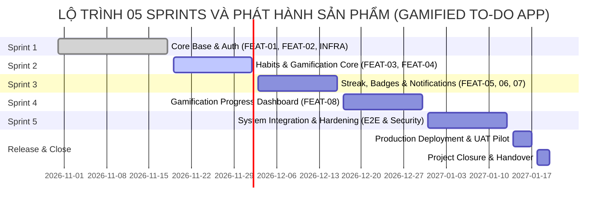
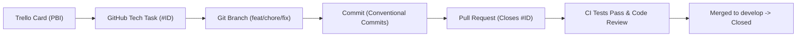

# 🎯 KẾ HOẠCH PHÁT TRIỂN DỰ ÁN TỔNG THỂ (MASTER PROJECT EXECUTION PLAN)
## Gamified To-Do Application (`pm-subject_gamified-todo-application`)

> **Phiên bản tài liệu:** 2.0 (Cập nhật chuẩn hóa toàn diện sau Sprint 1)  
> **Mô hình quản lý:** Hybrid (Kiểm soát đường cơ sở thác nước + Thực thi lặp Agile/Scrum 05 Sprint)  
> **Khung thời gian:** 11 tuần (31/10/2026 – 20/01/2027) | **Timebox mỗi Sprint:** 14 ngày (02 tuần)  
> **Nguồn lực thực hiện:** Nhóm 3 thành viên (Khổng Phú Cường, Nguyễn Trung Kiên, Lê Mạnh Hùng)  
> **Tài liệu căn cứ kỹ thuật (Single Source of Truth):**
> - [`docs/[DOC-11] System Design Document.md`]([DOC-11]%20System%20Design%20Document.md) (Kiến trúc, Schema Mongoose, API Contracts, Gamification Rules)
> - [`docs/Sprint1.md`](Sprint1.md) (Điều phối chi tiết Sprint 1, ánh xạ 24 Issues GitHub)
> - [`docs/[DOC-07] Requirements Elicitation Records.md`]([DOC-07]%20Requirements%20Elicitation%20Records.md) (Yêu cầu nghiệp vụ, Anti-gaming, Ngân sách 0 USD)
> - [`AGENTS.md`](../AGENTS.md) (Cẩm nang quy chuẩn Git, Branch, Commit & Pull Request tự động)

---

## 🧭 1. TỔNG QUAN KIẾN TRÚC & PHÂN CÔNG TRÁCH NHIỆM

### 1.1. Kiến trúc Công nghệ Cốt lõi (Decoupled Architecture)
- **Frontend (`client/`):** React 19 + TypeScript (SPA), Vite, React Router, Custom React Hooks, Axios API Client (BaseURL + Interceptors), Vitest + React Testing Library.
- **Backend (`server/`):** Node.js + Express + TypeScript, Clean Layered Architecture (Controller – Service – Model), Mongoose ODM, JWT Authentication (`Authorization: Bearer <token>`), Bcrypt (Salt rounds = 10), Jest + Supertest.
- **Cơ sở dữ liệu:** MongoDB (hỗ trợ Docker Compose local trên cổng `27017` kèm Mongo-Express Web GUI `8081` và MongoDB Atlas Free Tier M0 trên đám mây).
- **Hạ tầng & CI/CD:** Render (Web Service + Scheduled Cronjob 00:05 UTC+7), GitHub Actions (4 workflows tự động hóa Kanban, PR validation, Branch sync, Deadline reminder).

### 1.2. Đội ngũ thực hiện & Vai trò
| Thành viên | Tài khoản GitHub | Vai trò chính | Trách nhiệm cốt lõi |
|---|---|---|---|
| **Khổng Phú Cường** | `@khongpc-ptit` | Project Manager & Tech Lead | Quản lý tiến độ, kiến trúc hệ thống, Backend API, CSDL MongoDB, DevOps CI/CD. |
| **Nguyễn Trung Kiên** | `@kiennarutonbmn1` | Business Analyst & Frontend Lead | Phân tích yêu cầu, thiết kế giao diện UI/UX Component, tích hợp React State & Custom Hooks. |
| **Lê Mạnh Hùng** | `@mhunglee20405` | QA Lead & Fullstack Engineer | Thiết kế kịch bản kiểm thử (Test Plan/Cases), viết Integration Tests, kiểm thử bảo mật & hiệu năng. |

---

## 📅 2. BẢNG KẾ HOẠCH TỔNG THỂ 05 SPRINTS & PHÁT HÀNH



### Bảng Ma trận Kế hoạch Theo Chu kỳ

| Chu kỳ | Thời gian | Tính năng mục tiêu (Features) | User Stories | Technical Tasks | Sản phẩm bàn giao (Deliverables) | Trạng thái |
|---|---|---|---|---|---|:---:|
| **Sprint 1** | 31/10/2026 → 18/11/2026 | **FEAT-01:** Task Management (One-off Task)<br>**FEAT-02:** User Auth & Account Management<br>**INFRA:** Foundation Setup & Docker | `US-S1-01` → `US-S1-09`<br>(9 Stories) | `TECH-S1-00` → `TECH-S1-12`<br>(13 Tasks) | Docker MongoDB, Auth JWT/Bcrypt, CRUD One-off Tasks, Profile, 23/23 tests pass. | 🟢 Đang hoàn tất |
| **Sprint 2** | 19/11/2026 → 02/12/2026 | **FEAT-03:** Earn XP for Eligible Tasks<br>**FEAT-04:** Progress Through Levels<br>**Mở rộng FEAT-01:** Recurring Habits | `US-S2-01` → `US-S2-05`<br>(5 Stories) | `TECH-S2-01` → `TECH-S2-08`<br>(8 Tasks) | Module Thói quen lặp lại, Gamification Service tính XP, Anti-gaming (Cap 200 XP), Level Bar. | 🟡 Kế hoạch chi tiết |
| **Sprint 3** | 03/12/2026 → 16/12/2026 | **FEAT-05:** Maintain a Daily Streak & Freeze<br>**FEAT-06:** Unlock Achievements/Badges<br>**FEAT-07:** Task Notifications & Reminders | `US-S3-01` → `US-S3-05`<br>(5 Stories) | `TECH-S3-01` → `TECH-S3-08`<br>(8 Tasks) | Daily Streak UTC+7, Render Cronjob 00:05, Badge Unlock Engine, Notification Bell. | ⚪ Kế hoạch chi tiết |
| **Sprint 4** | 17/12/2026 → 30/12/2026 | **FEAT-08:** View Gamification Progress & Analytics Dashboard | `US-S4-01` → `US-S4-04`<br>(4 Stories) | `TECH-S4-01` → `TECH-S4-06`<br>(6 Tasks) | Dashboard Hub tổng thể, Biểu đồ năng suất tuần (Chart.js), Bộ lọc nâng cao, Mobile Responsive. | ⚪ Kế hoạch chi tiết |
| **Sprint 5** | 31/12/2026 → 13/01/2027 | **Tích hợp toàn diện hệ thống, Thắt chặt bảo mật, Kiểm thử E2E & Hiệu năng** | `US-S5-01` → `US-S5-03`<br>(3 Stories) | `TECH-S5-01` → `TECH-S5-05`<br>(5 Tasks) | Kiểm thử E2E Cypress/Supertest, Security Audit (Helmet, Rate-limit), Fix bug backlog, Staging Ready. | ⚪ Kế hoạch chi tiết |
| **Release** | 14/01/2027 → 17/01/2027 | **Production Deployment & Pilot User Testing** | UAT Acceptance | `PROD-01` → `PROD-04`<br>(4 Tasks) | Backend live trên Render, Frontend live trên Vercel/Netlify, UAT 20 người dùng thử nghiệm. | ⚪ Kế hoạch chi tiết |
| **Close** | 18/01/2027 → 20/01/2027 | **Project Closure & Final Evaluation** | Final Sign-off | `CLOSE-01` → `CLOSE-03`<br>(3 Tasks) | Hoàn thiện 21 tài liệu chuẩn PTIT, bảo vệ đồ án trước Hội đồng, đóng và lưu trữ kho mã nguồn. | ⚪ Kế hoạch chi tiết |

---

## 🚀 3. CHI TIẾT TỪNG SPRINT: USER STORIES & TECHNICAL TASKS

---

### 🏃 SPRINT 1: NỀN TẢNG KỸ THUẬT, QUẢN LÝ CÔNG VIỆC & XÁC THỰC NGƯỜI DÙNG
* **Khung thời gian:** 31/10/2026 – 18/11/2026 (18 ngày - bao gồm tuần chuẩn bị và thiết lập môi trường)
* **Mục tiêu Sprint:** Khởi tạo kiến trúc Decoupled, CSDL MongoDB qua Docker/Atlas, hoàn thành chức năng Xác thực người dùng (Auth) và Quản lý công việc làm một lần (One-off Task).
* **Chi tiết điều phối:** Xem tài liệu [`docs/Sprint1.md`](Sprint1.md).

#### Danh sách User Stories (09 US)
1. **`US-S1-01` [Tạo công việc cần làm]:** Là người dùng, tôi muốn tạo nhanh công việc với tiêu đề, mô tả, mức độ ưu tiên và ngày hết hạn để ghi nhớ việc cần làm.
2. **`US-S1-02` [Xem danh sách công việc]:** Là người dùng, tôi muốn xem danh sách công việc cá nhân được lọc theo trạng thái và độ ưu tiên với đầy đủ trạng thái Loading/Empty.
3. **`US-S1-03` [Cập nhật công việc]:** Là người dùng, tôi muốn chỉnh sửa tiêu đề, mô tả, hạn chót và mức độ ưu tiên của công việc khi có thay đổi kế hoạch.
4. **`US-S1-04` [Đánh dấu công việc đã hoàn thành]:** Là người dùng, tôi muốn tick chọn hoàn thành công việc để chuyển trạng thái sang `COMPLETED`.
5. **`US-S1-05` [Đăng ký tài khoản]:** Là người dùng mới, tôi muốn đăng ký tài khoản bằng email, mật khẩu và họ tên hợp lệ để bắt đầu sử dụng hệ thống.
6. **`US-S1-06` [Đăng nhập và đăng xuất]:** Là người dùng, tôi muốn đăng nhập an toàn bằng tài khoản đã tạo để lấy JWT session và đăng xuất khi rời khỏi thiết bị.
7. **`US-S1-07` [Xem hồ sơ người dùng]:** Là người dùng, tôi muốn xem thông tin tài khoản cá nhân, cấp độ hiện tại và điểm kinh nghiệm tích lũy.
8. **`US-S1-08` [Cập nhật hồ sơ người dùng]:** Là người dùng, tôi muốn cập nhật họ tên hiển thị cá nhân.
9. **`US-S1-09` [Đặt lại mật khẩu đã quên]:** Là người dùng, tôi muốn gửi yêu cầu đặt lại mật khẩu qua email khi quên mật khẩu đăng nhập.

#### Danh sách Technical Tasks (13 TECH Tasks)
| Mã Task | GitHub Issue | Phân loại & Phạm vi | Người phụ trách | Hạn chót | Mô tả công việc kỹ thuật | Phụ thuộc |
|---|:---:|---|---|:---:|---|---|
| **TECH-S1-00** | [#41](https://github.com/khongpc-ptit/pm-subject_gamified-todo-application/issues/41) | Shared Infra | `@khongpc-ptit` | 06/11/2026 | Khởi tạo cấu trúc Decoupled client/server, Docker Compose MongoDB + Mongo Express, Mongoose Connection Pooling, `GET /api/v1/health`. | Không có |
| **TECH-S1-01** | [#27](https://github.com/khongpc-ptit/pm-subject_gamified-todo-application/issues/27) | Shared Tech | `@khongpc-ptit` | 07/11/2026 | Xác định Task Data Model, Schema Mongoose, Validation Rules và API Contract CRUD Task. | Không có |
| **TECH-S1-02** | [#28](https://github.com/khongpc-ptit/pm-subject_gamified-todo-application/issues/28) | FE + BE | `@kiennarutonbmn1` | 10/11/2026 | Triển khai API `POST /api/v1/tasks` và Form tạo nhanh công việc (Quick Create Form) trên giao diện. | #41, #27 |
| **TECH-S1-03** | [#29](https://github.com/khongpc-ptit/pm-subject_gamified-todo-application/issues/29) | FE + BE | `@khongpc-ptit` | 10/11/2026 | Triển khai API `GET /api/v1/tasks` (filter status, priority) và Component `TaskList` (Skeleton, Empty State). | #41, #27 |
| **TECH-S1-04** | [#30](https://github.com/khongpc-ptit/pm-subject_gamified-todo-application/issues/30) | FE + BE | `@mhunglee20405` | 10/11/2026 | Triển khai API `PUT /api/v1/tasks/:id` và Modal chỉnh sửa chi tiết công việc trên giao diện. | #41, #27 |
| **TECH-S1-05** | [#31](https://github.com/khongpc-ptit/pm-subject_gamified-todo-application/issues/31) | FE + BE | `@kiennarutonbmn1` | 09/11/2026 | Triển khai API `PATCH /api/v1/tasks/:id/complete` và hiệu ứng tick checkbox hoàn thành công việc. | #41, #27, #28 |
| **TECH-S1-06** | [#32](https://github.com/khongpc-ptit/pm-subject_gamified-todo-application/issues/32) | QA / Test | Cả 3 thành viên | 13/11/2026 | Viết kịch bản kiểm thử tự động tích hợp cho toàn bộ module One-off Task Management. | #28, #29, #30, #31 |
| **TECH-S1-07** | [#33](https://github.com/khongpc-ptit/pm-subject_gamified-todo-application/issues/33) | Shared Tech | `@khongpc-ptit` | 17/11/2026 | Xác định User Data Model, Mongoose Schema, cơ chế JWT Bearer Auth và API Contract Authentication. | Không có |
| **TECH-S1-08** | [#34](https://github.com/khongpc-ptit/pm-subject_gamified-todo-application/issues/34) | FE + BE | `@khongpc-ptit` | 18/11/2026 | Triển khai API `POST /api/v1/auth/register` (mã hóa mật khẩu Bcrypt salt rounds=10) và Giao diện Đăng ký. | #41, #33 |
| **TECH-S1-09** | [#35](https://github.com/khongpc-ptit/pm-subject_gamified-todo-application/issues/35) | FE + BE | `@kiennarutonbmn1` | 18/11/2026 | Triển khai API `POST /api/v1/auth/login`, quản lý phiên JWT (LocalStorage), middleware bảo vệ và UI Đăng nhập. | #41, #33, #34 |
| **TECH-S1-10** | [#36](https://github.com/khongpc-ptit/pm-subject_gamified-todo-application/issues/36) | FE + BE | `@mhunglee20405` | 18/11/2026 | Triển khai API `GET/PUT /api/v1/users/profile` và Giao diện Hồ sơ cá nhân (Profile Page). | #41, #33, #34, #35 |
| **TECH-S1-11** | [#37](https://github.com/khongpc-ptit/pm-subject_gamified-todo-application/issues/37) | FE + BE | `@kiennarutonbmn1` | 18/11/2026 | Triển khai API `POST /api/v1/auth/forgot-password` (tạo reset token có thời hạn) và Giao diện Quên mật khẩu. | #41, #33, #34, #35 |
| **TECH-S1-12** | [#38](https://github.com/khongpc-ptit/pm-subject_gamified-todo-application/issues/38) | QA / Test | Cả 3 thành viên | 18/11/2026 | Viết kịch bản kiểm thử tích hợp cho toàn bộ module Authentication & Account Management. | #34, #35, #36, #37 |

---

### 🏃 SPRINT 2: THÓI QUEN LẶP LẠI (RECURRING HABITS) & ĐỘNG CƠ GAMIFICATION CỐT LÕI (XP & LEVEL)
* **Khung thời gian:** 19/11/2026 – 02/12/2026 (14 ngày)
* **Mục tiêu Sprint:** Xây dựng module Quản lý thói quen lặp lại (`habits`), cài đặt Business Rules Gamification (Cộng điểm XP theo độ ưu tiên, Chống gian lận Daily XP Cap 200 XP, Thuật toán Cấp bậc Level Progression).

#### Danh sách User Stories (05 US)
1. **`US-S2-01` [Thiết lập thói quen lặp lại]:** Là người dùng, tôi muốn tạo thói quen cần duy trì với chu kỳ lặp lại (Hàng ngày / Hàng tuần) và số ngày mục tiêu để theo đuổi mục tiêu dài hạn.
2. **`US-S2-02` [Điểm danh thói quen hàng ngày]:** Là người dùng, tôi muốn check-in đánh dấu hoàn thành thói quen trong ngày hôm nay và xem lại lịch sử các ngày đã thực hiện.
3. **`US-S2-03` [Tích lũy điểm kinh nghiệm khi hoàn thành]:** Là người dùng, tôi muốn nhận điểm kinh nghiệm tương ứng khi hoàn thành công việc (Thấp: 10 XP, Trung bình: 20 XP, Cao: 30 XP, Check-in thói quen: 15 XP).
4. **`US-S2-04` [Cơ chế giới hạn điểm thưởng và hoàn tác]:** Là người dùng, tôi hiểu rằng hệ thống giới hạn nhận tối đa 200 XP/ngày (để đảm bảo tính công bằng) và sẽ trừ lại điểm XP nếu tôi hủy đánh dấu hoàn thành một việc cũ.
5. **`US-S2-05` [Thăng cấp độ và theo dõi thanh tiến trình]:** Là người dùng, tôi muốn nhìn thấy cấp độ (Level) của mình tăng lên khi đủ điểm XP và có thanh tiến trình hiển thị rõ còn thiếu bao nhiêu XP để lên cấp tiếp theo.

#### Danh sách Technical Tasks (08 TECH Tasks)
| Mã Task | Phân loại | Người phụ trách | Hạn chót | Chi tiết triển khai kỹ thuật | Phụ thuộc |
|---|---|---|:---:|---|---|
| **TECH-S2-01** | Docs/Design | `@khongpc-ptit` | 21/11/2026 | Thiết kế Schema `habits` (mảng nhúng `logs: [{ log_date, is_completed, xp_earned }]`), Compound Index `{ user_id: 1, is_active: 1 }` và API Contract. | Sprint 1 |
| **TECH-S2-02** | Backend | `@khongpc-ptit` | 24/11/2026 | Xây dựng Habit Controller & Service: `GET /api/v1/habits`, `POST /api/v1/habits`, `DELETE /api/v1/habits/:id` gắn middleware xác thực JWT. | TECH-S2-01 |
| **TECH-S2-03** | Frontend | `@kiennarutonbmn1` | 25/11/2026 | Xây dựng giao diện Danh sách Thói quen và Form tạo mới thói quen (chọn tần suất Daily/Weekly, target days) theo Wireframe. | TECH-S2-01 |
| **TECH-S2-04** | Backend | `@khongpc-ptit` | 26/11/2026 | Lập trình Gamification Engine: Hàm tính XP theo priority, kiểm tra điều kiện chạm trần **Daily XP Cap = 200 XP/ngày**, hàm hoàn tác trừ lại XP khi chuyển TODO. | TECH-S2-02 |
| **TECH-S2-05** | Backend | `@mhunglee20405` | 27/11/2026 | Lập trình Level Progression Service theo công thức: $\text{Level} = \lfloor \sqrt{\text{Total\_XP}} / 10 \rfloor + 1$. Xử lý sự kiện Level-up. | TECH-S2-04 |
| **TECH-S2-06** | Fullstack | `@khongpc-ptit`<br>`@kiennarutonbmn1` | 29/11/2026 | Triển khai API Check-in `POST /api/v1/habits/:id/check-in`, nhúng nhật ký ngày YYYY-MM-DD vào mảng logs, tự động kích hoạt Gamification Engine. | TECH-S2-04, TECH-S2-05 |
| **TECH-S2-07** | Frontend | `@kiennarutonbmn1` | 30/11/2026 | Tích hợp nút check-in thói quen hàng ngày, hiển thị thanh kinh nghiệm XP Bar và huy hiệu Level hiện tại trên thanh Header điều hướng. | TECH-S2-03, TECH-S2-06 |
| **TECH-S2-08** | QA / Test | `@mhunglee20405` | 02/12/2026 | Viết kịch bản kiểm thử tự động (Unit & Integration): Kiểm tra cộng XP, giới hạn trần 200 XP, trừ điểm khi revert task, thăng cấp Level chính xác. | TECH-S2-06, TECH-S2-07 |

---

### 🏃 SPRINT 3: CHUỖI LIÊN TỤC (DAILY STREAK), THÀNH TỰU (BADGES) & THÔNG BÁO (NOTIFICATIONS)
* **Khung thời gian:** 03/12/2026 – 16/12/2026 (14 ngày)
* **Mục tiêu Sprint:** Triển khai thuật toán tính chuỗi ngày liên tục (Daily Streak) đồng bộ múi giờ UTC+7 qua Scheduled Cronjob, cơ chế bảo vệ chuỗi (Streak Freeze), mở khóa huy hiệu (Badges) và hệ thống thông báo nhắc nhở nội bộ.

#### Danh sách User Stories (05 US)
1. **`US-S3-01` [Theo dõi chuỗi ngày làm việc liên tục]:** Là người dùng, tôi muốn thấy biểu tượng ngọn lửa và số ngày duy trì hoạt động liên tục (Streak) tăng lên mỗi ngày khi tôi hoàn thành ít nhất 1 việc hoặc thói quen.
2. **`US-S3-02` [Sử dụng đóng băng chuỗi]:** Là người dùng, tôi muốn sử dụng lượt "Đóng băng chuỗi" (Streak Freeze) để không bị mất chuỗi ngày đã tích lũy khi có việc bận đột xuất trong ngày.
3. **`US-S3-03` [Mở khóa huy hiệu thành tích]:** Là người dùng, tôi muốn nhận được thông báo chúc mừng và mở khóa huy hiệu khi đạt được các cột mốc thử thách (ví dụ: việc đầu tiên, chuỗi 7 ngày, đạt Level 5).
4. **`US-S3-04` [Xem bộ sưu tập huy hiệu]:** Là người dùng, tôi muốn vào trang Bộ sưu tập để chiêm ngưỡng các huy hiệu đã mở khóa (ảnh sáng rõ) và xem điều kiện của các huy hiệu chưa đạt (ảnh xám/mờ).
5. **`US-S3-05` [Nhận thông báo nhắc nhở công việc]:** Là người dùng, tôi muốn nhận thông báo khi có công việc sắp đến hạn chót hoặc khi có thành tựu mới mở khóa tại góc chuông thông báo.

#### Danh sách Technical Tasks (08 TECH Tasks)
| Mã Task | Phân loại | Người phụ trách | Hạn chót | Chi tiết triển khai kỹ thuật | Phụ thuộc |
|---|---|---|:---:|---|---|
| **TECH-S3-01** | Docs/Design | `@khongpc-ptit` | 05/12/2026 | Thiết kế Schema `badges`, `user_badges` (Unique index `{ user_id: 1, badge_id: 1 }`), `notifications` và API Contract tương ứng. | Sprint 2 |
| **TECH-S3-02** | Backend/Cron | `@khongpc-ptit` | 08/12/2026 | Xây dựng Scheduled Cronjob (chạy lúc `00:05 UTC+7` trên Render): Quét hoạt động ngày hôm trước, tính $Streak = Streak + 1$, trừ lượt freeze nếu nghỉ hoặc reset $Streak = 0$. | TECH-S3-01 |
| **TECH-S3-03** | Fullstack | `@kiennarutonbmn1`<br>`@khongpc-ptit` | 09/12/2026 | Triển khai API `POST /api/v1/gamification/freeze-streak` và giao diện xác nhận sử dụng lượt đóng băng chuỗi. | TECH-S3-02 |
| **TECH-S3-04** | Backend | `@khongpc-ptit` | 11/12/2026 | Xây dựng Badge Trigger Service: Tự động kiểm tra điều kiện `TASK_COUNT`, `STREAK_DAYS`, `LEVEL_REACH` khi hoàn thành task để cấp bản ghi vào `user_badges`. | TECH-S3-01, TECH-S3-02 |
| **TECH-S3-05** | Fullstack | `@kiennarutonbmn1` | 12/12/2026 | Triển khai API `GET /api/v1/gamification/badges` và Giao diện Bộ sưu tập Huy hiệu (Badge Showcase Component với ảnh WebP tối ưu). | TECH-S3-04 |
| **TECH-S3-06** | Backend | `@mhunglee20405` | 13/12/2026 | Xây dựng Notifications Service & APIs: `GET /api/v1/notifications`, `PATCH /api/v1/notifications/:id/read`. Tự động tạo notification khi mở khóa badge hoặc nhắc deadline. | TECH-S3-01, TECH-S3-04 |
| **TECH-S3-07** | Frontend | `@kiennarutonbmn1` | 14/12/2026 | Triển khai Giao diện Chuông thông báo (Notification Bell Dropdown), hiển thị số lượng badge chưa đọc và thao tác đánh dấu đã đọc. | TECH-S3-06 |
| **TECH-S3-08** | QA / Test | `@mhunglee20405` | 16/12/2026 | Viết kịch bản kiểm thử tích hợp tự động: Kiểm thử múi giờ UTC+7 đối với Streak, kiểm thử Cronjob reset chuỗi, kiểm thử chống cấp trùng badge và đọc thông báo. | TECH-S3-05, TECH-S3-07 |

---

### 🏃 SPRINT 4: DASHBOARD TIẾN ĐỘ GAMIFICATION & THỐNG KÊ NĂNG SUẤT (ANALYTICS HUB)
* **Khung thời gian:** 17/12/2026 – 30/12/2026 (14 ngày)
* **Mục tiêu Sprint:** Hoàn thiện bảng điều khiển trung tâm (Dashboard Hub) tổng hợp toàn bộ tiến trình Gamification, biểu đồ thống kê năng suất hoàn thành task theo tuần, bộ lọc tìm kiếm nâng cao và tối ưu hóa Responsive trên Mobile.

#### Danh sách User Stories (04 US)
1. **`US-S4-01` [Biểu đồ thống kê năng suất theo tuần]:** Là người dùng, tôi muốn xem biểu đồ trực quan thống kê số lượng công việc và thói quen hoàn thành trong 7 ngày qua để nắm bắt nhịp độ làm việc.
2. **`US-S4-02` [Xem bảng tổng quan tiến trình Gamification]:** Là người dùng, tôi muốn nhìn thấy một bảng tổng hợp đầy đủ gồm: Level, tổng XP, số ngày Streak hiện tại, số huy hiệu đã đạt và tỷ lệ hoàn thành công việc.
3. **`US-S4-03` [Tìm kiếm và lọc nâng cao]:** Là người dùng, tôi muốn tìm kiếm nhanh công việc theo từ khóa tiêu đề, lọc kết hợp nhiều điều kiện (Status + Priority + Date range) trên một màn hình duy nhất.
4. **`US-S4-04` [Trải nghiệm giao diện đa thiết bị]:** Là người dùng, tôi muốn ứng dụng hiển thị vừa vặn, mượt mà trên cả trình duyệt máy tính lẫn màn hình điện thoại thông minh (Responsive Mobile Design).

#### Danh sách Technical Tasks (06 TECH Tasks)
| Mã Task | Phân loại | Người phụ trách | Hạn chót | Chi tiết triển khai kỹ thuật | Phụ thuộc |
|---|---|---|:---:|---|---|
| **TECH-S4-01** | Backend | `@khongpc-ptit` | 19/12/2026 | Thiết kế MongoDB Aggregation Pipeline tính toán tổng hợp: Tỷ lệ hoàn thành task 7 ngày, tổng số task theo status, tổng hợp chỉ số Gamification cho Dashboard. | Sprint 3 |
| **TECH-S4-02** | Backend | `@khongpc-ptit` | 22/12/2026 | Triển khai API `GET /api/v1/dashboard/summary` trả về dữ liệu thống kê tổng hợp chuẩn Response Envelope Pattern (tối ưu hóa thời gian phản hồi < 300ms). | TECH-S4-01 |
| **TECH-S4-03** | Frontend | `@kiennarutonbmn1` | 24/12/2026 | Tích hợp thư viện biểu đồ nhẹ (Recharts / Chart.js) xây dựng Component Biểu đồ Năng suất tuần (Weekly Productivity Chart). | TECH-S4-02 |
| **TECH-S4-04** | Frontend | `@kiennarutonbmn1` | 26/12/2026 | Tái cấu trúc Dashboard Page: Kết hợp liền mạch giữa One-off Task list, Habit Tracker, Gamification Stats widget và Biểu đồ thống kê. | TECH-S4-03 |
| **TECH-S4-05** | Frontend/UX | `@mhunglee20405` | 28/12/2026 | Tối ưu hóa Responsive Mobile CSS (Media Queries, Hamburger navigation, Touch targets $\ge$ 48px) và Lazy Loading ảnh WebP. | TECH-S4-04 |
| **TECH-S4-06** | QA / Test | `@mhunglee20405` | 30/12/2026 | Kiểm thử tích hợp UI/UX Dashboard, kiểm thử tính toán số liệu thống kê chính xác, benchmark thời gian phản hồi API dưới ngưỡng 300ms. | TECH-S4-04, TECH-S4-05 |

---

### 🏃 SPRINT 5: TÍCH HỢP HỆ THỐNG, THẮT CHẶT BẢO MẬT & KIỂM THỬ E2E (STAGING READY)
* **Khung thời gian:** 31/12/2026 – 13/01/2027 (14 ngày)
* **Mục tiêu Sprint:** Rà soát và kết nối toàn bộ các mắt xích hệ thống (End-to-End), gia cố bảo mật (Security Hardening), kiểm soát giới hạn tài nguyên Free Tier, dọn sạch Bug Backlog và đóng gói bản phát hành Staging.

#### Danh sách User Stories (03 US)
1. **`US-S5-01` [Trải nghiệm người dùng thông suốt]:** Là người dùng, tôi muốn toàn bộ thao tác từ đăng ký, tạo task, điểm danh thói quen, nhận thưởng XP đến xem biểu đồ đều vận hành trơn tru, không có lỗi đứng trang.
2. **`US-S5-02` [Bảo vệ an toàn thông tin]:** Là người dùng, tôi tin tưởng rằng mật khẩu và dữ liệu cá nhân của tôi được bảo mật tuyệt đối, phiên làm việc không bị đánh cắp hay giả mạo.
3. **`US-S5-03` [Tốc độ tải trang nhanh]:** Là người dùng, tôi muốn mọi thao tác tương tác trên hệ thống đều phản hồi tức thì (dưới 1 giây) mà không phải chờ đợi lâu.

#### Danh sách Technical Tasks (05 TECH Tasks)
| Mã Task | Phân loại | Người phụ trách | Hạn chót | Chi tiết triển khai kỹ thuật | Phụ thuộc |
|---|---|---|:---:|---|---|
| **TECH-S5-01** | QA / Test | `@mhunglee20405` | 03/01/2027 | Xây dựng bộ kịch bản kiểm thử tự động End-to-End (E2E) bao phủ toàn bộ User Journey: Đăng ký $\rightarrow$ Đăng nhập $\rightarrow$ Tạo task $\rightarrow$ Hoàn thành task $\rightarrow$ Nhận XP $\rightarrow$ Lên cấp $\rightarrow$ Mở badge. | Sprint 4 |
| **TECH-S5-02** | Security/DevOps | `@khongpc-ptit` | 06/01/2027 | Rà soát và gia cố bảo mật toàn diện: Cấu hình HTTP Security Headers (Helmet), CORS whitelist chặt chẽ, Express Rate Limiting chống Brute-force, Sanitize chống XSS/NoSQL Injection. | Sprint 4 |
| **TECH-S5-03** | Performance | `@khongpc-ptit`<br>`@kiennarutonbmn1` | 08/01/2027 | Tối ưu hóa tài nguyên Free Tier 0 USD: Tối ưu Connection Pooling MongoDB (giới hạn maxPoolSize 10 kết nối), nén assets Vite bundle, kiểm tra giới hạn RAM < 512MB trên Render. | TECH-S5-02 |
| **TECH-S5-04** | DevOps/Staging | `@khongpc-ptit` | 10/01/2027 | Triển khai bản thử nghiệm lên môi trường Staging/Preview, kiểm thử hồi quy tự động (Regression Testing) qua GitHub Actions. | TECH-S5-01, TECH-S5-03 |
| **TECH-S5-05** | Bugfix/Docs | Cả 3 thành viên | 13/01/2027 | Sửa chữa triệt để toàn bộ các lỗi phát sinh (Bug Backlog từ Sprint 1 đến Sprint 5), đóng băng mã nguồn (Code Freeze) và hoàn thiện Swagger API Docs tại `/api-docs`. | TECH-S5-04 |

---

### 🚢 GIAI ĐOẠN RELEASE: PRODUCTION DEPLOYMENT & KIỂM THỬ NGHIỆM THU (UAT)
* **Khung thời gian:** 14/01/2027 – 17/01/2027 (04 ngày)
* **Mục tiêu:** Đưa hệ thống lên môi trường điện toán đám mây Production chính thức, bàn giao tài khoản cho 20 người dùng thử nghiệm mục tiêu để thực hiện User Acceptance Testing (UAT).

#### Danh sách Công việc Triển khai (04 Tasks)
1. **`PROD-01` [Triển khai Backend Production lên Render]:** Cấu hình Web Service Production trên Render, kết nối cụm CSDL MongoDB Atlas Cluster M0, thiết lập biến môi trường bảo mật (`NODE_ENV=production`, `MONGODB_URI`, `JWT_SECRET`), cấu hình Scheduled Cronjob 00:05 UTC+7.
2. **`PROD-02` [Triển khai Frontend Production lên Vercel/Netlify]:** Thiết lập dự án Frontend React SPA trên Vercel/Netlify, liên kết domain, cấu hình CDN caching và HTTPS SSL/TLS tự động.
3. **`PROD-03` [Tổ chức Kiểm thử Nghiệm thu Người dùng (UAT Pilot)]:** Cung cấp tài khoản cho 20 người dùng thực tế (nhóm đối tượng sinh viên/nhân viên văn phòng theo DOC-07), hướng dẫn kịch bản trải nghiệm, ghi nhận phiếu khảo sát đánh giá độ hài lòng.
4. **`PROD-04` [Giám sát vận hành & Xử lý sự cố thời gian thực]:** Thiết lập công cụ giám sát tình trạng máy chủ (Render Metrics, UptimeRobot ping 5 phút/lần chống ngủ đông máy chủ Free Tier), ghi nhận error log tập trung.

---

### 🏁 GIAI ĐOẠN CLOSE: BÀN GIAO & KẾT THÚC DỰ ÁN (PROJECT CLOSURE)
* **Khung thời gian:** 18/01/2027 – 20/01/2027 (03 ngày)
* **Mục tiêu:** Hoàn thiện toàn bộ chuỗi 21 tài liệu quản lý dự án theo chuẩn PTIT/PMBOK, nghiệm thu sản phẩm trước Hội đồng chấm đồ án, tổng kết bài học kinh nghiệm và chính thức đóng dự án.

#### Danh sách Công việc Kết thúc (03 Tasks)
1. **`CLOSE-01` [Hoàn thiện hồ sơ nghiệm thu & Báo cáo tổng kết dự án]:** Tổng hợp đầy đủ 21 tài liệu quản lý dự án, lập Báo cáo Đóng dự án (*DOC-21: Project Closure Report*), Báo cáo Hồi cứu toàn diện 05 Sprint (*DOC-18*).
2. **`CLOSE-02` [Bảo vệ đồ án trước Hội đồng Đánh giá]:** Trình diễn trực tiếp hệ thống (Live Demo) trên môi trường Production, thuyết trình kết quả đạt được, số liệu đo lường năng suất (Velocity) và minh chứng tuân thủ quy trình Hybrid.
3. **`CLOSE-03` [Lưu trữ mã nguồn & Giải phóng tài nguyên]:** Gắn thẻ phát hành phiên bản chính thức `v1.0.0-MVP` trên GitHub Release, xuất bản tài liệu lưu trữ, chuyển kho mã nguồn sang chế độ Read-only và giải phóng các tài nguyên thử nghiệm tạm thời.

---

## 📊 4. MA TRẬN PHÂN CÔNG TRÁCH NHIỆM KỸ THUẬT (RACI MATRIX)

* **R (Responsible):** Người trực tiếp triển khai code / thực hiện công việc.
* **A (Accountable):** Người chịu trách nhiệm phê duyệt cuối cùng (Tech Lead / QA Lead).
* **C (Consulted):** Người được tham vấn chuyên môn trước khi thực hiện.
* **I (Informed):** Người được thông báo kết quả sau khi hoàn thành.

| Phân hệ / Hạng mục công việc kỹ thuật | Khổng Phú Cường (`@khongpc-ptit`) | Nguyễn Trung Kiên (`@kiennarutonbmn1`) | Lê Mạnh Hùng (`@mhunglee20405`) |
|---|:---:|:---:|:---:|
| **Khởi tạo kiến trúc, Docker & CSDL (Sprint 1)** | **R / A** | C | I |
| **Authentication & Profile (Sprint 1)** | **R** (Backend) / **A** | **R** (Frontend) | **R** (Integration Tests) |
| **One-off Task Management (Sprint 1)** | **R** (Backend) / **A** | **R** (Frontend) | **R** (Modal Update & Tests) |
| **Recurring Habits Module (Sprint 2)** | **R** (Backend) / **A** | **R** (Frontend Tracker) | C / **R** (Test Suites) |
| **Gamification Engine: XP & Level (Sprint 2)** | **R** (XP Rules & Cap) / **A** | **R** (XP/Level Bar UI) | **R** (Level Service & Tests) |
| **Daily Streak & Scheduled Cronjob (Sprint 3)** | **R** (Cron & Algorithm) / **A** | **R** (Streak Freeze UI) | C / **R** (Timezone Tests) |
| **Badges & Achievements Engine (Sprint 3)** | **R** (Trigger Engine) / **A** | **R** (Badge Showcase UI) | C / **R** (Award Tests) |
| **Notifications System (Sprint 3)** | C / **A** | **R** (Notification Bell UI) | **R** (Backend & Read Status) |
| **Dashboard Summary API & Analytics (Sprint 4)** | **R** (Mongo Pipeline) / **A** | **R** (Chart.js & Dashboard) | **R** (Responsive & Perf Test) |
| **System Security, Rate Limiting & Hardening (Sprint 5)** | **R** (Security Config) / **A** | C | **R** (Security Audit) |
| **End-to-End Testing & Performance Benchmarks (Sprint 5)** | C / **A** | C | **R** (E2E Test Suites) |
| **Production Deployment & Cloud Infrastructure (Release)** | **R** (Backend & Render) / **A** | **R** (Vercel CDN) | **R** (UAT Coordination) |
| **Project Closure & Final PM Documentation (Close)** | **R / A** | **R** (UI Docs) | **R** (QA Docs) |

---

## 🛠️ 5. QUY CHUẨN ĐIỀU PHỐI CÔNG VIỆC QUA GITHUB & TRELLO

Mọi thành viên trong nhóm và AI Agent khi thực thi bất kỳ task nào đều phải tuân thủ nghiêm ngặt quy trình:



1. **Phân cấp Quản lý:**
   - **Trello:** Quản lý User Story, Feature và tiến độ tổng thể Sprint (dành cho Stakeholders & Product Owner).
   - **GitHub:** Quản lý chi tiết từng Technical Task (`tech-task`), mã nguồn, nhánh phát triển và Pull Requests.
2. **Quy chuẩn đặt tên nhánh Git (Branch Naming):**
   - Feature Task: `feat/tech-s<sprint_num>-<task_num>-<ten-ngan>` (Ví dụ: `feat/tech-s2-02-habits-api`)
   - Infrastructure / Chore: `chore/tech-s<sprint_num>-<task_num>-<ten-ngan>`
   - Bugfix: `fix/bug-s<sprint_num>-<bug_num>-<ten-ngan>`
3. **Quy chuẩn Commit Message:** Tuân thủ Conventional Commits:
   ```text
   <type>: [TECH-S<x>-<yy>] <mô tả ngắn bằng tiếng Anh hoặc tiếng Việt>

   - Chi tiết các thay đổi chính
   - Logic nghiệp vụ hoặc validation
   - Unit test bổ sung
   ```
4. **Quy chuẩn Pull Request:**
   - Sử dụng đúng mẫu [`.github/PULL_REQUEST_TEMPLATE.md`](../.github/PULL_REQUEST_TEMPLATE.md).
   - Bắt buộc khai báo liên kết tự động đóng issue: `Closes #<id_cua_tech_task>`.
   - Vượt qua 100% các bước kiểm tra tự động của CI (PR Convention Check, Tests).
   - Được phê duyệt (Approved) bởi Tech Lead trước khi merge vào nhánh `develop`.
